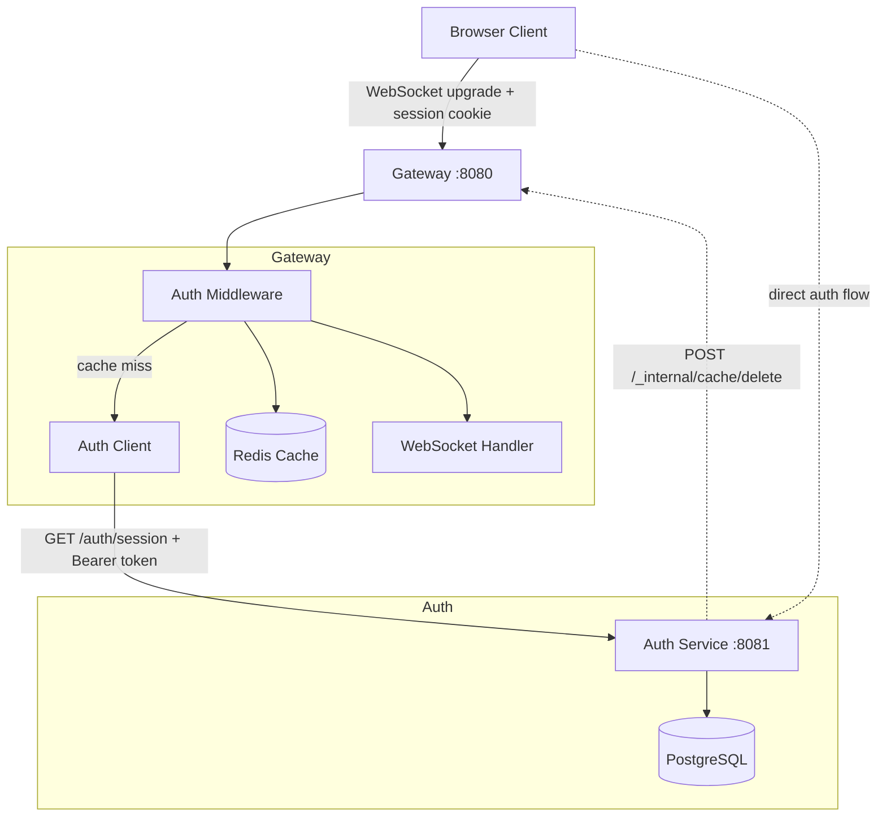

# Gateway-Auth Integration Design

> Design document for integrating gateway WebSocket authentication with the auth service session validation.

**Date:** 2026-02-15
**Status:** Design Approved, Ready for Implementation Planning

---

## Overview

Integrate the gateway WebSocket service with the auth service to require authenticated sessions for all WebSocket connections. The gateway validates session tokens at HTTP upgrade time, caching results in Redis for performance.

**Key decisions:**
- Authentication validated at WebSocket upgrade (not post-connect message)
- Gateway-owned Redis cache for session validation (reuses existing quota Redis client)
- Auth failures return 401, client redirects to auth service
- HTTP client uses stdlib `net/http` (simple, no external deps)
- Shared `INTERNAL_SECRET` for service-to-service communication

---

## Architecture



**Flow:**
1. Login/signup goes directly to auth service (not through gateway)
2. Gateway validates sessions at WebSocket upgrade time
3. Redis cache reduces load on auth service
4. Logout triggers cache invalidation webhook

---

## Components

### 1. Auth Client (`internal/auth/client.go`)

```go
type AuthClient struct {
    baseURL string
    client  *http.Client
    logger  zerolog.Logger
    secret  string  // INTERNAL_SECRET for Bearer token
}

type SessionInfo struct {
    UserID    string
    ExpiresAt time.Time
}

func (c *AuthClient) ValidateSession(ctx context.Context, sessionToken string) (*SessionInfo, error)
```

**Responsibilities:**
- Extract session ID from token format `{sessionId}.{secret}`
- Call auth service `GET /auth/session` with cookie and Bearer token
- Parse JSON response
- Handle timeouts and errors

### 2. Auth Middleware (`internal/server/middleware.go`)

```go
type AuthMiddleware struct {
    authClient *auth.Client
    cache      *redis.Client  // optional, nil if no Redis
    logger     zerolog.Logger
}

func (m *AuthMiddleware) Authenticate(next http.Handler) http.Handler
```

**Flow:**
1. Extract `session` cookie from request
2. Check Redis cache first (if configured)
3. On cache miss: call `authClient.ValidateSession()`
4. On success: store `user_id` in request context, call next handler
5. Forward any Set-Cookie headers from auth service (for sliding expiration)
6. On failure: return 401 without calling next handler

### 3. Internal Router (`internal/server/internal.go`)

> **Security Design:** All internal endpoints are mounted under `/_internal/*` path prefix with automatic Bearer token authentication middleware. This ensures future internal endpoints are protected by default.

```go
// Internal router with automatic Bearer auth for all routes
type InternalMiddleware struct {
    secret string
}

func (m *InternalMiddleware) RequireInternalAuth(next http.Handler) http.Handler
func NewInternalRouter(secret string, cache Cache) *mux.Router
```

**Routes:**
- `POST /_internal/cache/delete` - Cache invalidation webhook

**Request body:**
```json
{
  "user_id": "uuid",
  "session_id": "uuid"  // optional
}
```

**Authorization:** `Bearer <INTERNAL_SECRET>` (applied to ALL `/_internal/*` routes)

### 4. Modified WebSocket Handler

- Extract `user_id` from request context (set by middleware)
- Use `user_id` instead of random `sessionID` for agent creation
- Still generate unique `conn_id` per connection

---

## Configuration

### New Environment Variables

| Variable | Description | Default |
|----------|-------------|---------|
| `AUTH_SERVICE_URL` | Base URL of auth service | `http://localhost:8081` |
| `AUTH_TIMEOUT` | Timeout for auth service requests | `2s` |
| `INTERNAL_SECRET` | Shared secret for service-to-service auth | (required in prod) |

**Note:** Redis is already configured via existing `REDIS_ADDR`, `REDIS_PASSWORD` for quota system. Gateway reuses that Redis client for session cache.

---

## Data Flows

### Successful Authentication

```
Browser → Gateway: WebSocket Upgrade + session cookie
Gateway → Auth Service: GET /auth/session (Cookie + Bearer token)
Auth Service → Gateway: 200 OK {"user_id": "uuid"}
Gateway → Redis: SET session:{id} user_id (TTL 5m)
Gateway → Browser: 101 Switching Protocols
```

### Failed Authentication

```
Browser → Gateway: WebSocket Upgrade (no/invalid cookie)
Gateway → Auth Service: GET /auth/session
Auth Service → Gateway: 401 Unauthorized
Gateway → Browser: 401 Unauthorized
Browser → Auth Service: Redirect to /auth/login/{provider}
```

### Logout with Cache Invalidation

```
Browser → Auth Service: POST /auth/logout
Auth Service → Gateway: POST /_internal/cache/delete (Bearer token)
Gateway → Redis: DEL session:{id}
Gateway → Auth Service: 200 OK
Auth Service → Browser: 204 No Content (clear cookie)
```

---

## Error Handling

| Error | HTTP Status | Client Action |
|-------|-------------|---------------|
| Missing session cookie | `401` | Redirect to login |
| Invalid/expired session | `401` | Redirect to login |
| Malformed session token | `401` | Redirect to login |
| Auth service unavailable | `503` | Retry with backoff |
| Invalid internal secret | `403` | Gateway config error |
| Timeout calling auth service | `504` | Retry with backoff |

**401 Response Format:**
```json
{
  "error": "authentication_required",
  "message": "Valid session required. Please login.",
  "login_url": "/auth/login/google"
}
```

---

## Testing Strategy

Mirrors auth service test structure:

```
tests/
├── unit/                      # Pure unit tests with mocks
│   ├── auth_client_test.go    # 40+ tests
│   ├── middleware_test.go     # 30+ tests
│   ├── cache_test.go          # 25+ tests
│   └── invalidation_test.go   # 20+ tests
├── integration/               # Tests with real services
│   ├── common_test.go         # Shared setup
│   ├── auth_integration_test.go  # 20+ tests
│   ├── websocket_auth_test.go    # 15+ tests
│   └── cache_invalidation_test.go
├── testutil/
│   ├── testutil.go
│   ├── mock_auth.go
│   └── mock_redis.go
├── e2e/                       # Very end-to-end only
│   └── full_flow_test.go
└── compose.test.yaml          # Test services
```

**Build tags:** `//go:build !integration` for unit, `//go:build integration` for integration.

**Coverage target:** >95% for critical auth paths.

---

## Implementation Phases

### Phase 1: Foundation
- Add `internal/auth` package with `client.go`
- Add `internal/server/middleware.go`
- Add configuration variables (disabled by default)
- Comprehensive unit tests

### Phase 2: Integration
- Wire auth middleware into WebSocket handler
- Implement internal router with automatic Bearer auth (`/_internal/*`)
- Add cache invalidation endpoint to internal router
- Integration tests with mock auth service
- Redis caching (reuse existing quota client)

### Phase 3: Production Ready
- Metrics (auth success/failure, cache hit/miss)
- Rate limiting on invalidation endpoint
- Circuit breaker for auth service calls
- Load testing
- Documentation updates

---

## Auth Service Changes Needed

**You will implement:**
1. `GET /auth/session` requires `Authorization: Bearer <INTERNAL_SECRET>` header
2. Response format: `{"authenticated": true, "user_id": "uuid"}`
3. `INTERNAL_SECRET` env var for shared secret
4. Cache invalidation webhook: `POST /_internal/cache/delete` with Bearer auth
5. Request body: `{"user_id": "uuid", "session_id": "uuid"}`

---

## Alternatives Considered

### Option 2: Direct Auth Service Proxy
**Rejected because:** More network hops, auth service becomes bottleneck, tighter coupling.

### Option 3: Shared JWT/Token Validation
**Rejected because:** Requires changing auth service token format, revocation requires token blacklist, more complex key rotation.

---

## Design Sign-Off

| Aspect | Decision |
|--------|----------|
| Auth timing | HTTP upgrade (header-based) |
| Session cache | Gateway-owned Redis, reused from quota |
| Auth failures | 401, redirect to login |
| HTTP client | stdlib net/http |
| Secret | Shared `INTERNAL_SECRET` |
| Tests | Extensive, mirror auth structure |
| Phases | Foundation → Integration → Production |

**Ready for implementation planning.**
