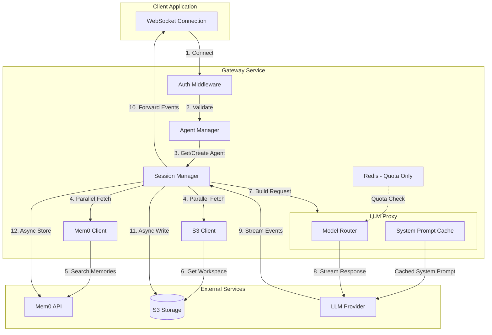
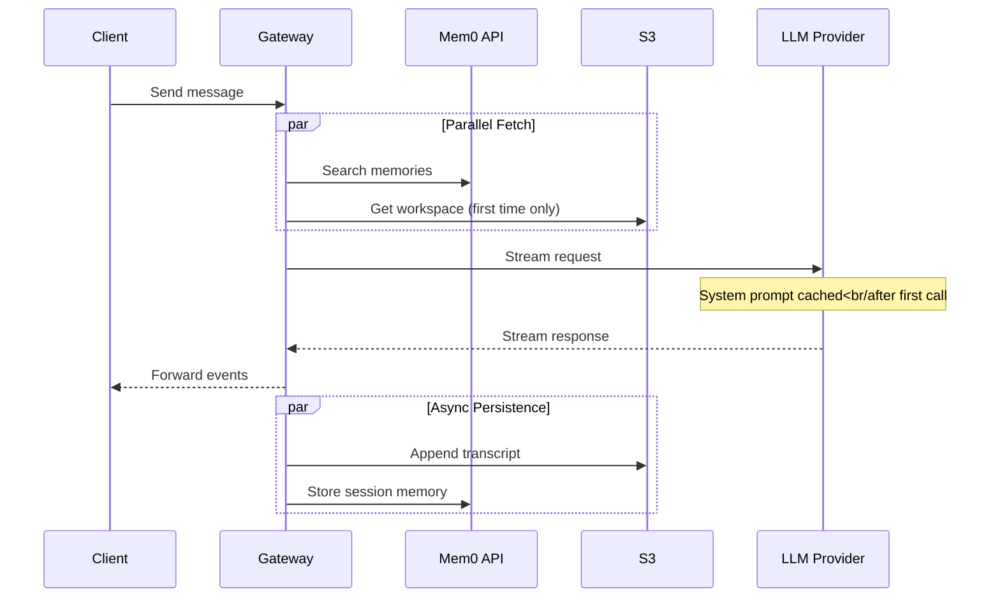
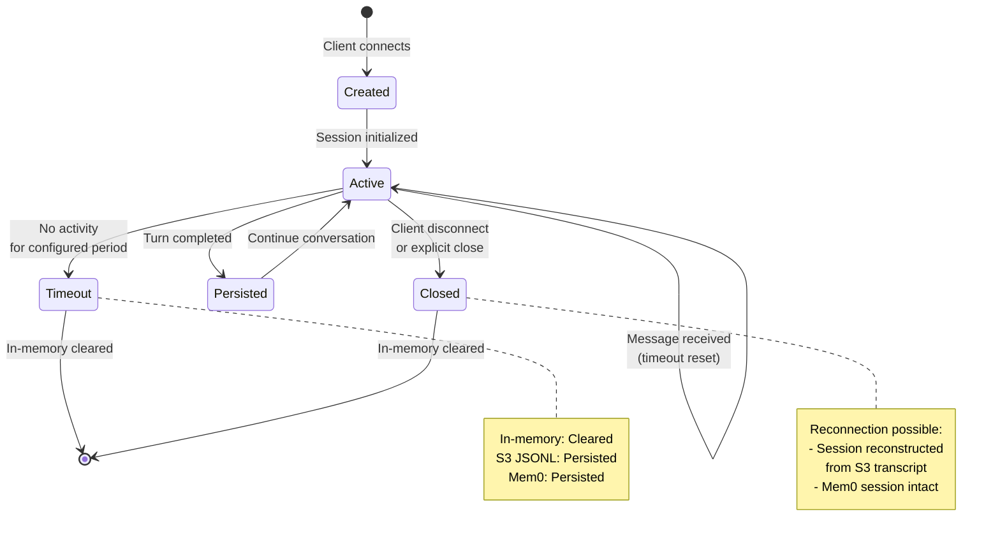
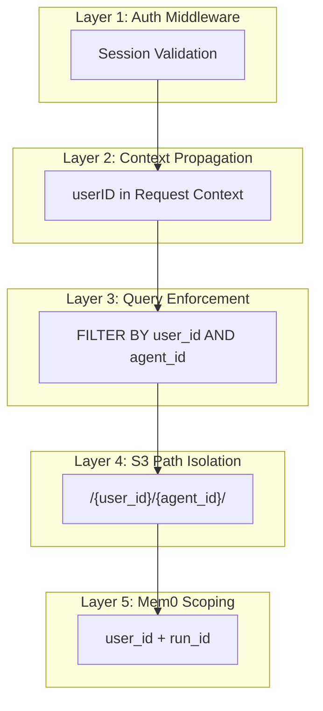
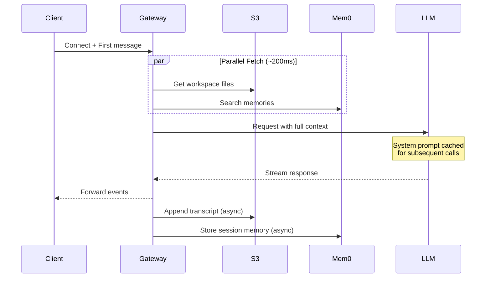
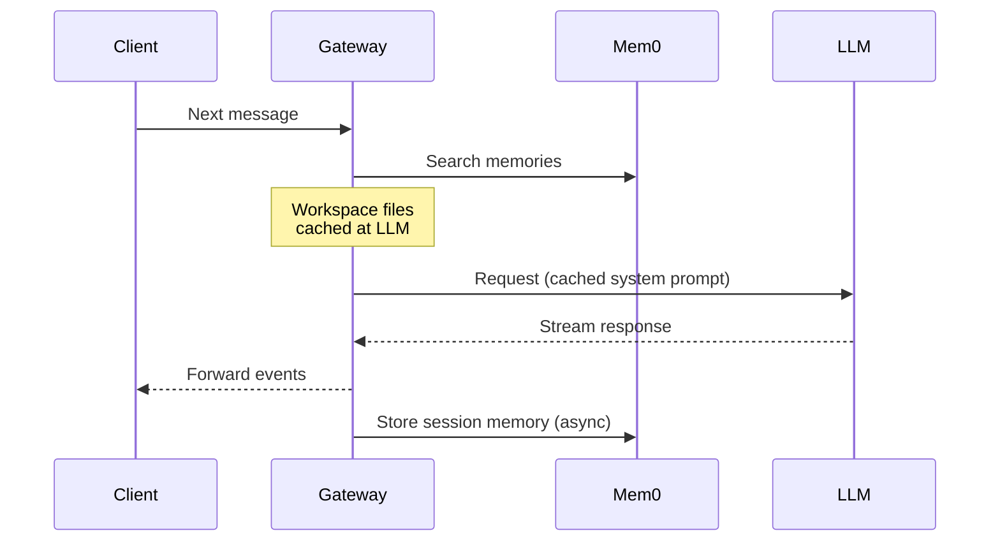

# Multi-Agent Storage & Security Design

**Status:** Approved
**Date:** 2026-02-17
**Author:** Design Team

## Overview

This document describes the architecture for multi-agent per user support with secure storage, isolation, and session management. The design follows the OpenClaw agent model while adapting it for cloud-native S3 storage and Mem0 API-based memory management.

### Key Objectives

1. **Multiple agents per user** - Each user can create and manage multiple independent agents
2. **Workspace-based isolation** - Each agent has its own isolated workspace with personality files
3. **Secure persistence** - All data stored securely in S3 with proper path-based isolation
4. **Semantic memory** - Mem0 API handles all memory and search functionality
5. **Efficient token usage** - LLM provider caching for static workspace content

---

## Architecture

### System Overview



### Data Flow Per Turn



---

## Agent Layer

### Composite Key Design

Agents are now keyed by `(userID, agentID)` instead of `sessionID`:

```go
// Agent represents an AI assistant with its own workspace
type Agent struct {
    UserID        string
    AgentID       string
    Status        AgentStatus  // idle, active, error
    CreatedAt     time.Time
    LastActiveAt  time.Time

    // One active session per agent
    ActiveSession *Session
}

type AgentStatus string

const (
    AgentStatusIdle   AgentStatus = "idle"
    AgentStatusActive AgentStatus = "active"
    AgentStatusError  AgentStatus = "error"
)
```

### Agent Lifecycle

1. **Creation** - Agent created with unique `agentID` for a `userID`
2. **Workspace Initialization** - Default workspace files created in S3
3. **Activation** - Session created on first WebSocket connection
4. **Idle** - Agent persists but no active session (after disconnect/timeout)
5. **Reactivation** - New session can reconnect to existing agent

---

## Session Management

### Session Model

The server manages one active session per agent. Sessions support timeout with reconnection:

```go
// Session represents an active conversation with an agent
type Session struct {
    SessionID      string    // Server-generated, unique
    UserID         string    // Owning user
    AgentID        string    // Owning agent
    Mem0SessionID  string    // Links to Mem0 session scope

    // In-memory state (cleared on timeout)
    Messages       []Message // Accumulates during session
    StartedAt      time.Time
    LastActivity   time.Time

    // Persistence paths
    TranscriptPath string    // S3 path for reconstruction
}
```

### Session Lifecycle



### Timeout Behavior

| Component | Timeout Behavior | Reconnection |
|-----------|-----------------|--------------|
| **In-memory messages** | Cleared | Reconstructed from S3 JSONL |
| **S3 transcript** | Persists | Source of truth for reconstruction |
| **Mem0 session** | Persists | Immediately available |

### Session Reconstruction

When a client reconnects after timeout:

1. Server generates new `SessionID`
2. Links to existing `Mem0SessionID`
3. Fetches recent messages from S3 transcript
4. Rebuilds in-memory `Messages` array
5. Continues conversation seamlessly

---

## Storage Architecture

### S3 Structure

```
s3://bucket/
  └── {user_id}/
      └── {agent_id}/
          ├── workspace/              ← Agent's personality/config
          │   ├── SOUL.md            (persona, tone, boundaries)
          │   ├── AGENTS.md          (operating instructions, rules)
          │   ├── USER.md            (who the user is)
          │   ├── IDENTITY.md        (name, vibe, emoji)
          │   └── TOOLS.md           (tool guidance)
          │
          └── transcripts/            ← Full conversation history
              └── session-{timestamp}.jsonl
```

### Workspace Files

Each workspace file serves a specific purpose:

| File | Purpose | LLM Cache |
|------|---------|-----------|
| **SOUL.md** | Agent's persona, tone, ethical boundaries | ✅ Cached |
| **AGENTS.md** | Operating instructions and rules | ✅ Cached |
| **USER.md** | Information about the user | ✅ Cached |
| **IDENTITY.md** | Agent's name, vibe, emoji | ✅ Cached |
| **TOOLS.md** | Guidance on tool usage | ✅ Cached |

Workspace files are:
- Fetched once per session from S3
- Cached at LLM provider level (system prompt cache)
- ~85% token savings after first call

### Transcript Format

Transcripts are stored in JSONL format (one line per turn):

```jsonl
{"turn":1,"user":"Help me deploy","assistant":"Let me check the pods...","tools":[{"name":"list_pods","result":{"pods":["redis-abc","nginx-xyz"]}}],"timestamp":1737123456}
{"turn":2,"user":"What about redis?","assistant":"Redis is having connection issues...","tools":[{"name":"get_logs","result":{"logs":"Error: connection refused"}}],"timestamp":1737123459}
```

**Transcript properties:**
- **Write-only** - Appended to, never modified
- **Append-per-turn** - One write per turn completion (not per tool call)
- **Source of truth** - Used for session reconstruction
- **Audit trail** - For billing, compliance, debugging

---

## Memory Management

### Mem0 API Integration

Mem0 handles ALL memory and search functionality, replacing OpenClaw's `MEMORY.md` file:

### Memory Scopes

| Scope | Purpose | Storage Duration | API Call |
|-------|---------|------------------|----------|
| **Long-term** | Facts, preferences, decisions | Until explicit delete | `mem0.add(..., user_id=X)` |
| **Session** | Temporary context, current topic | Until session reset | `mem0.add(..., user_id=X, run_id=Y)` |

### Memory Operations

**Auto-recall (every turn):**
```go
memories := mem0.Search(query, userID)
// Prepend to user message as <relevant-memories>
```

**Explicit tools available to LLM:**
- `mem0_search(query)` - Search stored memories
- `mem0_store(content)` - Promote to long-term memory

**Session auto-capture:**
```go
// Every turn automatically added to session scope
mem0.Add(turnContent, userID, runID=mem0SessionID)
```

### Memory vs Transcript

| Aspect | Mem0 | S3 Transcript |
|--------|------|---------------|
| **Purpose** | Semantic knowledge | Exact words, audit trail |
| **Access** | Searched every turn | Write-only, admin only |
| **Format** | Vector embeddings | JSONL lines |
| **Search** | Semantic via API | Not searchable |
| **Retention** | Until explicit delete | Indefinite |

---

## Security Isolation

### Isolation Layers



### Enforcement Points

| Layer | Mechanism | Enforced By |
|-------|-----------|-------------|
| **Auth** | Session validation | Auth middleware |
| **Context** | userID propagation | Gateway |
| **Query** | Composite key filtering | Agent/Session managers |
| **S3** | Path-based separation | S3 client + IAM policies |
| **Mem0** | User/run scoping | Mem0 API |

### S3 Security

S3 paths enforce physical separation:
```
s3://bucket/{user_id}/{agent_id}/...
```

Additional protections:
- IAM policies restrict access per prefix
- Presigned URLs scoped to specific paths
- Server-side encryption enabled
- Versioning for recovery

---

## Tools Available to LLM

### Agent-Scoped Tools

All tools are scoped to a specific agent:

| Tool | Purpose | Backend | Scope |
|------|---------|---------|-------|
| `mem0_search` | Search memories | Mem0 API | `user_id` |
| `mem0_store` | Store long-term memory | Mem0 API | `user_id` |
| `read_agent_file` | Read workspace file | S3 | `user_id/agent_id` |
| `write_agent_file` | Write workspace file | S3 | `user_id/agent_id` |

### Tool Implementation

```go
// Example: read_agent_file tool
func (s *ToolService) ReadAgentFile(ctx context.Context, path string) (string, error) {
    userID := GetUserIDFromContext(ctx)
    agentID := GetAgentIDFromContext(ctx)

    // Enforce scope
    s3Path := fmt.Sprintf("%s/%s/workspace/%s", userID, agentID, path)

    // Fetch from S3
    return s3Client.Get(ctx, s3Path)
}
```

### Removed Tools

The following tools were considered but removed:
- `search_agent_transcript` - Transcripts are write-only for audit
- No transcript search tools - All search handled by Mem0

---

## Request Flow Details

### First Message (Cold Start)



### Subsequent Messages (Warm)



---

## Component Changes

### Agent Manager

**Before:**
```go
agents := map[string]*Agent  // key: sessionID
```

**After:**
```go
type AgentKey struct {
    UserID  string
    AgentID string
}

agents := map[AgentKey]*Agent
```

### WebSocket Handler

**Changes:**
1. Extract `userID` from context (set by auth middleware)
2. Extract `agentID` from request (client specifies which agent)
3. Use composite key to look up or create agent
4. Create session for the agent
5. Handle reconnection to existing sessions

### Session Manager

**New component** responsible for:
- Session lifecycle management
- Timeout tracking and cleanup
- Session reconstruction from S3
- Mem0 session ID management

---

## Implementation Priorities

### Phase 1: Core Refactoring
1. ✅ Update agent manager to use composite key `(userID, agentID)`
2. ✅ Update WebSocket handler for multi-agent support
3. Implement session manager with timeout
4. Update auth context propagation

### Phase 2: Storage Integration
5. Implement S3 client wrapper
6. Implement workspace file loading
7. Implement transcript writing (JSONL format)
8. Implement session reconstruction

### Phase 3: Memory Integration
9. Implement Mem0 client
10. Implement memory search/store tools
11. Implement auto-recall on each turn
12. Implement session auto-capture

### Phase 4: Testing & Documentation
13. Unit tests for all components
14. Integration tests for session lifecycle
15. Update system documentation
16. Create operator guides

---

## Key Decisions Summary

| Decision | Rationale |
|----------|-----------|
| **Composite key `(userID, agentID)`** | Enables multiple agents per user with proper isolation |
| **Workspace-based agents** | Follows OpenClaw model, each agent has isolated personality |
| **Mem0 for all memory/search** | Replaces MEMORY.md, provides semantic search, API-managed |
| **LLM cache for workspace** | Static files cached at provider, ~85% token savings |
| **Direct S3 writes** | Cheaper ($5/M) and simpler than Redis buffer |
| **Redis for quota only** | High-frequency quota checks need low latency |
| **In-memory session + S3 transcript** | Fast during session, durable source of truth |
| **Batch writes per turn** | One S3 write per turn, not per tool call |
| **Transcripts write-only** | S3 for audit/billing, Mem0 handles all search |
| **Server-managed sessions** | One active per agent, timeout with reconnection support |

---

## Removed from Scope

The following were considered but removed:
- ❌ SQLite search service - Unnecessary complexity with Mem0
- ❌ Transcript search indexing - Transcripts are write-only
- ❌ Vector embeddings for transcripts - Handled by Mem0
- ❌ Redis buffer for transcripts - Direct S3 writes cheaper
- ❌ Warm storage layer for workspace - LLM cache sufficient

---

## References

- **OpenClaw Architecture** - Inspiration for workspace-based agents
- **Mem0 API Documentation** - Memory management service
- **S3 Best Practices** - Storage and security patterns
- **Brainstorming Document** - `.claude/brainstorming/2026-02-17-multi-agent-storage-security-design.md`
