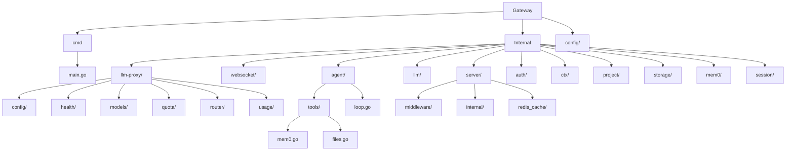

# Architecture

The Nevaria Gateway is a WebSocket-based AI agent gateway with authentication, intelligent LLM proxy routing, quota management, multi-provider support, and multi-agent storage with memory persistence.

## System Overview

```mermaid
flowchart TB
    subgraph Clients
        WS[WebSocket Client]
    end

    subgraph Gateway["Nevaria Gateway"]
        HTTP[HTTP Server]
        WSHandler[WebSocket Handler]
        AuthMW[Auth Middleware]

        subgraph Agents
            AgentRuntime[Agent Runtime]
            AgentLoop[Tool Loop]
            ToolReg[Tool Registry]
            AgentMgr[Agent Manager]
        end

        subgraph LLMProxy["LLM Proxy"]
            ProxyHandler[Proxy Handler]
            Router[Model Router]
            Health[Health Checker]
            Quota[Quota Manager]
            Usage[Usage Tracker]
        end

        subgraph LLM["LLM Clients"]
            OpenAI[OpenAI Client]
            Anthropic[Anthropic Client]
            Google[Google Client]
        end

        subgraph Storage["Storage Layer"]
            S3Client[S3 Client]
            Workspace[Workspace Loader]
            Transcript[Transcript Writer]
        end

        subgraph Memory["Memory Layer"]
            Mem0Client[Mem0 Client]
            Mem0Tools[Mem0 Tools]
        end

        subgraph Session["Session Layer"]
            SessionMgr[Session Manager]
            Session[Session State]
        end

        subgraph Internal["Internal Router"]
            InternalRouter[/_internal/*]
            CacheInvalid[Cache Invalidation]
        end
    end

    subgraph External["External Services"]
        AuthService[Auth Service]
        Redis[(Redis)]
        S3[(S3 Storage)]
        Mem0API[(Mem0 API)]
    end

    WS -->|WebSocket| HTTP
    HTTP --> AuthMW
    AuthMW --> WSHandler

    AuthMW -->|Session Validate| AuthService
    AuthMW -.->|Cache| Redis

    WSHandler --> AgentMgr
    AgentMgr --> AgentRuntime
    AgentRuntime --> AgentLoop
    AgentLoop --> ToolReg
    AgentLoop --> Mem0Tools

    AgentRuntime -->|LLM Call| ProxyHandler
    ProxyHandler --> Router
    ProxyHandler --> Health
    ProxyHandler --> Quota

    Router --> OpenAI
    Router --> Anthropic
    Router --> Google

    Quota --> Redis
    Health --> Redis

    AgentMgr -->|Load Workspace| S3Client
    AgentMgr -->|Load/Save| Workspace
    AgentRuntime -->|Write Transcript| Transcript
    AgentRuntime -->|Store Memory| Mem0Client
    AgentRuntime -->|Search Memory| Mem0Client

    S3Client --> S3
    Mem0Client --> Mem0API

    SessionMgr --> Session
    AgentMgr --> SessionMgr

    InternalRouter --> CacheInvalid
    CacheInvalid --> Redis
```

## Package Structure



## Component Overview

| Package | Purpose |
|---------|---------|
| [`config/`](config.md) | Environment-based configuration with validation |
| [`internal/server/`](server.md) | HTTP server, middleware, routing |
| [`internal/websocket/`](websocket.md) | WebSocket connection management with multi-agent routing |
| [`internal/agent/`](agent/README.md) | Agent runtime, state management, event system |
| [`internal/agent/tools/`](agent/tools.md) | Built-in agent tools (Mem0, file operations) |
| [`internal/llm/`](llm.md) | LLM client factory for multiple providers |
| [`internal/llm-proxy/`](llm-proxy/README.md) | LLM proxy with quota, health, routing |
| [`internal/auth/`](auth.md) | Auth service client for session validation |
| [`internal/ctx/`](ctx.md) | Context utilities for user ID and agent ID propagation |
| [`internal/project/`](project.md) | Project metadata and constants |
| [`internal/storage/`](storage/README.md) | S3 storage, workspace loader, transcript writer |
| [`internal/mem0/`](mem0/README.md) | Mem0 API client for long-term memory |
| [`internal/session/`](session/README.md) | Session management with timeout and reconnection |

## Data Flows

| Flow | Description |
|------|-------------|
| WebSocket Connection | Auth validate → Agent manager lookup → Events stream |
| Multi-Agent Message | Client sends `agent_id` → Routes to specific agent instance |
| Agent Initialization | Load workspace from S3 → Restore state → Subscribe to events |
| LLM Proxy Request | Quota check → Router → Health check → LLM call → Usage track |
| Agent Tool Loop | LLM stream → Extract tool calls → Execute → Add results → Repeat |
| Memory Operations | Agent prompts → Mem0 search/store → Context enrichment |
| Transcript Writing | Turn events → JSONL append to S3 |
| Session Validation | Cookie extract → Cache check → Auth service call → User ID in context |
| Cache Invalidation | Internal webhook → Delete from Redis |

## Design Patterns

| Pattern | Description |
|---------|-------------|
| [Factory](../internal/llm/factory.go) | Creates provider-specific LLM clients |
| [Strategy](../internal/agent/loop.go) | Pluggable tool execution |
| [Observer](../internal/agent/agent.go) | Event subscription system |
| [Middleware](../internal/server/middleware.go) | HTTP request processing chain |
| [Singleton](../internal/llm-proxy/models/registry.go) | Global model registry |
| [Pool](../internal/websocket/handler.go) | `wsMessage` sync.Pool for efficiency |
| [Circuit Breaker](../internal/llm-proxy/health/circuit.go) | Provider health management |
| [Composite Key](../internal/websocket/agent_manager.go) | (userID, agentID) for agent isolation |
| [Workspace](../internal/storage/workspace.go) | OpenClaw-style agent workspace persistence |

## Technology Stack

| Component | Technology |
|-----------|------------|
| Language | Go 1.24 |
| WebSocket | gorilla/websocket |
| OpenAI SDK | openai/openai-go |
| Anthropic SDK | anthropics/anthropic-sdk-go |
| Google AI | google.golang.org/genai |
| Redis | go-redis/v9 |
| S3 Storage | aws/aws-sdk-go-v2 |
| Logging | zerolog |
| Config | Environment variables |
| Router | gorilla/mux |

## Performance

### Connection Scaling
- Default buffer size: 8KB read + 8KB write per connection
- 100K connections: ~1.6GB RAM for buffers
- Connection limiting via semaphore pattern
- Horizontal scaling required for viral growth

### Optimization Techniques
- sync.Pool for WebSocket message structs
- Single-writer pattern for WebSocket writes
- Redis pipelining for quota operations
- Circuit breaker to fail fast on unhealthy providers
- Session caching to reduce auth service calls
- Agent instances persist beyond WebSocket connections

## Protocol Notes

### WebSocket Messages

**Client to Server:**
```json
{
  "type": "prompt",
  "agent_id": "agent-uuid",
  "text": "user message here"
}
```

**Server to Client Events:**
```json
{
  "type": "connected",
  "data": {
    "session_id": "...",
    "conn_id": "..."
  }
}
```

All agent events include `agent_id`:
```json
{
  "type": "agent_start",
  "agent_id": "agent-uuid",
  "data": {
    "timestamp": 1234567890
  }
}
```

Event types: `connected`, `agent_start`, `agent_end`, `turn_start`, `turn_end`, `message_start`, `message_update`, `message_end`, `tool_start`, `tool_update`, `tool_end`

### Message Flow

1. Client connects via WebSocket upgrade
2. Auth middleware validates session cookie → userID in context
3. Server sends `connected` event with session/connection ID
4. Client sends `prompt` messages with `agent_id` field
5. Agent manager routes to correct agent instance (creates if needed)
6. Agent emits streaming events back to client
7. Connection closes but agent persists (state preserved)

### Multi-Agent Architecture

- **Single WebSocket connection** per user
- **Multiple agents** per user, identified by `agent_id`
- **Agents are pre-created** in S3 on account creation
- **Messages routed** based on `agent_id` field in every message
- **Agent isolation** via composite key (userID, agentID)

### Internal Endpoints

| Endpoint | Method | Auth | Description |
|----------|--------|------|-------------|
| `/_internal/cache/delete` | POST | Bearer | Invalidate session cache |
| `/_internal/*` | * | Bearer | All internal endpoints protected |

## Related Documentation

- [Configuration](config.md) - Environment variables and setup
- [Server](server.md) - HTTP server and middleware
- [WebSocket](websocket.md) - WebSocket handler and multi-agent routing
- [Agent](agent/README.md) - Agent runtime
- [Agent Tools](agent/tools.md) - Built-in tools (Mem0, files)
- [LLM](llm.md) - LLM client factory
- [LLM Proxy](llm-proxy/README.md) - Proxy routing and quota
- [Auth](auth.md) - Authentication client
- [Storage](storage/README.md) - S3 storage, workspaces, transcripts
- [Mem0](mem0/README.md) - Memory API client
- [Session](session/README.md) - Session management
