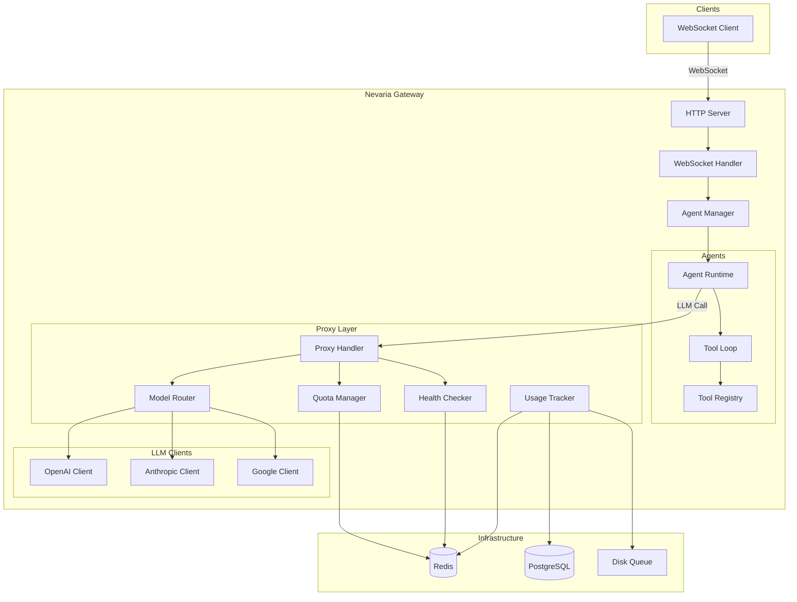
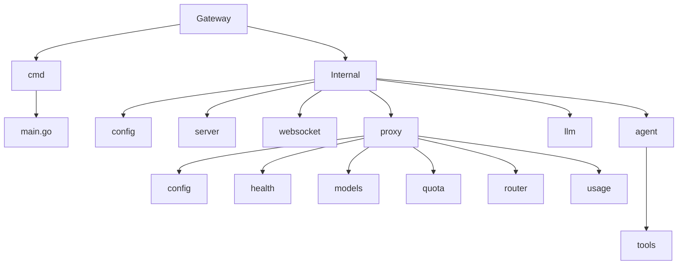

# Architecture

The Nevaria Gateway is a WebSocket-based AI agent gateway with intelligent LLM proxy routing, quota management, and multi-provider support.

## System Overview



## Package Structure



## Data Flows

| Flow | Description |
|------|-------------|
| WebSocket Connection | Client connects, agent is created/retrieved, events stream |
| Proxy Request | Quota check -> Router -> Health check -> LLM call -> Usage track |
| Agent Tool Loop | LLM stream -> Extract tool calls -> Execute -> Add results -> Repeat |

## Design Patterns

| Pattern | Description |
|---------|-------------|
| [Factory](../internal/llm/factory.go) | Creates provider-specific LLM clients |
| [Strategy](../internal/agent/loop.go) | Pluggable tool execution |
| [Observer](../internal/agent/agent.go) | Event subscription system |
| [Circuit Breaker](../internal/proxy/health/circuit.go) | Provider health management |
| [Middleware](../internal/proxy/middleware.go) | HTTP request processing chain |
| [Singleton](../internal/proxy/models/registry.go) | Global model registry |
| [Pool](../internal/websocket/handler.go) | `wsMessage` sync.Pool for efficiency |

## Technology Stack

| Component | Technology |
|-----------|------------|
| Language | Go 1.24 |
| WebSocket | gorilla/websocket |
| OpenAI SDK | openai/openai-go |
| Anthropic SDK | anthropics/anthropic-sdk-go |
| Google AI | google.golang.org/genai |
| Redis | go-redis/v9 |
| Database | PostgreSQL (lib/pq) |
| Logging | zerolog |
| Config | Environment variables + YAML |

## Performance

### Connection Scaling
- Default buffer size: 8KB read + 8KB write per connection
- 100K connections: ~1.6GB RAM for buffers
- Connection limiting via semaphore pattern
- Horizontal scaling required for viral growth

### Optimization Techniques
- sync.Pool for WebSocket message structs
- Single-writer pattern for WebSocket writes
- Redis pipelining for quota operations
- Batch database inserts for usage tracking
- Circuit breaker to fail fast on unhealthy providers

## Production Checklist

- [ ] Set `GATEWAY_ALLOWED_ORIGINS` to specific origins
- [ ] Configure `GATEWAY_MAX_CONNS` based on available memory
- [ ] Set up Redis for quota and health tracking
- [ ] Configure PostgreSQL for usage events
- [ ] Set `GATEWAY_MODEL_CONFIG` path
- [ ] Configure provider API keys
- [ ] Set appropriate timeouts (default: 120s for LLM calls)
- [ ] Enable structured logging at appropriate level
- [ ] Set up monitoring for circuit breaker state
- [ ] Configure disk queue fallback path

## Protocol Notes

### WebSocket Messages

**Client to Server:**
```json
{
  "type": "prompt",
  "text": "user message here"
}
```

**Server to Client Events:**
```json
{
  "type": "connected",
  "data": {
    "session_id": "...",
    "agent_id": "...",
    "conn_id": "..."
  }
}
```

Event types: `connected`, `agent_start`, `agent_end`, `turn_start`, `turn_end`, `message_start`, `message_update`, `message_end`, `tool_start`, `tool_update`, `tool_end`

### Message Flow

1. Client connects via WebSocket upgrade
2. Server sends `connected` event with session info
3. Client sends `prompt` messages
4. Agent emits streaming events back to client
5. Connection closes on client disconnect or error
