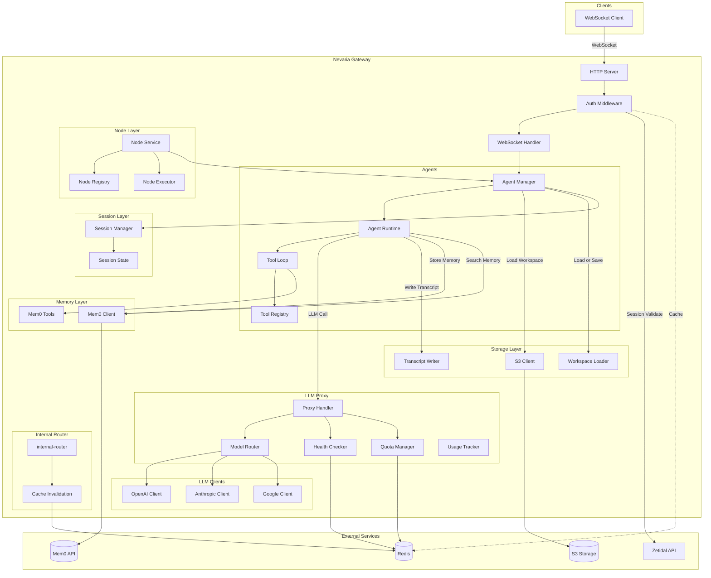

# Nevaria Gateway

The Nevaria Gateway is a WebSocket-based AI agent gateway with authentication, intelligent LLM proxy routing, quota management, multi-provider support, and multi-agent storage with memory persistence.

## System Overview



## Package Structure

```
cmd/
└── gateway/        # Application entry point

config/             # Environment-based configuration
├── models/         # LLM model definitions
└── plans/          # Subscription plans

internal/
├── server/         # HTTP server, middleware, routing
├── websocket/      # WebSocket handler, multi-agent routing
├── agent/          # Agent runtime, state management, events
│   └── tools/      # Built-in tools (Mem0, files, nodes)
├── llm/            # Multi-provider LLM client factory
├── llm-proxy/      # LLM proxy with quota, health, routing
│   ├── health/     # Circuit breaker, health checks
│   ├── models/     # Model registry
│   ├── quota/      # Credit quota management
│   ├── router/     # Intelligent model routing
│   └── usage/      # Usage tracking and billing
├── auth/           # Zetidal API client for session validation
├── billing/        # RevenueCat webhooks, migrations
├── ctx/            # Context utilities (userID, agentID)
├── storage/        # S3 storage, workspaces, transcripts
├── mem0/           # Mem0 API client for memory
├── session/        # Session management with Redis
└── node/           # Distributed node execution
```

## Component Overview

| Package | Purpose |
|---------|---------|
| [`config/`](config/README.md) | Environment-based configuration with validation |
| [`cmd/gateway`](cmd/gateway.md) | Application entry point |
| [`internal/server/`](internal/server/README.md) | HTTP server, middleware, routing |
| [`internal/websocket`](internal/websocket.md) | WebSocket connection management with multi-agent routing |
| [`internal/agent/`](internal/agent/README.md) | Agent runtime, state management, event system |
| [`internal/agent/tools`](internal/agent/tools.md) | Built-in agent tools (Mem0, file operations, node tools) |
| [`internal/llm/`](internal/llm.md) | LLM client factory for multiple providers |
| [`internal/llm-proxy/`](internal/llm-proxy/README.md) | LLM proxy with quota, health, routing |
| [`internal/auth/`](internal/auth.md) | Zetidal API client for session validation |
| [`internal/billing/`](internal/billing.md) | RevenueCat webhooks, credit tracking, migrations |
| [`internal/ctx/`](internal/ctx.md) | Context utilities for user ID and agent ID propagation |
| [`internal/storage/`](internal/storage/README.md) | S3 storage, workspace loader, transcript writer |
| [`internal/mem0/`](internal/mem0/README.md) | Mem0 API client for long-term memory |
| [`internal/session/`](internal/session/README.md) | Session management with timeout and reconnection |
| [`internal/node/`](internal/node/README.md) | Distributed node execution for remote tools |

## Data Flows

| Flow | Description |
|------|-------------|
| WebSocket Connection | Auth validate → Agent manager lookup → Events stream |
| Multi-Agent Message | Client sends `agent_id` → Routes to specific agent instance |
| Agent Initialization | Load workspace from S3 → Restore state → Subscribe to events |
| LLM Proxy Request | Quota check → Router → Health check → LLM call → Usage track |
| Agent Tool Loop | LLM stream → Extract tool calls → Execute → Add results → Repeat |
| Memory Operations | Agent prompts → Mem0 search/store → Context enrichment |
| Transcript Writing | Turn events → JSONL append to S3 |
| Session Validation | Cookie extract → Cache check → Zetidal API call → User ID in context |
| Node Tool Execution | Agent calls node tool → Service routes to node → Node executes → Result returned |

## Design Patterns

| Pattern | Description |
|---------|-------------|
| [Factory](internal/llm/factory.go) | Creates provider-specific LLM clients |
| [Strategy](internal/agent/loop.go) | Pluggable tool execution |
| [Observer](internal/agent/agent.go) | Event subscription system |
| [Middleware](internal/server/middleware.go) | HTTP request processing chain |
| [Singleton](internal/llm-proxy/models/registry.go) | Global model registry |
| [Pool](internal/websocket/handler.go) | `wsMessage` sync.Pool for efficiency |
| [Circuit Breaker](internal/llm-proxy/health/circuit.go) | Provider health management |
| [Composite Key](internal/websocket/agent_manager.go) | (userID, agentID) for agent isolation |
| [Workspace](internal/storage/workspace.go) | OpenClaw-style agent workspace persistence |

## Technology Stack

| Component | Technology |
|-----------|------------|
| Language | Go 1.24 |
| WebSocket | gorilla/websocket |
| OpenAI SDK | openai/openai-go |
| Anthropic SDK | anthropics/anthropic-sdk-go |
| Google AI | google.golang.org/genai |
| PostgreSQL | jackc/pgx/v5 |
| Redis | go-redis/v9 |
| S3 Storage | aws/aws-sdk-go-v2 |
| Logging | zerolog |
| Config | Environment variables |
| Router | gorilla/mux |

## Performance

### Connection Scaling
- Default buffer size: 8KB read + 8KB write per connection
- 100K connections: ~1.6GB RAM for buffers
- Connection limiting via semaphore pattern
- Horizontal scaling required for viral growth

### Optimization Techniques
- sync.Pool for WebSocket message structs
- Single-writer pattern for WebSocket writes
- Redis pipelining for quota operations
- Circuit breaker to fail fast on unhealthy providers
- Session caching to reduce zetidal API calls
- Agent instances persist beyond WebSocket connections

## Protocol Notes

### WebSocket Messages

**Client to Server:**
```json
{
  "type": "prompt",
  "agent_id": "agent-uuid",
  "text": "user message here"
}
```

**Server to Client Events:**
```json
{
  "type": "connected",
  "data": {
    "session_id": "...",
    "conn_id": "..."
  }
}
```

All agent events include `agent_id`:
```json
{
  "type": "agent_start",
  "agent_id": "agent-uuid",
  "data": {
    "timestamp": 1234567890
  }
}
```

Event types: `connected`, `agent_start`, `agent_end`, `turn_start`, `turn_end`, `message_start`, `message_update`, `message_end`, `tool_start`, `tool_update`, `tool_end`

### Message Flow

1. Client connects via WebSocket upgrade
2. Auth middleware validates session cookie → userID in context
3. Server sends `connected` event with session/connection ID
4. Client sends `prompt` messages with `agent_id` field
5. Agent manager routes to correct agent instance (creates if needed)
6. Agent emits streaming events back to client
7. Connection closes but agent persists (state preserved)

### Multi-Agent Architecture

- **Single WebSocket connection** per user
- **Multiple agents** per user, identified by `agent_id`
- **Agents are pre-created** in S3 on account creation
- **Messages routed** based on `agent_id` field in every message
- **Agent isolation** via composite key (userID, agentID)

## Related Documentation

### Configuration
- [Config](config/README.md) - Environment variables and setup
- [Models](config/models.md) - LLM model configuration
- [Plans](config/plans.md) - Subscription plan definitions

### Command
- [Gateway](cmd/gateway.md) - Application entry point

### Internal Packages
- [Server](internal/server/README.md) - HTTP server and middleware
- [WebSocket](internal/websocket.md) - WebSocket handler and multi-agent routing
- [Agent](internal/agent/README.md) - Agent runtime
- [Agent Tools](internal/agent/tools.md) - Built-in tools (Mem0, files, nodes)
- [LLM](internal/llm.md) - LLM client factory
- [LLM Proxy](internal/llm-proxy/README.md) - Proxy routing and quota
- [Auth](internal/auth.md) - Authentication client
- [Billing](internal/billing.md) - RevenueCat webhooks and credit tracking
- [Storage](internal/storage/README.md) - S3 storage, workspaces, transcripts
- [Mem0](internal/mem0/README.md) - Memory API client
- [Session](internal/session/README.md) - Session management
- [Node](internal/node/README.md) - Distributed node execution
- [Context](internal/ctx.md) - Context utilities
