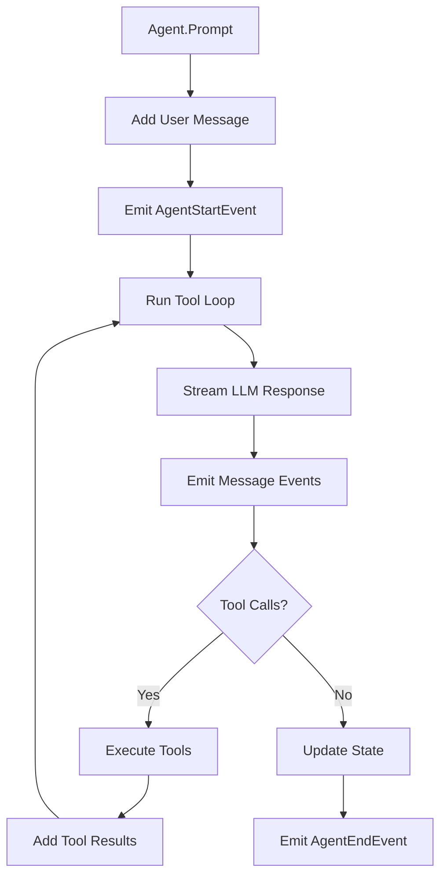
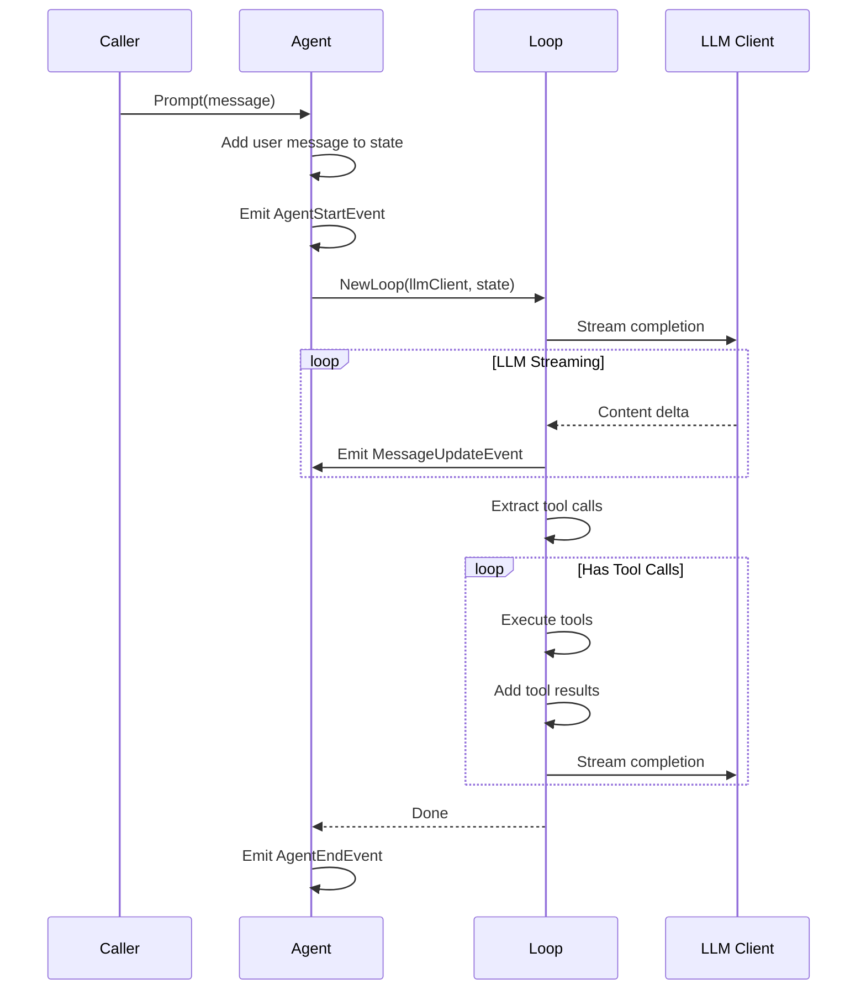

# Agent Package

Core agent runtime framework with state management, event streaming, and tool execution loop.

## Overview



## Purpose

The agent package provides:

- Agent state management with thread-safe access
- Event subscription system (10 event types)
- Tool calling loop with parallel execution
- Message history tracking
- LLM client integration
- Multi-agent support with userID and agentID

## Types

### Agent

```go
type Agent struct {
    mu            sync.RWMutex
    state         AgentState
    id            string
    userID        string           // User identifier for multi-agent
    agentID       string           // Agent identifier for multi-agent
    subscribers   map[string]chan AgentEvent
    subscribersMu sync.Mutex
    ctx           context.Context
    cancel        context.CancelFunc
    llmClient     LLMClient        // Optional LLM client for tool calling
}
```

| Field | Type | Description |
|-------|------|-------------|
| `mu` | sync.RWMutex | State mutex |
| `state` | AgentState | Current agent state |
| `id` | string | Unique agent instance ID |
| `userID` | string | User identifier (for multi-agent isolation) |
| `agentID` | string | Agent identifier (for multi-agent routing) |
| `subscribers` | map[string]chan AgentEvent | Event subscribers |
| `ctx` | context.Context | Agent context |
| `cancel` | context.CancelFunc | Context cancel function |
| `llmClient` | LLMClient | Optional LLM client |

### AgentState

```go
type AgentState struct {
    SystemPrompt     string
    Model            Model
    ThinkingLevel    ThinkingLevel
    Tools            []Tool
    Messages         []AgentMessage
    IsStreaming      bool
    StreamMessage    *AgentMessage
    PendingToolCalls map[string]bool
    Error            string
    SessionID        string
    UserID           string           // User identifier
    AgentID          string           // Agent identifier
}
```

| Field | Type | Description |
|-------|------|-------------|
| `SystemPrompt` | string | System prompt for LLM |
| `Model` | Model | Model configuration |
| `ThinkingLevel` | ThinkingLevel | Thinking intensity |
| `Tools` | []Tool | Available tools |
| `Messages` | []AgentMessage | Conversation history |
| `IsStreaming` | bool | Currently streaming |
| `StreamMessage` | *AgentMessage | Current streaming message |
| `PendingToolCalls` | map[string]bool | Pending tool call IDs |
| `Error` | string | Error state |
| `SessionID` | string | Session identifier |
| `UserID` | string | User identifier |
| `AgentID` | string | Agent identifier |

### AgentMessage

```go
type AgentMessage struct {
    Role       Role
    Content    []ContentBlock
    Timestamp  int64
    ToolCallID string
    ToolName   string
    IsError    bool
}
```

| Field | Type | Description |
|-------|------|-------------|
| `Role` | Role | Message role (user/assistant/toolResult) |
| `Content` | []ContentBlock | Message content |
| `Timestamp` | int64 | Unix timestamp |
| `ToolCallID` | string | Tool call ID (for tool results) |
| `ToolName` | string | Tool name (for tool results) |
| `IsError` | bool | Error flag (for tool results) |

### Tool

```go
type Tool struct {
    Name        string
    Description string
    Execute     func(ctx context.Context, args map[string]any) (*ToolResult, error)
}
```

| Field | Type | Description |
|-------|------|-------------|
| `Name` | string | Tool identifier |
| `Description` | string | Tool description for LLM |
| `Execute` | func | Tool execution function |

### AgentStatus

```go
type AgentStatus string

const (
    AgentStatusIdle   AgentStatus = "idle"
    AgentStatusActive AgentStatus = "active"
    AgentStatusError  AgentStatus = "error"
)
```

## Roles

| Role | Description |
|------|-------------|
| `RoleUser` | From user |
| `RoleAssistant` | From AI assistant |
| `RoleToolResult` | From tool execution |

## Thinking Levels

| Level | Description |
|-------|-------------|
| `ThinkingLevelOff` | Disabled |
| `ThinkingLevelMinimal` | Minimal |
| `ThinkingLevelLow` | Low |
| `ThinkingLevelMedium` | Medium |
| `ThinkingLevelHigh` | High |

## Agent Status

| Status | Description |
|--------|-------------|
| `AgentStatusIdle` | Agent is idle, waiting for input |
| `AgentStatusActive` | Agent is processing a request |
| `AgentStatusError` | Agent encountered an error |

## Functions

| Function | Description |
|----------|-------------|
| `NewAgent(opts AgentOptions) *Agent` | Creates new agent |
| `Subscribe() (string, chan AgentEvent)` | Subscribe to events |
| `Unsubscribe(id string)` | Unsubscribe from events |
| `State() AgentState` | Gets current state (copy) |
| `Prompt(ctx context.Context, message string) error` | Sends user message |
| `AddTools(tools ...Tool)` | Add tools to agent |
| `RemoveTools(prefix string)` | Remove tools by name prefix |

### State Management

| Function | Description |
|----------|-------------|
| `NewAgentState(opts AgentStateOptions) AgentState` | Creates state |
| `AddMessage(msg AgentMessage)` | Adds message to history |
| `SetStreaming(streaming bool, msg *AgentMessage)` | Sets streaming state |
| `AddPendingToolCall(id string)` | Marks tool call as pending |
| `RemovePendingToolCall(id string)` | Removes pending tool call |

### Tools

| Function | Description |
|----------|-------------|
| `ExecuteToolCall(ctx context.Context, state *AgentState, toolCall ToolCallContent) (AgentMessage, error)` | Executes tool |
| `FindToolByName(state *AgentState, name string) *Tool` | Finds tool by name |

### Messages

| Function | Description |
|----------|-------------|
| `NewTextMessage(role Role, text string) AgentMessage` | Creates text message |
| `NewToolCallMessage(id, name string, args map[string]any) AgentMessage` | Creates tool call message |
| `NewToolResultMessage(toolCallID, toolName, result string, isError bool) AgentMessage` | Creates tool result message |

## Event Types

| Event | Description |
|-------|-------------|
| `AgentStartEvent` | Agent begins processing |
| `AgentEndEvent` | Agent finishes processing |
| `TurnStartEvent` | New interaction cycle begins |
| `TurnEndEvent` | Interaction cycle completes |
| `MessageStartEvent` | Message generation starts |
| `MessageUpdateEvent` | Streaming content delta |
| `MessageEndEvent` | Message is complete |
| `ToolExecutionStartEvent` | Tool execution begins |
| `ToolExecutionUpdateEvent` | Partial tool result |
| `ToolExecutionEndEvent` | Tool execution completes |

## Flow

### Prompt Execution



## Sub-packages

| Package | Description |
|---------|-------------|
| [tools.md](tools.md) | Tool interface and built-in tools (Mem0, files) |
| [types.md](types.md) | Agent types and event definitions |

## Built-in Tools

| Tool | Description | Package |
|------|-------------|---------|
| `mem0_search` | Search long-term memory | `tools/mem0.go` |
| `mem0_store` | Store in long-term memory | `tools/mem0.go` |
| `read_agent_file` | Read from agent workspace | `tools/files.go` |
| `write_agent_file` | Write to agent workspace | `tools/files.go` |

## File Locations

- [`internal/agent/agent.go`](../internal/agent/agent.go) - Main agent implementation
- [`internal/agent/loop.go`](../internal/agent/loop.go) - Tool calling loop
- [`internal/agent/tool.go`](../internal/agent/tool.go) - Tool execution
- [`internal/agent/types.go`](../internal/agent/types.go) - Core types
- [`internal/agent/status.go`](../internal/agent/status.go) - Agent status enum
- [`internal/agent/tools/mem0.go`](../internal/agent/tools/mem0.go) - Memory tools
- [`internal/agent/tools/files.go`](../internal/agent/tools/files.go) - File operation tools
- [`tests/unit/agent/`](../tests/unit/agent/) - Tests

## Related

- [WebSocket](../websocket.md) - Multi-agent routing via agent_id
- [Storage](../storage/README.md) - Workspace persistence for agents
- [Mem0](../mem0/README.md) - Long-term memory tools
