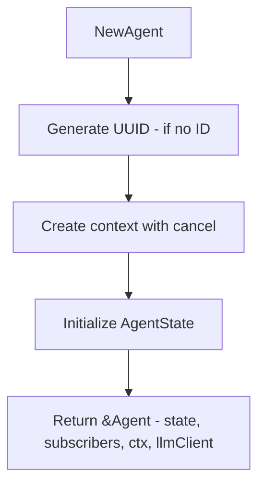
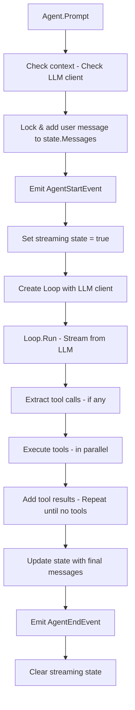
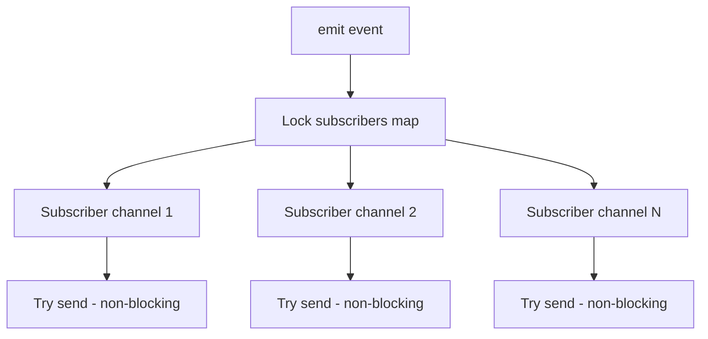

# internal/agent

Core agent execution engine with event subscription and tool calling loop.

## Description

The agent package provides a complete agent runtime with state management, event broadcasting, and tool execution loop. It supports streaming LLM responses with real-time event updates.

## Agent Runtime Flow

## Prompt Execution Flow

## Event Broadcasting

## Sub-packages

| Package | Description |
|---------|-------------|
| [tools.md](tools.md) | Tool interface and execution framework |
| [types.md](types.md) | Agent types and event definitions |

## Key Types and Functions

| Name | Kind | Location | Description |
|------|------|----------|-------------|
| Agent | struct | [agent.go#L74](../internal/agent/agent.go#L74) | Agent with state and events |
| AgentOptions | struct | [agent.go#L66](../internal/agent/agent.go#L66) | Agent creation options |
| NewAgent | func | [agent.go#L88](../internal/agent/agent.go#L88) | Agent creation |
| Subscribe | func | [agent.go#L112](../internal/agent/agent.go#L112) | Subscribe to events |
| Unsubscribe | func | [agent.go#L124](../internal/agent/agent.go#L124) | Unsubscribe from events |
| emit | func | [agent.go#L133](../internal/agent/agent.go#L133) | Broadcast to subscribers |
| State | func | [agent.go#L147](../internal/agent/agent.go#L147) | Returns copy of agent state |
| Prompt | func | [agent.go#L180](../internal/agent/agent.go#L180) | Executes the agent loop |
| Loop | struct | [loop.go#L18](../internal/agent/loop.go#L18) | Manages tool calling |
| NewLoop | func | [loop.go#L24](../internal/agent/loop.go#L24) | Creates loop with LLM client |
| Loop.Run | func | [loop.go#L35](../internal/agent/loop.go#L35) | Executes tool loop |
| ExecuteToolCall | func | [tool.go#L14](../internal/agent/tool.go#L14) | Executes a tool |
| FindToolByName | func | [tool.go#L75](../internal/agent/tool.go#L75) | Locates a tool |
| MockLLMClient | struct | [mock.go#L10](../internal/agent/mock.go#L10) | Mock LLM client for testing |

## Event Types

| Event | Description | Source |
|-------|-------------|--------|
| `AgentStartEvent` | Agent begins processing | [events.go#L30](../internal/agent/events.go#L30) |
| `AgentEndEvent` | Agent finishes processing | [events.go#L37](../internal/agent/events.go#L37) |
| `TurnStartEvent` | New interaction cycle begins | [events.go#L45](../internal/agent/events.go#L45) |
| `TurnEndEvent` | Interaction cycle completes | [events.go#L52](../internal/agent/events.go#L52) |
| `MessageStartEvent` | Message generation starts | [events.go#L61](../internal/agent/events.go#L61) |
| `MessageUpdateEvent` | Streaming content delta | [events.go#L69](../internal/agent/events.go#L69) |
| `MessageEndEvent` | Message is complete | [events.go#L78](../internal/agent/events.go#L78) |
| `ToolExecutionStartEvent` | Tool execution begins | [events.go#L86](../internal/agent/events.go#L86) |
| `ToolExecutionUpdateEvent` | Partial tool result | [events.go#L96](../internal/agent/events.go#L96) |
| `ToolExecutionEndEvent` | Tool execution completes | [events.go#L106](../internal/agent/events.go#L106) |
| `TokenUsageEvent` | Token usage information | [events.go#L117](../internal/agent/events.go#L117) |

## Agent Options

| Field | Type | Description |
|-------|------|-------------|
| `ID` | string | Unique agent identifier |
| `SystemPrompt` | string | System prompt for LLM |
| `SessionID` | string | Session identifier |
| `LLMClient` | LLMClient | LLM client for streaming |
