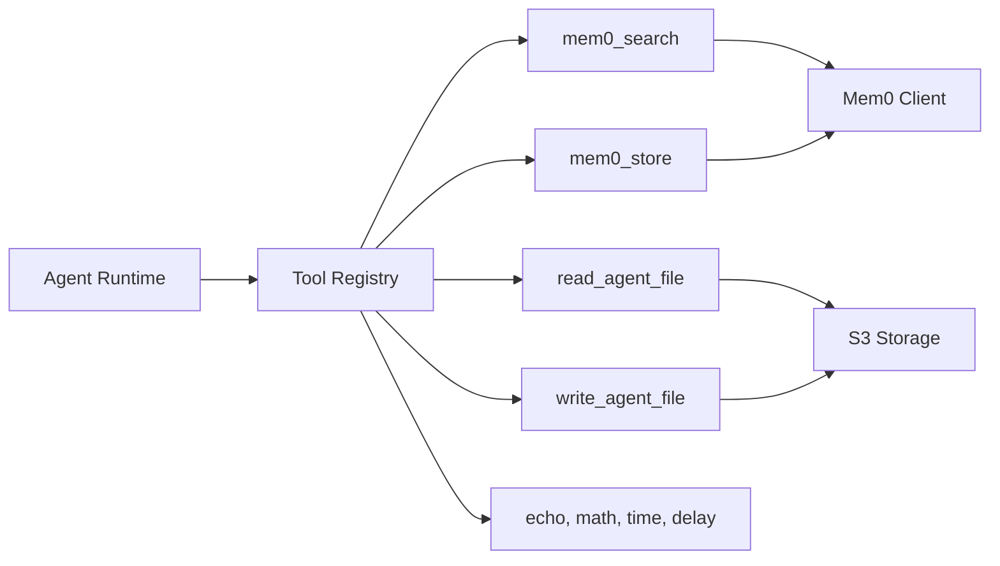
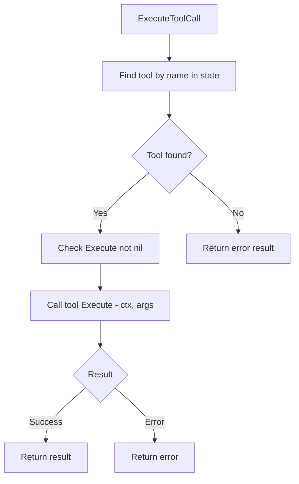

# Agent Tools

Tool interface, execution framework, and built-in tools for agent runtime.

## Overview



## Tool Interface

```go
type Tool struct {
    Name        string
    Description string
    Execute     func(ctx context.Context, args map[string]any) (*ToolResult, error)
}
```

| Field | Type | Description |
|-------|------|-------------|
| `Name` | string | Unique identifier for the tool |
| `Description` | string | Human-readable description for LLM |
| `Execute` | func | Function to execute with context and arguments |

## Tool Result

```go
type ToolResult struct {
    Content []ContentBlock
    Details any
}
```

| Field | Type | Description |
|-------|------|-------------|
| `Content` | []ContentBlock | Result content blocks |
| `Details` | any | Additional metadata |

## Built-in Tools

| Tool | Description | Arguments | Returns |
|------|-------------|-----------|---------|
| `mem0_search` | Search long-term memory | `query`, `limit` | Relevant memories |
| `mem0_store` | Store in long-term memory | `content`, `metadata` | Success confirmation |
| `read_agent_file` | Read from agent workspace | `path` | File contents |
| `write_agent_file` | Write to agent workspace | `path`, `content` | Success confirmation |
| `echo` | Echo input text (example) | `text` | Echoed text |
| `math` | Arithmetic operations (example) | `operation`, `a`, `b` | Calculation result |
| `time` | Current time (example) | none | Current timestamp |
| `delay` | Simulate delay (example) | `duration_ms` | Delay confirmation |

## Production Tools

### Mem0SearchTool

Searches long-term memory for relevant information.

```go
var Mem0SearchTool = Tool{
    Name: "mem0_search",
    Description: "Search long-term memory for relevant information. Use this to retrieve facts, preferences, or past conversations.",
}
```

**Arguments:**

| Name | Type | Required | Description |
|------|------|----------|-------------|
| `query` | string | Yes | Search query |
| `limit` | int | No | Max results (default: 5) |

### Mem0StoreTool

Stores information in long-term memory.

```go
var Mem0StoreTool = Tool{
    Name: "mem0_store",
    Description: "Store important information in long-term memory for future retrieval. Use for facts, preferences, decisions.",
}
```

**Arguments:**

| Name | Type | Required | Description |
|------|------|----------|-------------|
| `content` | string | Yes | Information to store |
| `metadata` | map[string]string | No | Optional metadata tags |

### ReadAgentFileTool

Reads a file from the agent's workspace in S3.

```go
var ReadAgentFileTool = Tool{
    Name: "read_agent_file",
    Description: "Read a file from the agent's workspace. Files are stored in S3 under the user's agent workspace.",
}
```

**Arguments:**

| Name | Type | Required | Description |
|------|------|----------|-------------|
| `path` | string | Yes | File path relative to workspace root |

### WriteAgentFileTool

Writes content to a file in the agent's workspace in S3.

```go
var WriteAgentFileTool = Tool{
    Name: "write_agent_file",
    Description: "Write content to a file in the agent's workspace. Existing files will be overwritten.",
}
```

**Arguments:**

| Name | Type | Required | Description |
|------|------|----------|-------------|
| `path` | string | Yes | File path relative to workspace root |
| `content` | string | Yes | File content to write |

## Example Tools

For testing and development:

| Tool | Description | Arguments |
|------|-------------|-----------|
| `echo` | Echoes input text | `text` (string) |
| `math` | Performs arithmetic | `operation` (string), `a`, `b` (float64) |
| `time` | Returns current time | none |
| `delay` | Simulates long operation | `duration_ms` (int/float64) |

## Tool Execution Flow



## S3 Workspace Structure

```
s3://{bucket}/workspaces/{user_id}/{agent_id}/
├── notes/
│   ├── project-planning.md
│   └── meeting-summary-2024-01-15.md
├── code/
│   └── snippet.go
└── data/
    └── config.json
```

## Tool Registration

Tools are added to agents via `AddTools()` method:

```go
import mem0tools "github.com/nevaria-ai/gateway/internal/agent/tools/mem0"
import filetools "github.com/nevaria-ai/gateway/internal/agent/tools/files"

agent.AddTools(
    mem0tools.Mem0SearchTool,
    mem0tools.Mem0StoreTool,
    filetools.ReadAgentFileTool,
    filetools.WriteAgentFileTool,
)
```

## Context Requirements

Tools require context values to operate:

| Tool | Context Key | Description |
|------|-------------|-------------|
| File tools | `UserIDKey` | User identifier for S3 path |
| File tools | `AgentIDKey` | Agent identifier for S3 path |
| Mem0 tools | (from agent) | Session ID for memory operations |

## File Locations

- [`internal/agent/tool.go`](../internal/agent/tool.go) - Tool execution
- [`internal/agent/tools/mem0.go`](../internal/agent/tools/mem0.go) - Memory tools
- [`internal/agent/tools/files.go`](../internal/agent/tools/files.go) - File tools
- [`internal/agent/tools/example.go`](../internal/agent/tools/example.go) - Example tools
- [`internal/agent/tools/registry.go`](../internal/agent/tools/registry.go) - Tool registry
- [`tests/unit/agent/tools/mem0_test.go`](../../tests/unit/agent/tools/mem0_test.go) - Memory tool tests
- [`tests/unit/agent/tools/files_test.go`](../../tests/unit/agent/tools/files_test.go) - File tool tests

## Related

- [Agent](../agent/README.md) - Agent runtime with tool execution
- [Storage](../../storage/README.md) - S3 storage implementation
- [Mem0](../../mem0/README.md) - Memory client API
