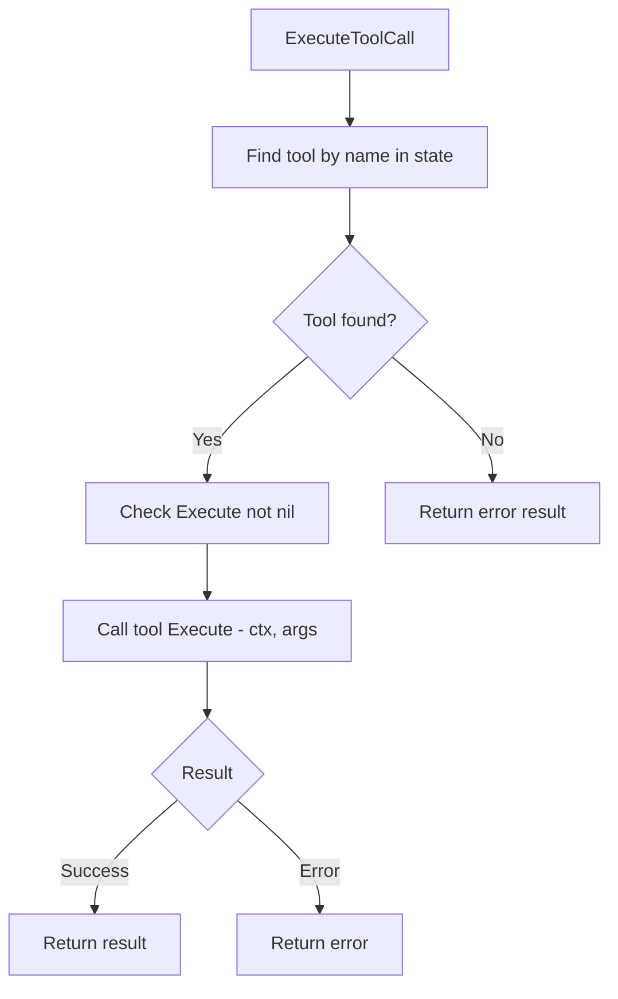
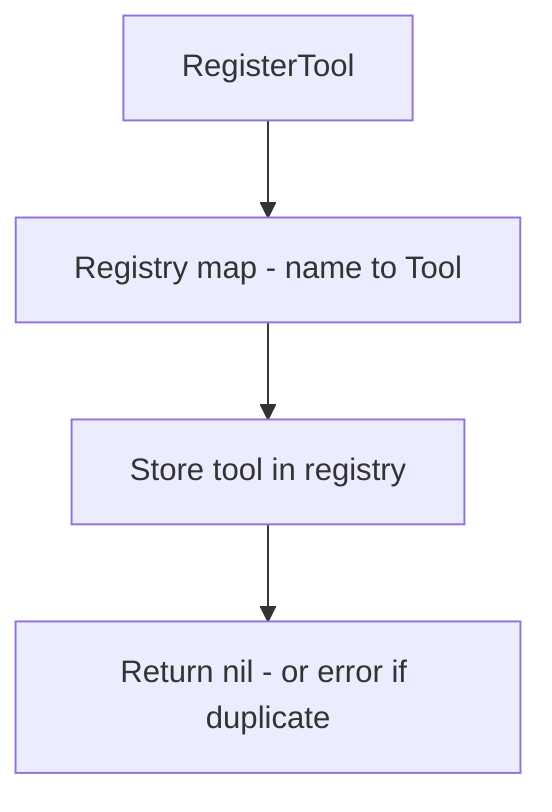

# internal/agent/tools

Tool interface and execution framework.

## Description

The tools package defines the tool execution interface. Tools are callable functions that can be invoked by the agent during the tool calling loop. Each tool has a name, description, and execute function.

## Tool Execution Flow



## Tool Registry Flow



## Functions and Types

| Name | Kind | Location | Description |
|------|------|----------|-------------|
| ExecuteToolCall | func | [tool.go#L14](../internal/agent/tool.go#L14) | Executes a tool from state |
| FindToolByName | func | [tool.go#L75](../internal/agent/tool.go#L75) | Locates a tool in state |
| Registry | struct | [tools/registry.go#L23](../internal/agent/tools/registry.go#L23) | Registry for tool management |
| RegisterTool | func | [tools/registry.go#L45](../internal/agent/tools/registry.go#L45) | Adds tool to registry |
| GetTool | func | [tools/registry.go#L59](../internal/agent/tools/registry.go#L59) | Retrieves tool by name |
| ExampleEchoTool | func | [tools/example.go#L24](../internal/agent/tools/example.go#L24) | Example echo tool for testing |
| ExampleMathTool | func | [tools/example.go#L53](../internal/agent/tools/example.go#L53) | Example math tool for arithmetic |
| ExampleTimeTool | func | [tools/example.go#L109](../internal/agent/tools/example.go#L109) | Example time tool returns current time |
| ExampleDelayTool | func | [tools/example.go#L136](../internal/agent/tools/example.go#L136) | Example delay tool simulates long operations |

## Tool Interface

```go
type Tool struct {
    Name        string
    Description string
    Execute     func(ctx context.Context, args map[string]any) (*ToolResult, error)
}
```

| Field | Type | Description |
|-------|------|-------------|
| Name | string | Unique identifier for the tool |
| Description | string | Human-readable description for LLM |
| Execute | func | Function to execute with context and arguments |

## Tool Result

```go
type ToolResult struct {
    Content []ContentBlock
    Details any
}
```

| Field | Type | Description |
|-------|------|-------------|
| Content | []ContentBlock | Result content blocks |
| Details | any | Additional metadata |

## Example Tools

| Tool | Description | Arguments |
|------|-------------|-----------|
| `echo` | Echoes input text | `text` (string) |
| `math` | Performs arithmetic | `operation` (string), `a`, `b` (float64) |
| `time` | Returns current time | none |
| `delay` | Simulates long operation | `duration_ms` (int/float64) |
