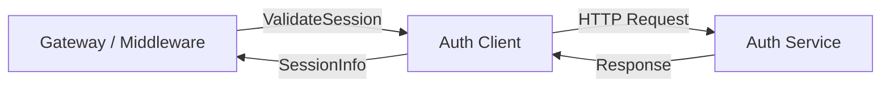
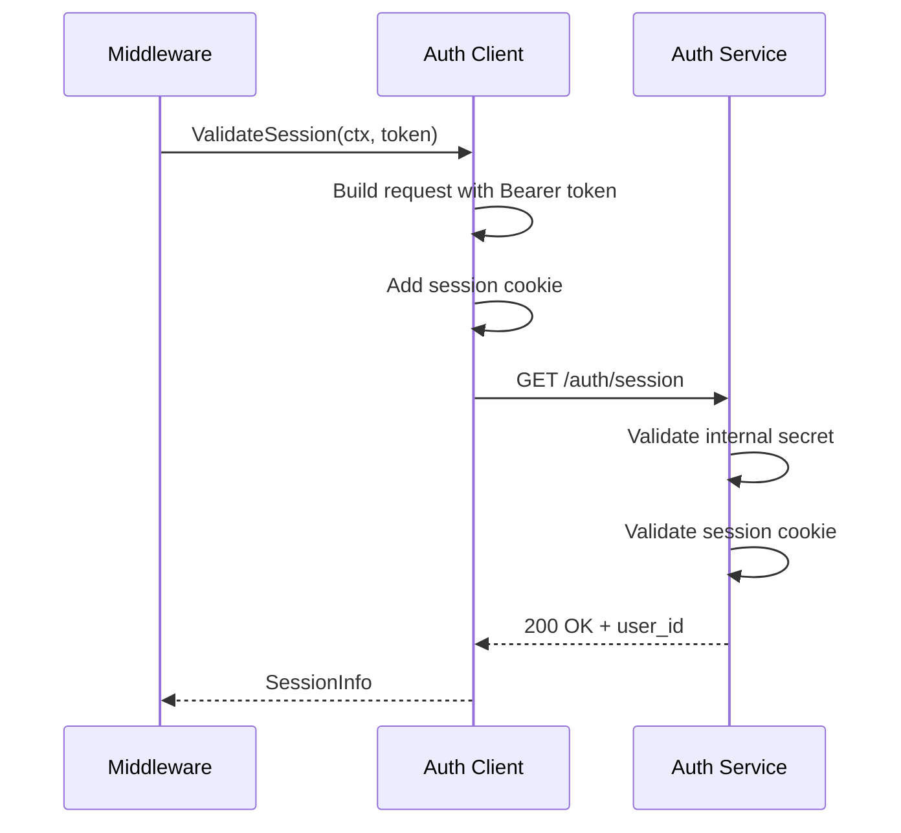

# Auth Package

HTTP client for communicating with the authentication service. Handles session validation, cookie management, and sliding expiration.

## Overview



## Purpose

The auth package provides a clean HTTP client for validating session tokens against an external auth service. It supports:

- Session validation via Bearer token authentication
- Sliding expiration (updated cookie forwarding)
- Configurable timeouts
- Context-aware requests (cancellation support)

## Types

### SessionInfo

```go
type SessionInfo struct {
    UserID    string
    ExpiresAt time.Time
    SetCookie *http.Cookie  // nil if session wasn't extended
}
```

| Field | Description |
|-------|-------------|
| `UserID` | Authenticated user identifier |
| `ExpiresAt` | Session expiration time |
| `SetCookie` | Updated cookie for sliding expiration (forward to client) |

### Client

```go
type Client struct {
    baseURL string
    secret  string
    client  *http.Client
    logger  interface{}
}
```

| Field | Description |
|-------|-------------|
| `baseURL` | Auth service base URL |
| `secret` | Internal secret for service-to-service auth |
| `client` | HTTP client with configured timeout |
| `logger` | Logger instance |

## Functions

| Function | Description |
|----------|-------------|
| `NewAuthClient(baseURL, secret string, logger interface{}) *Client` | Creates new auth client with defaults |
| `ValidateSession(ctx context.Context, sessionToken string) (*SessionInfo, error)` | Validates session token with auth service |

## Errors

| Error | When Returned |
|--------|--------------|
| `ErrSessionInvalid` | Session token is invalid or not authenticated |
| `ErrSessionExpired` | Session has expired |
| `ErrAuthUnavailable` | Auth service is unreachable or returns error status |
| `ErrInvalidResponse` | Response body cannot be parsed |
| `ErrContextCanceled` | Request context was canceled |

## Configuration

Uses the following environment variables (via config package):

| Env Var | Description | Default |
|---------|-------------|---------|
| `AUTH_SERVICE_URL` | Auth service base URL | `http://localhost:8081` |
| `AUTH_TIMEOUT` | Request timeout | `2s` |
| `AUTH_INTERNAL_SECRET` | Secret for Bearer authentication | (required) |

## Flow



## Request Format

**Request to Auth Service:**
```http
GET /auth/session HTTP/1.1
Host: auth-service:8081
Authorization: Bearer <internal_secret>
Cookie: session=<session_token>
```

**Success Response (200 OK):**
```json
{
  "authenticated": true,
  "user_id": "user-123",
  "expires_at": 1737654321
}
```

**Error Response (401 Unauthorized):**
```json
{
  "error": "invalid token"
}
```

## File Locations

- [`internal/auth/client.go`](../internal/auth/client.go) - Main implementation
- [`tests/unit/auth_client_test.go`](../tests/unit/auth_client_test.go) - Unit tests

## Constants

| Constant | Value | Description |
|----------|-------|-------------|
| `defaultAuthURL` | `http://localhost:8081` | Default auth service URL |
| `defaultTimeout` | `2s` | Default request timeout |
| `sessionCookieName` | `session` | Cookie name for session token |
