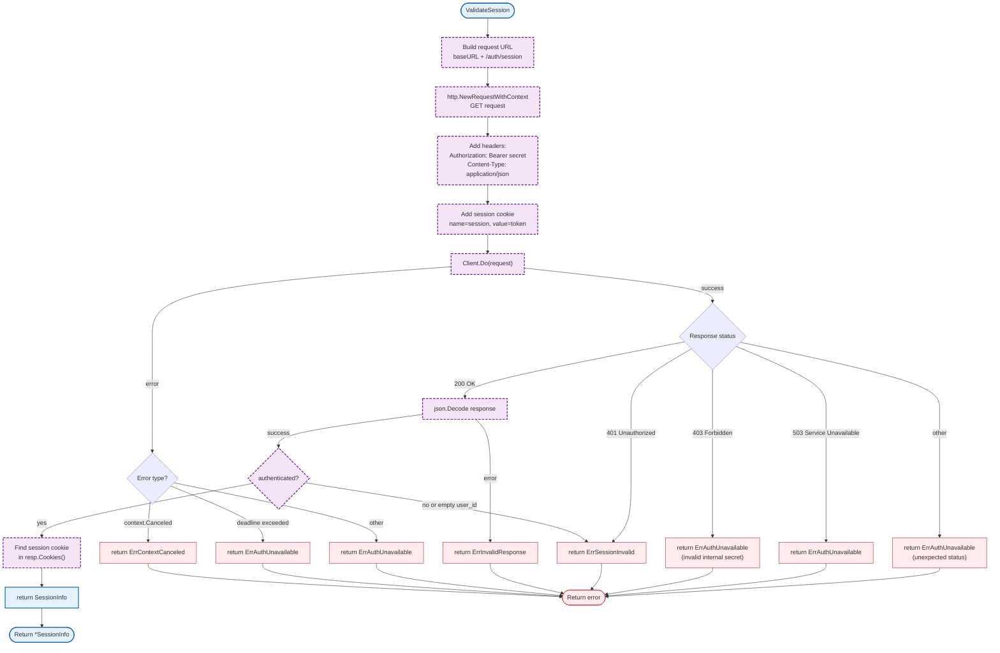

# auth (internal/auth)

Auth service client for session validation. The gateway delegates authentication to an external auth service, validating session tokens via HTTP API.

**Note:** This is the current implementation. A planned migration to Zitadel JWT validation is in progress - see [Implementation Plan](../.claude/plans/auth-billing-migration.md) for details.

## Overview

### Variables

| Variable | Type | Description |
|----------|------|-------------|
| `defaultAuthURL` | `string` | Default auth service URL (`http://localhost:8081`) |
| `defaultTimeout` | `time.Duration` | Default request timeout (`2s`) |
| `sessionCookieName` | `string` | Cookie name for session token (`session`) |

### Constants

| Constant | Type | Value | Description |
|----------|------|-------|-------------|
| `defaultAuthURL` | `string` | `"http://localhost:8081"` | Default auth service URL |
| `defaultTimeout` | `time.Duration` | `2 * time.Second` | Default HTTP timeout |
| `sessionCookieName` | `string` | `"session"` | Cookie name for session token |

### Structs

| Struct | Field | Type | Description |
|--------|-------|------|-------------|
| `Client` | `baseURL` | `string` | Auth service base URL |
| | `secret` | `string` | Internal secret for auth service calls |
| | `Client` | `*http.Client` | HTTP client (exported for testing) |
| | `logger` | `interface{}` | Logger instance (zerolog.Logger) |
| `SessionInfo` | `UserID` | `string` | Authenticated user ID |
| | `ExpiresAt` | `time.Time` | Session expiration time |
| | `SetCookie` | `*http.Cookie` | Cookie to set on client (sliding expiration) |

### Error Handling

| Error | Handler | Exit Code / Behavior |
|-------|---------|---------------------|
| `ErrSessionInvalid` | Return to caller | Session validation failed |
| `ErrSessionExpired` | Return to caller | Session has expired |
| `ErrAuthUnavailable` | Return to caller | Auth service unreachable or error |
| `ErrInvalidResponse` | Return to caller | Invalid JSON from auth service |
| `ErrContextCanceled` | Return to caller | Request context was canceled |

<!--### Embedded Files-->

<!-- N/A - This package does not embed any files. -->

### Environment Variables

| Variable | Required | Default | Description |
|----------|----------|---------|-------------|
| `AUTH_SERVICE_URL` | No | `http://localhost:8081` | Auth service base URL |
| `AUTH_TIMEOUT` | No | `2s` | HTTP request timeout |
| `AUTH_INTERNAL_SECRET` | Yes (prod) | - | Bearer secret for auth service calls |

## Design Notes

### Auth Service Delegation

**Q: Why delegate auth to a separate service?**

**A:** Separation of concerns. The auth service handles user registration, login, password resets, OAuth, etc. The gateway only validates sessions.

| Aspect | Description |
|--------|-------------|
| Context | Microservices architecture |
| Options considered | In-memory auth, JWT validation, auth service delegation |
| Rationale | Auth service provides centralized user management |

**Current approach is recommended because:**
- Gateway stays lightweight (focused on WebSocket/LLM routing)
- Auth service can be updated independently
- Multiple gateways can share one auth service
- Auth complexity (OAuth, WebAuthn, etc.) stays in auth service

### 2 Second Timeout

**Q: Why is the default auth timeout 2 seconds?**

**A:** Auth validation is on the critical path for WebSocket connections. It needs to be fast but allow for network latency.

| Aspect | Description |
|--------|-------------|
| Context | WebSocket connection establishment |
| Options considered | 500ms, 1s, 2s, 5s |
| Rationale | 2s allows for network delays while failing fast |

**Current approach is recommended because:**
- Fast enough for good UX
- Allows for cross-region network latency
- Fails fast on actual auth service issues
- Configurable via environment variable

### Session Cookie Sliding Expiration

**Q: Why capture the SetCookie from auth service response?**

**A:** The auth service implements sliding expiration - active sessions get extended. Gateway must forward the updated cookie to the browser.

| Aspect | Description |
|--------|-------------|
| Context | Session refresh on activity |
| Implementation | Gateway reads `Set-Cookie` header and forwards to client |
| Benefit | Active users stay logged in |

**Current approach is recommended because:**
- Improves UX (no abrupt session expiration)
- Auth service controls expiration policy
- Gateway is transparent to cookie changes

## Planned Migration: Zitadel JWT Validation

The following is **NOT YET IMPLEMENTED**. See [Implementation Plan](../.claude/plans/auth-billing-migration.md) for progress.

### Planned Changes

| Current | Planned (Wave 2) |
|---------|------------------|
| HTTP session validation | Zitadel JWT validation |
| External auth service | Direct JWKS verification |
| Session cookie | JWT bearer token |

### Files to be Created

| File | Purpose |
|------|---------|
| `internal/auth/jwks.go` | JWKS fetching and caching |
| `internal/auth/validator.go` | JWT signature and claims validation |
| `internal/auth/middleware.go` | Gin/JWT middleware integration |

### Files to be Removed

| File | Reason |
|------|--------|
| `internal/auth/client.go` | Replaced by JWKS validation |

## Test Coverage

For general testing patterns, see [gateway testing practices](../README.md#testing).

### Unit Tests

<!-- N/A - No unit tests exist for auth client currently. -->

### Integration Tests

<!-- N/A - No integration tests exist for auth client currently. -->

### Dependencies and Location

| Package | Version | Purpose |
|---------|---------|---------|
| `net/http` | stdlib | HTTP client for auth service calls |
| `encoding/json` | stdlib | Response parsing |

**File Location:** [`internal/auth/client.go`](../internal/auth/client.go)

## See Also

- [Configuration](config.md) - Environment variables for auth
- [Implementation Plan](../.claude/plans/auth-billing-migration.md) - Planned Zitadel migration
- [Billing Documentation](billing.md) - RevenueCat webhook integration
