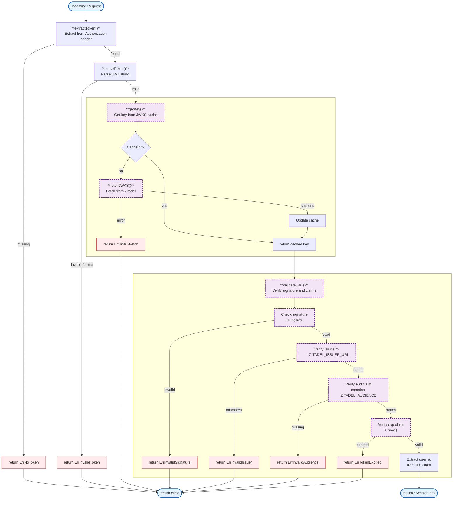

# auth (internal/auth)

**⚠️ PLANNED FEATURES - NOT YET IMPLEMENTED**

This document describes the planned Zitadel JWT authentication system. The current implementation uses an external auth service client - see [`client.go`](../internal/auth/client.go) for the actual code.

**Status:** This is the planned Wave 2 implementation. See [`.claude/plans/auth-billing-migration.md`](../.claude/plans/auth-billing-migration.md) for progress.

---

# Zitadel JWT Validation (Planned)

Zitadel JWT validation and authentication middleware for the gateway. Validates incoming JWTs using Zitadel JWKS (JSON Web Key Sets) and extracts user identity for request authorization.

## Overview

### JWT Validation Flow

## Current Implementation

The gateway currently uses an external auth service for session validation. See [`internal/auth/client.go`](../internal/auth/client.go) for the actual implementation.

### Auth Client (Current)

| Function | Description |
|----------|-------------|
| `NewAuthClient(baseURL, secret, logger)` | Creates auth service client |
| `ValidateSession(ctx, sessionToken)` | Validates session with external auth service |

| Error | Description |
|-------|-------------|
| `ErrSessionInvalid` | Session token invalid |
| `ErrSessionExpired` | Session expired |
| `ErrAuthUnavailable` | Auth service unreachable |
| `ErrInvalidResponse` | Invalid response from auth service |
| `ErrContextCanceled` | Context was canceled |

## Environment Variables (Current)

| Variable | Required | Default | Description |
|----------|----------|---------|-------------|
| `AUTH_SERVICE_URL` | No | `http://localhost:8081` | Auth service URL |
| `AUTH_TIMEOUT` | No | `2s` | Auth request timeout |
| `AUTH_INTERNAL_SECRET` | Yes (prod) | - | Secret for auth service calls |

## Files to be Created (Planned)

| File | Purpose |
|------|---------|
| `internal/auth/jwks.go` | JWKS fetching and JWT validation |
| `internal/auth/middleware.go` | JWT auth middleware |
| `internal/auth/validator.go` | JWT validation logic |

## Files to be Removed (After Migration)

| File | Reason |
|------|--------|
| `internal/auth/client.go` | Replaced by JWKS validation |

## See Also

- [Implementation Plan](../.claude/plans/auth-billing-migration.md) - Full migration details
- [Billing Documentation](billing.md) - RevenueCat webhook integration (partially implemented)
- [Configuration](config.md) - Environment variables
