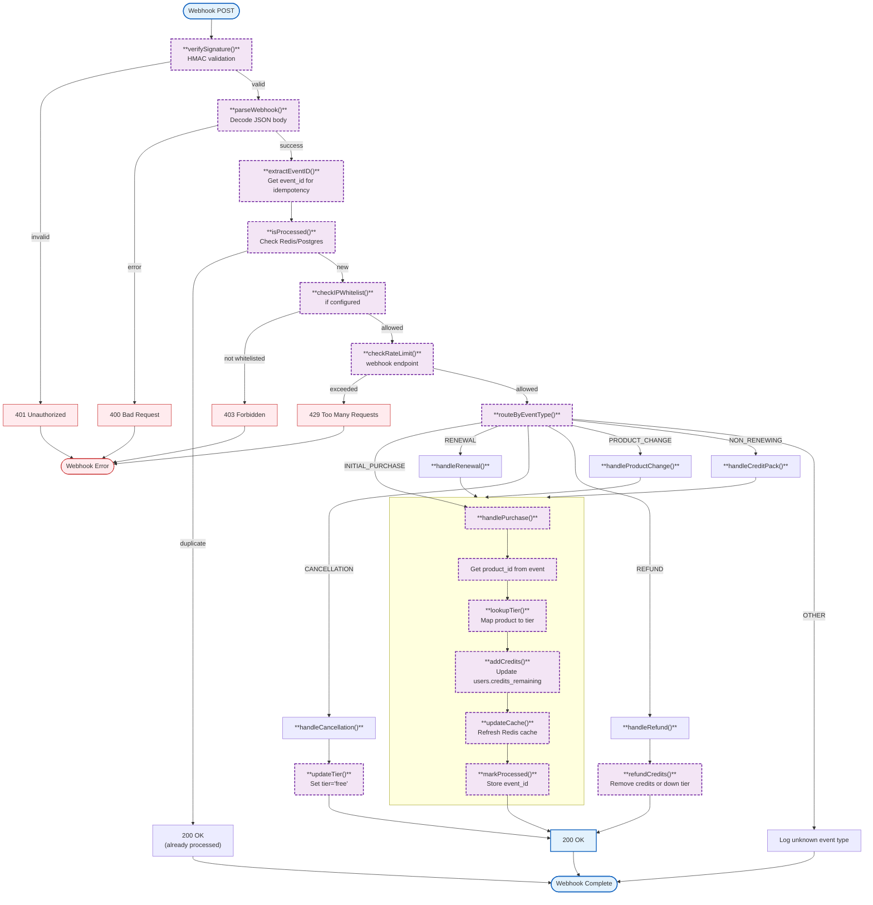

# billing (internal/billing)

RevenueCat webhook handler and credit quota management for the gateway. Processes subscription events, manages user credit balances, and enforces rate limits based on tier.

## Overview

### Webhook Handler Flow

## Implementation Status

| Component | Status | File |
|-----------|--------|------|
| Database migrations | ✅ Complete | `migrations.go` |
| Webhook handler | ✅ Complete | `webhook_impl.go`, `webhook.go` |
| Quota management | ⏳ Stub | `quota.go` (Wave 4 TODO) |

## Variables

| Variable | Type | Description |
|----------|------|-------------|
| `webhookSecret` | `[]byte` | HMAC secret for webhook signature validation |
| `ipWhitelist` | `[]string` | Allowed IP addresses for webhook endpoint |
| `rateLimiter` | `*rate.Limiter` | Rate limiter for webhook endpoint |
| `db` | `*pgx.Conn` | Postgres connection for user/usage data |

## Constants

| Constant | Type | Value | Description |
|----------|------|-------|-------------|
| `TierFree` | int | `0` | Free tier |
| `TierPro` | int | `1` | Pro tier |
| `TierEnterprise` | int | `2` | Enterprise tier |

## Structs

| Struct | Field | Type | Description |
|--------|-------|------|-------------|
| `WebhookHandler` | `db` | `Database` | Database interface for queries |
| | `webhookSecret` | `string` | HMAC secret for verification |
| | `ipWhitelist` | `map[string]bool` | Allowed IPs |
| | `rateLimiter` | `*rate.Limiter` | Rate limiter (60 req/min) |
| `WebhookEvent` | `EventID` | `string` | Unique event identifier |
| | `Type` | `string` | Type of event |
| | `Data` | `EventData` | Event payload |
| `QuotaManager` | `db` | `*pgxpool.Pool` | Database connection pool |

## Error Handling

| Error | HTTP Status | Description |
|-------|-------------|-------------|
| `ErrInvalidSignature` | 401 | Invalid webhook signature |
| `ErrDuplicateEvent` | 200 | Already processed (idempotent) |
| `ErrIPNotAllowed` | 403 | IP not in whitelist |
| `ErrRateLimitExceeded` | 429 | Rate limit exceeded |
| `ErrInsufficientCredits` | 402 | Not enough credits |

## Environment Variables

| Env Var | Required | Default | Description |
|---------|----------|---------|-------------|
| `WEBHOOK_SECRET` | Yes | - | HMAC secret for webhook verification |
| `WEBHOOK_IP_WHITELIST` | No | - | Comma-separated allowed IPs |
| `DATABASE_URL` | Yes | - | PostgreSQL connection string |
| `TEST_DATABASE_URL` | No | - | Test database URL |

## Database Schema

### users Table

| Column | Type | Constraints |
|--------|------|-------------|
| `id` | TEXT | PRIMARY KEY |
| `email` | TEXT | - |
| `tier` | INTEGER | NOT NULL, DEFAULT 0, CHECK (tier IN (0,1,2)) |
| `credits_remaining` | NUMERIC(10,2) | NOT NULL, DEFAULT 0 |
| `subscription_tier` | TEXT | DEFAULT 'free' |
| `subscription_status` | TEXT | DEFAULT 'active' |
| `billing_period_start` | INTEGER | - |
| `billing_period_end` | INTEGER | - |
| `revenuecat_customer_id` | TEXT | - |
| `created_at` | INTEGER | NOT NULL |
| `updated_at` | INTEGER | NOT NULL |

### usage_logs Table

| Column | Type | Constraints |
|--------|------|-------------|
| `id` | BIGSERIAL | PRIMARY KEY |
| `user_id` | TEXT | NOT NULL, FK → users(id) |
| `agent_id` | TEXT | NOT NULL |
| `tokens_used` | INTEGER | NOT NULL |
| `credit_cost` | NUMERIC(10,4) | NOT NULL |
| `timestamp` | TIMESTAMPTZ | NOT NULL, DEFAULT NOW() |

### processed_webhooks Table

| Column | Type | Constraints |
|--------|------|-------------|
| `event_id` | TEXT | PRIMARY KEY |
| `processed_at` | INTEGER | NOT NULL |
| `event_type` | TEXT | NOT NULL |

### Indexes

| Index | Table | Columns |
|-------|-------|--------|
| `idx_users_tier` | users | tier |
| `idx_users_updated_at` | users | updated_at |
| `idx_users_email` | users | email |
| `idx_users_revenuecat_customer_id` | users | revenuecat_customer_id |
| `idx_usage_logs_user_id` | usage_logs | user_id |
| `idx_usage_logs_agent_id` | usage_logs | agent_id |
| `idx_usage_logs_timestamp` | usage_logs | timestamp |
| `idx_usage_logs_user_timestamp` | usage_logs | (user_id, timestamp DESC) |
| `idx_processed_webhooks_processed_at` | processed_webhooks | processed_at |
| `idx_processed_webhooks_event_type` | processed_webhooks | event_type |

### Foreign Key

| Constraint | Table | Reference |
|------------|-------|----------|
| `usage_logs_user_id_fkey` | usage_logs | users(id) ON DELETE CASCADE |

## Product ID to Tier Mapping

| Product ID | Tier | Credits |
|------------|------|---------|
| `com.nevaria.basic` | Free (0) | 100.0 |
| `com.nevaria.pro` | Pro (1) | 500.0 |
| `com.nevaria.enterprise` | Enterprise (2) | 2000.0 |

## Files

| File | Purpose |
|------|---------|
| [`migrations.go`](../internal/billing/migrations.go) | Database migrations |
| [`webhook.go`](../internal/billing/webhook.go) | HMAC signature verification |
| [`webhook_impl.go`](../internal/billing/webhook_impl.go) | Webhook HTTP handler |
| [`quota.go`](../internal/billing/quota.go) | Quota manager (stub) |

## See Also

- [Implementation Plan](../.claude/plans/auth-billing-migration.md) - Migration details
- [Configuration](config.md) - Environment variables
