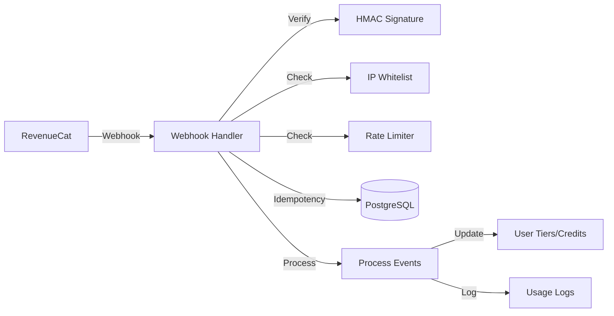

# billing (internal/billing)

**⚠️ PLANNED FEATURES - NOT YET IMPLEMENTED**

This document describes the planned RevenueCat billing integration. The current implementation does not have this package.

**Status:** This is the planned Wave 3-4 implementation. See [`.claude/plans/auth-billing-migration.md`](../.claude/plans/auth-billing-migration.md) for progress.

---

# RevenueCat Billing Integration (Planned)

Credit-based usage tracking and RevenueCat webhook integration for tier-based access control.

## Implementation Status

| Component | Status |
|-----------|--------|
| Database migrations | ⏳ TODO - `internal/billing/migrations.go` |
| Webhook handler | ⏳ TODO - `internal/billing/webhook_impl.go` |
| Quota management | ⏳ TODO - `internal/billing/quota.go` |
| Migration command | ⏳ TODO - `cmd/migrate/main.go` |

## Overview

## Planned Database Schema

### users Table

| Column | Type | Constraints |
|--------|------|-------------|
| `user_id` | TEXT | PRIMARY KEY |
| `tier` | INTEGER | NOT NULL, CHECK (tier >= 0 AND tier <= 2) |
| `credits_remaining` | NUMERIC(10,2) | NOT NULL, CHECK (credits_remaining >= 0) |
| `created_at` | TIMESTAMPTZ | NOT NULL, DEFAULT NOW() |
| `updated_at` | TIMESTAMPTZ | NOT NULL, DEFAULT NOW() |

### usage_logs Table

| Column | Type | Constraints |
|--------|------|-------------|
| `id` | BIGSERIAL | PRIMARY KEY |
| `user_id` | TEXT | NOT NULL, FOREIGN KEY → users(user_id) |
| `agent_id` | TEXT | NOT NULL |
| `tokens_used` | INTEGER | NOT NULL |
| `credit_cost` | NUMERIC(10,4) | NOT NULL |
| `timestamp` | TIMESTAMPTZ | NOT NULL, DEFAULT NOW() |

### processed_webhooks Table

| Column | Type | Constraints |
|--------|------|-------------|
| `event_id` | TEXT | PRIMARY KEY |
| `processed_at` | TIMESTAMPTZ | NOT NULL, DEFAULT NOW() |
| `event_type` | TEXT | NOT NULL |

## Planned Environment Variables

| Env Var | Description | Required |
|---------|-------------|----------|
| `WEBHOOK_SECRET` | RevenueCat webhook secret for HMAC verification | Yes |
| `WEBHOOK_IP_WHITELIST` | Comma-separated allowed IPs for webhooks | No |
| `DATABASE_URL` | PostgreSQL connection string | Yes |
| `TEST_DATABASE_URL` | Test database URL for integration tests | No |

## Tier Structure

| Tier | Value | Agent Limit | Cron Limit |
|------|-------|-------------|------------|
| Free | 0 | 1 | 0 |
| Pro | 1 | 5 | 10 |
| Enterprise | 2 | unlimited | unlimited |

## Files to be Created

| File | Purpose |
|------|---------|
| `internal/billing/migrations.go` | Database schema and migrations |
| `internal/billing/webhook_impl.go` | Webhook handler implementation |
| `internal/billing/quota.go` | Quota and rate limiting |
| `cmd/migrate/main.go` | Standalone migration binary |

## Webhook Events to Handle

| Event Type | Description |
|------------|-------------|
| `INITIAL_PURCHASE` | First-time subscription purchase |
| `RENEWAL` | Subscription renewal |
| `CANCELLATION` | Subscription cancellation |
| `REFUND` | Purchase refund |
| `PRODUCT_CHANGE` | Plan upgrade/downgrade |

## Security Features (Planned)

1. **HMAC Signature Verification** - SHA256 HMAC using shared secret
2. **IP Whitelisting** - Optional IP-based access control
3. **Rate Limiting** - 60 requests/minute per IP
4. **Idempotency** - Duplicate events are detected and ignored

## See Also

- [Implementation Plan](../.claude/plans/auth-billing-migration.md) - Full migration details
- [Auth Documentation](auth.md) - Planned Zitadel authentication
- [Configuration](config.md) - Environment variables
