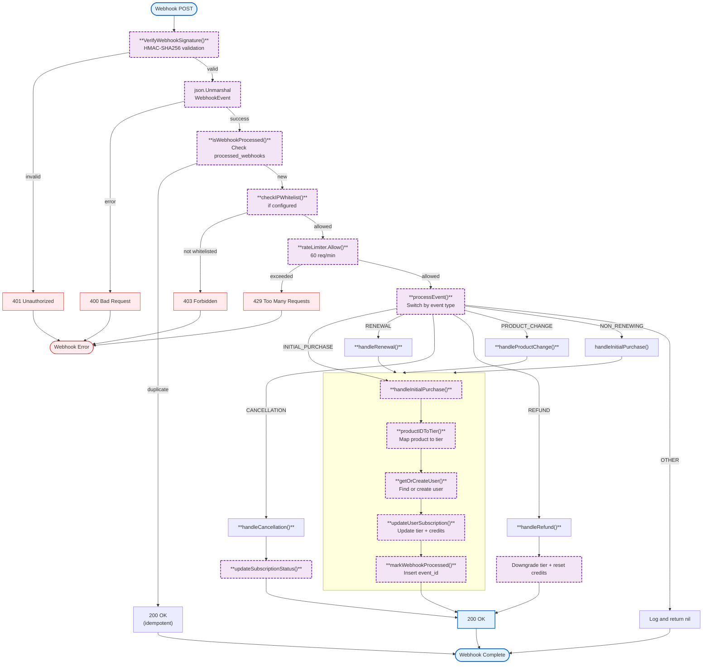
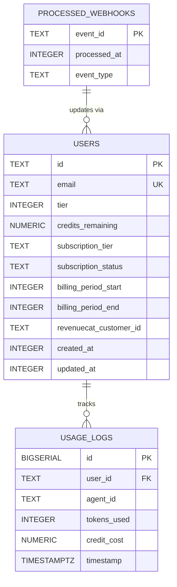

# billing (internal/billing)

RevenueCat webhook handler and database migrations for billing and usage tracking. Processes subscription events, manages user credit balances, and enforces idempotency.

## Overview



### Variables

| Variable | Type | Description |
|----------|------|-------------|
| N/A | - | This package has no package-level variables. |

### Constants

| Constant | Type | Value | Description |
|----------|------|-------|-------------|
| `TierFree` | int | `0` | Free tier subscription level |
| `TierPro` | int | `1` | Pro tier subscription level |
| `TierEnterprise` | int | `2` | Enterprise tier subscription level |
| `CreditsBasic` | float64 | `100.0` | Credits allocated for basic tier |
| `CreditsPro` | float64 | `500.0` | Credits allocated for pro tier |
| `CreditsEnterprise` | float64 | `2000.0` | Credits allocated for enterprise tier |

### Structs

| Struct | Field | Type | Description |
|--------|-------|------|-------------|
| `WebhookHandler` | `db` | `Database` | Database interface for queries |
| | `webhookSecret` | `string` | HMAC secret for webhook verification |
| | `ipWhitelist` | `map[string]bool` | Allowed IP addresses for webhooks |
| | `rateLimiter` | `*rate.Limiter` | Rate limiter (60 req/min) |
| | `logger` | `zerolog.Logger` | Structured logger instance |
| `WebhookEvent` | `EventID` | `string` | Unique event identifier |
| | `Type` | `string` | Event type (INITIAL_PURCHASE, etc.) |
| | `Data` | `EventData` | Event payload data |
| `EventData` | `ProductID` | `string` | RevenueCat product identifier |
| | `CustomerInfo` | `CustomerInfo` | Customer information |
| | `Transaction` | `Transaction` | Transaction details (for refunds) |
| `CustomerInfo` | `AppUserID` | `string` | RevenueCat customer user ID |
| | `Email` | `string` | Customer email address |
| `Transaction` | `Amount` | `float64` | Transaction amount (for refunds) |
| `QuotaManager` | `db` | `*pgxpool.Pool` | Database connection pool (stub) |
| `Migration` | `Name` | `string` | Migration identifier |
| | `SQL` | `string` | SQL statement to execute |
| `MigrationResult` | `MigrationName` | `string` | Name of the migration |
| | `AlreadyExists` | `bool` | Whether migration was already applied |
| | `Error` | `error` | Any error from checking migration |

### Functions

| Function | Signature | Description |
|----------|-----------|-------------|
| `NewWebhookHandler` | `(db Database, webhookSecret string, ipWhitelist []string) *WebhookHandler` | Creates a new webhook handler |
| `NewQuotaManager` | `(db *pgxpool.Pool) *QuotaManager` | Creates a new quota manager (stub) |
| `VerifyWebhookSignature` | `(payload []byte, signature, secret string) error` | Verifies HMAC-SHA256 webhook signature |
| `RunMigrations` | `(ctx context.Context, dbURL string) error` | Runs all database migrations |
| `CheckMigrations` | `(ctx context.Context, dbURL string) ([]MigrationResult, error)` | Checks migration status |
| `RunMigrationsWithPool` | `(ctx context.Context, pool *pgxpool.Pool) error` | Runs migrations with existing pool |
| `WebhookHandler.HandleWebhook` | `(w http.ResponseWriter, r *http.Request)` | Handles incoming webhook HTTP requests |
| `WebhookHandler.SetLogger` | `(logger zerolog.Logger)` | Sets the logger instance |
| `WebhookHandler.UpdateIPWhitelist` | `(ips []string)` | Updates the IP whitelist at runtime |
| `QuotaManager.CheckQuota` | `(ctx context.Context, userID string, creditsNeeded float64) error` | Checks if user has sufficient credits (stub) |
| `QuotaManager.ReserveCredit` | `(ctx context.Context, userID string, amount float64) error` | Reserves credits for an operation (stub) |
| `QuotaManager.DeductCredit` | `(ctx context.Context, userID string, agentID string, tokensUsed int, creditCost float64) error` | Deducts credits after LLM operation (stub) |

### Error Handling

| Error | HTTP Status | Description |
|-------|-------------|-------------|
| Invalid signature | 401 | HMAC verification failed |
| Duplicate event | 200 | Already processed (idempotent) |
| IP not allowed | 403 | IP not in whitelist (if configured) |
| Rate limit exceeded | 429 | More than 60 requests/minute |
| Invalid JSON | 400 | Malformed webhook payload |
| Processing failed | 500 | Database or processing error |

<!--### Embedded Files-->

<!-- N/A - This package does not embed any files. -->

### Environment Variables

| Variable | Required | Default | Description |
|----------|----------|---------|-------------|
| `WEBHOOK_SECRET` | Yes* | - | HMAC secret for RevenueCat webhook verification |
| `WEBHOOK_IP_WHITELIST` | No | - | Comma-separated allowed webhook source IPs |
| `DATABASE_URL` | Yes* | - | PostgreSQL connection string for billing data |
| `TEST_DATABASE_URL` | No | - | Test database URL (defaults to localhost:5433) |

\* Required when billing features are enabled

## Database Schema



### Relationships

| Relationship | Type | Description |
|--------------|------|-------------|
| `users` → `usage_logs` | 1:N | One user can have many usage log entries |
| `processed_webhooks` → `users` | Logical | Webhooks update user billing via RevenueCat events |

### Cascade Behavior

| Table | On Delete | Behavior |
|-------|-----------|----------|
| `usage_logs` | CASCADE | Deleted when user is deleted |
| `processed_webhooks` | None | Standalone deduplication table |

### Key Constraints

| Table | Constraints |
|-------|-------------|
| `users` | `CHECK (tier IN (0, 1, 2))` |
| `usage_logs` | FOREIGN KEY `(user_id) REFERENCES users(id) ON DELETE CASCADE` |
| `processed_webhooks` | PRIMARY KEY `(event_id)` |

### Idempotency

All migrations use `IF NOT EXISTS` / `IF NOT EXISTS` clauses for safe re-execution. Webhook processing uses `processed_webhooks` table to deduplicate events.

```sql
INSERT INTO processed_webhooks (event_id, event_type, processed_at)
VALUES ($1, $2, $3)
ON CONFLICT (event_id) DO NOTHING
```

## Design Notes

### Quota Manager Stub

**Q: Why is QuotaManager a stub?**

**A:** The quota manager is planned for Wave 4 of the implementation. The current implementation focuses on database migrations and webhook handling for revenue events.

| Aspect | Description |
|--------|-------------|
| Context | Credit quota enforcement and usage tracking |
| Status | Stub with TODO comments for Wave 4 |
| Planned features | Period-based rate limiting, Redis caching, credit reservation |

**Current stub provides:**
- `QuotaManager` struct with database pool
- `NewQuotaManager()` constructor
- Method stubs with TODO comments: `CheckQuota()`, `ReserveCredit()`, `DeductCredit()`

**Planned implementation (Wave 4):**
- 6-hour rolling window rate limits with 10% buffer
- Redis caching for performance
- Tier-based limits (agent count, cron job count)
- Credit reservation and refund mechanism

### Webhook IP Whitelist Optional

**Q: Why is IP whitelist optional?**

**A:** Development environments may not have fixed IPs. Production should configure whitelist for security.

| Aspect | Description |
|--------|-------------|
| Context | Webhook endpoint security |
| Options considered | Required whitelist, optional whitelist, no whitelist |
| Rationale | Optional allows development flexibility while production can enable |

**Current approach is recommended because:**
- Empty whitelist allows all IPs (convenient for development)
- Production can configure explicit whitelist for security
- Follows security-by-default for production operations

### Product ID to Tier Mapping

**Q: Why use product ID strings instead of enum?**

**A:** RevenueCat uses string product IDs. Mapping them to internal tiers allows flexibility in product naming.

| Product ID | Tier | Credits |
|------------|------|---------|
| `com.nevaria.basic` | Free (0) | 100.0 |
| `com.nevaria.pro` | Pro (1) | 500.0 |
| `com.nevaria.enterprise` | Enterprise (2) | 2000.0 |

**Current approach is recommended because:**
- Decouples RevenueCat product naming from internal tier system
- Easy to add new products without code changes
- Clear mapping in one place (`productIDToTier()`)

## Test Coverage

For general testing patterns, see [gateway testing practices](../README.md#testing).

### Unit Tests (`webhook_test.go`)

White box tests for HMAC signature verification. No external dependencies.

| Test Suite | Coverage |
|------------|----------|
| `TestVerifyWebhookSignature` | Valid/invalid signatures, empty inputs, tampered payloads |
| `TestVerifyWebhookSignature_TimingSafeComparison` | Verifies timing-safe comparison |

### Unit Tests (`webhook_impl_test.go`)

White box tests for webhook handler. No external dependencies.

| Test Suite | Coverage |
|------------|----------|
| `TestNewWebhookHandler` | Constructor with various IP whitelist configs |
| `TestWebhookHandler_SetLogger` | Logger configuration |
| `TestWebhookHandler_UpdateIPWhitelist` | Runtime IP whitelist updates |
| `TestProductIDToTier` | Product ID to tier/credits mapping |
| `TestNetSplitHostPort` | IPv4/IPv6 address parsing |
| `TestWebhookHandler_HandleWebhook_MethodNotAllowed` | HTTP method validation |
| `TestWebhookHandler_HandleWebhook_IPWhitelist` | IP whitelist enforcement |
| `TestWebhookHandler_HandleWebhook_InvalidSignature` | Signature validation |
| `TestWebhookHandler_HandleWebhook_InvalidJSON` | JSON parsing errors |
| `TestWebhookHandler_HandleWebhook_EmptyBody` | Empty body handling |
| `TestWebhookHandler_checkIPWhitelist` | IP whitelist check logic |
| `TestWebhookHandler_writeJSON` | JSON response helper |
| `TestWebhookHandler_writeError` | Error response helper |
| `TestWebhookHandler_HandleWebhook_ReadBodyError` | Body read error handling |
| `TestWebhookEvent_JSONRoundTrip` | JSON serialization/deserialization |
| `TestCreditsConstants` | Credit constant values |
| `TestTierConstants` | Tier constant values |

### Integration Tests (`migrations_test.go`)

Tests that require PostgreSQL database. Run with `//go:build integration` tag.

| Test Suite | Coverage |
|------------|----------|
| `TestRunMigrations_CreatesUsersTable` | Table creation, columns, check constraint |
| `TestRunMigrations_CreatesUsageLogsTable` | Table creation, foreign key |
| `TestRunMigrations_CreatesProcessedWebhooksTable` | Table creation |
| `TestRunMigrations_CreatesIndexes` | All indexes created correctly |
| `TestRunMigrations_IsIdempotent` | Migrations can run multiple times safely |
| `TestRunMigrations_WithExistingData` | Data preservation across migrations |
| `TestCheckMigrations` | Migration status checking |
| `TestRunMigrationsWithPool` | Using existing connection pool |
| `TestRunMigrations_InvalidURL` | Error handling for invalid URL |
| `TestRunMigrationsWithPool_NilPool` | Error handling for nil pool |

**Running:**
```bash
# Unit tests only (no database required)
CGO_ENABLED=1 make test TEST_PATH=./internal/billing

# Integration tests (requires PostgreSQL)
docker compose -f tests/docker-compose.test.yml up -d --wait
make test-integration TEST_PATH=./internal/billing
```

### Dependencies and Location

| Package | Version | Purpose |
|---------|---------|---------|
| `github.com/jackc/pgx/v5` | v5 | PostgreSQL driver with connection pooling |
| `github.com/rs/zerolog` | latest | Structured logging |
| `golang.org/x/time/rate` | latest | Rate limiting for webhook endpoint |

**File Locations:**
- [`internal/billing/migrations.go`](../internal/billing/migrations.go) - Database migrations
- [`internal/billing/webhook.go`](../internal/billing/webhook.go) - HMAC signature verification
- [`internal/billing/webhook_impl.go`](../internal/billing/webhook_impl.go) - Webhook HTTP handler
- [`internal/billing/quota.go`](../internal/billing/quota.go) - Quota manager (stub - Wave 4)
- [`internal/billing/webhook_test.go`](../internal/billing/webhook_test.go) - Signature verification tests
- [`internal/billing/webhook_impl_test.go`](../internal/billing/webhook_impl_test.go) - Handler unit tests
- [`internal/billing/migrations_test.go`](../internal/billing/migrations_test.go) - Migration integration tests

## See Also

- [Configuration](config.md) - Environment variables for billing
- [Implementation Plan](../.claude/plans/auth-billing-migration.md) - Wave 4 quota manager details
