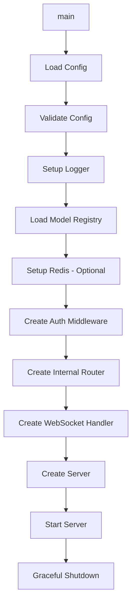

# Gateway Command

Application entry point and service initialization.

## Overview

## Purpose

The main package initializes all components and starts the HTTP server with:

- Configuration loading and validation
- Model registry initialization
- Redis client setup (optional)
- Auth middleware with session caching
- Internal router for service endpoints
- WebSocket handler with agent management
- Graceful shutdown handling

## Initialization Sequence

1. **Load Config** - Load and validate configuration from environment
2. **Setup Logger** - Configure zerolog with requested level
3. **Model Registry** - Load model configuration from YAML
4. **Redis Client** - Create Redis client if configured
5. **Auth Middleware** - Create session validation middleware with cache
6. **Internal Router** - Create internal router with Bearer auth
7. **WebSocket Handler** - Create handler with agent manager
8. **Create Server** - Wire all components together
9. **Start** - Block until shutdown signal
10. **Graceful Shutdown** - Clean shutdown with timeout

## Configuration

| Environment Variable | Default | Description |
|---------------------|---------|-------------|
| `GATEWAY_ADDR` | `:8080` | Server bind address |
| `GATEWAY_LOG_LEVEL` | `info` | Log level |
| `GATEWAY_ALLOWED_ORIGINS` | empty | Comma-separated CORS origins |
| `GATEWAY_MAX_CONNS` | `10000` | Max concurrent connections |
| `AUTH_SERVICE_URL` | `http://localhost:8081` | Auth service URL |
| `AUTH_TIMEOUT` | `2s` | Auth request timeout |
| `AUTH_INTERNAL_SECRET` | (required) | Secret for auth service |
| `INTERNAL_SECRET` | (required) | Gateway internal secret |
| `REDIS_ADDR` | (optional) | Redis server address |
| `REDIS_PASSWORD` | (optional) | Redis password |
| `GATEWAY_MODEL_CONFIG` | `config/models.yaml` | Model configuration path |

## Endpoints

| Path | Method | Auth | Description |
|------|--------|------|-------------|
| `/health` | GET, HEAD | None | Health check |
| `/ws` | GET | Session cookie | WebSocket connection |
| `/_internal/*` | * | Bearer token | Internal service endpoints |

## File Locations

- [`cmd/gateway/main.go`](../cmd/gateway/main.go) - Main entry point
