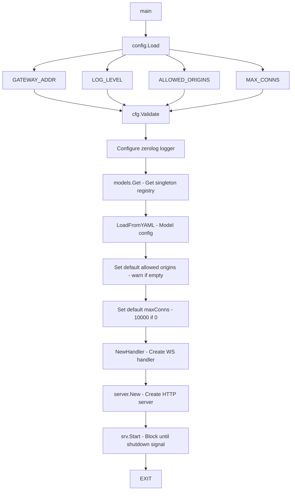

# cmd/gateway

Application entry point and service initialization.

## Description

The main package initializes all components and starts the HTTP server. It loads configuration from environment variables, initializes the model registry, sets up the WebSocket handler, and manages graceful shutdown.

## Initialization Flow

## Functions

| Name | Kind | Location | Description |
|------|------|----------|-------------|
| main | func | [main.go#L14](../cmd/gateway/main.go#L14) | Complete initialization flow |

## Configuration

| Environment Variable | Default | Description |
|----------------------|---------|-------------|
| `GATEWAY_ADDR` | `:8080` | Server bind address |
| `GATEWAY_LOG_LEVEL` | `info` | Log level (trace, debug, info, warn, error) |
| `GATEWAY_ALLOWED_ORIGINS` | empty | Comma-separated list of allowed WebSocket origins |
| `GATEWAY_MAX_CONNS` | `10000` | Maximum concurrent WebSocket connections |
| `GATEWAY_MODEL_CONFIG` | `config/models.yaml` | Path to model configuration file |
