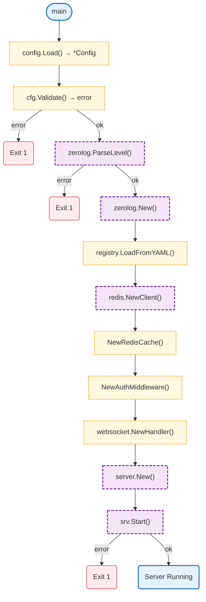

# Gateway Command

Gateway application entry point. Initializes configuration, logger, model registry, Redis client, and starts the HTTP/WebSocket server.

## Overview

## Variables

| Variable | Type | Description |
|----------|------|-------------|
| `cfg` | `*config.Config` | Loaded configuration |
| `logger` | `zerolog.Logger` | Configured logger |
| `registry` | `*models.Registry` | LLM model registry |
| `redisClient` | `*redis.Client` | Redis client (required) |
| `cache` | `server.Cache` | Session cache adapter |
| `authMW` | `*server.AuthMiddleware` | Auth middleware |
| `wsHandler` | `*websocket.Handler` | WebSocket handler |
| `srv` | `*server.Server` | HTTP server |

## Error Handling

| Error Type | Handler | Exit Code / Behavior |
|------------|---------|---------------------|
| Config load error | `fmt.Fprintf(os.Stderr)` | Exit 1 |
| Config validation error | `fmt.Fprintf(os.Stderr)` | Exit 1 |
| Invalid log level | `fmt.Fprintf(os.Stderr)` | Exit 1 |
| Server start error | `logger.Error()` | Exit 1 |

## Environment Variables

| Variable | Required | Default | Description |
|----------|----------|---------|-------------|
| `GATEWAY_MODEL_CONFIG` | No | `config/models.yaml` | Model config path |

See [Config README](../config/README.md) for full environment variable list.

## Design Notes

### Default Connection Limit

**Q: Why default to 10000 connections?**

| Aspect | Description |
|--------|-------------|
| Context | WebSocket connection limits |
| Options considered | 1000, 10000, unlimited |
| Rationale | 10000 provides reasonable capacity while preventing resource exhaustion |

**Current approach is recommended because:**
- Handles typical traffic spikes
- Leaves room for other processes
- Prevents accidental resource exhaustion
- Can be configured for specific deployments

### Warning on Missing Origins

**Q: Why warn instead of fail on missing GATEWAY_ALLOWED_ORIGINS?**

| Aspect | Description |
|--------|-------------|
| Context | CORS configuration |
| Options considered | Fail, Warn + allow all, Deny all |
| Rationale | Development convenience with production safety via warnings |

**Current approach is recommended because:**
- Developers can start quickly locally
- Warning ensures production deployments are configured
- Consistent with security best practices
- Easy to fix when warning appears in logs

## Test Coverage

This package has no unit tests. Integration tests cover the server startup.

## Dependencies and Location

| Package | Purpose |
|---------|---------|
| `github.com/rs/zerolog` | Structured logging |
| `github.com/redis/go-redis/v9` | Redis client |
| `github.com/nevaria-ai/gateway/config` | Configuration |
| `github.com/nevaria-ai/gateway/internal/llm-proxy/models` | Model registry |
| `github.com/nevaria-ai/gateway/internal/server` | HTTP server |
| `github.com/nevaria-ai/gateway/internal/websocket` | WebSocket handler |

**File Location:** [`cmd/gateway/main.go`](https://github.com/nevaria-ai/gateway/blob/main/cmd/gateway/main.go)
