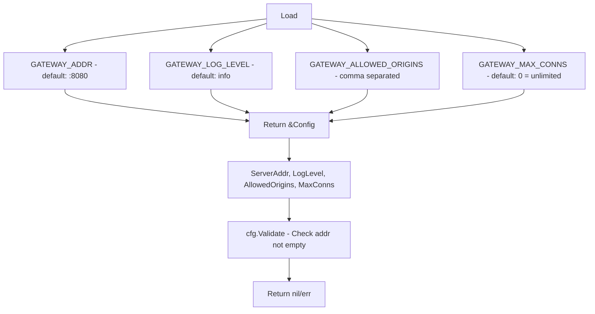

# internal/config

Environment-based configuration loading.

## Description

The config package loads application configuration from environment variables. It provides type-safe access to configuration values with validation.

## Config Loading Flow

## Types and Functions

| Name | Kind | Location | Description |
|------|------|----------|-------------|
| Config | struct | [config.go#L11](../internal/config/config.go#L11) | Configuration struct definition |
| Load | func | [config.go#L19](../internal/config/config.go#L19) | Reads from environment |
| Validate | func | [config.go#L63](../internal/config/config.go#L63) | Checks required fields |

## Configuration Fields

| Field | Type | Default | Description |
|-------|------|---------|-------------|
| `ServerAddr` | string | `:8080` | HTTP server bind address |
| `LogLevel` | string | `info` | Logging level |
| `AllowedOrigins` | []string | empty | WebSocket allowed origins |
| `MaxConns` | int | `0` (unlimited) | Max concurrent connections |
