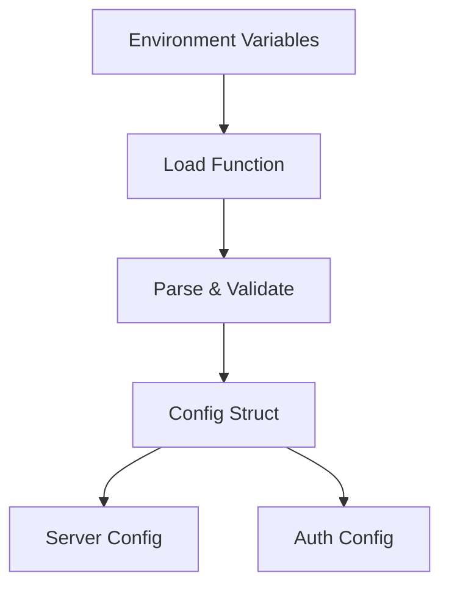

# Config Package

Centralized configuration management for the gateway application with environment variable parsing, defaults, and validation.

## Overview



## Purpose

The config package loads and validates all application configuration from environment variables. It provides:

- Server settings (address, logging, CORS, connection limits)
- Authentication service configuration
- Redis connection settings
- Production environment validation

## Types

### Config

```go
type Config struct {
    ServerAddr    string
    LogLevel      string
    AllowedOrigins []string
    MaxConns      int
    Auth          AuthConfig
    RedisAddr     string
    RedisPassword string
}
```

| Field | Type | Description |
|-------|------|-------------|
| `ServerAddr` | string | HTTP server bind address |
| `LogLevel` | string | Logging level (debug, info, warn, error) |
| `AllowedOrigins` | []string | CORS allowed origins for WebSocket |
| `MaxConns` | int | Max concurrent WebSocket connections (0 = unlimited) |
| `Auth` | AuthConfig | Authentication service configuration |
| `RedisAddr` | string | Redis server address (optional) |
| `RedisPassword` | string | Redis password (optional) |

### AuthConfig

```go
type AuthConfig struct {
    URL             string
    Timeout         time.Duration
    AuthInternalSecret string
    InternalSecret  string
}
```

| Field | Type | Description |
|-------|------|-------------|
| `URL` | string | Auth service base URL |
| `Timeout` | time.Duration | Auth request timeout |
| `AuthInternalSecret` | string | Secret for calling auth service |
| `InternalSecret` | string | Gateway's internal secret for /_internal/* endpoints |

## Functions

| Function | Description |
|----------|-------------|
| `Load() (*Config, error)` | Loads configuration from environment variables |
| `Validate() error` | Validates configuration (production requirements) |

## Configuration

| Environment Variable | Description | Default |
|---------------------|-------------|---------|
| `GATEWAY_ADDR` | Server bind address | `:8080` |
| `GATEWAY_LOG_LEVEL` | Logging level | `info` |
| `GATEWAY_ALLOWED_ORIGINS` | Comma-separated CORS origins | (empty = deny all) |
| `GATEWAY_MAX_CONNS` | Max concurrent connections | `0` (unlimited) |
| `AUTH_SERVICE_URL` | Auth service URL | `http://localhost:8081` |
| `AUTH_TIMEOUT` | Auth request timeout | `2s` |
| `AUTH_INTERNAL_SECRET` | Secret for auth service calls | (required in prod) |
| `INTERNAL_SECRET` | Gateway internal secret (min 16 chars) | (required in prod) |
| `REDIS_ADDR` | Redis server address | (optional) |
| `REDIS_PASSWORD` | Redis password | (optional) |

## Validation Rules

### Production Environment (when `GATEWAY_ADDR` contains public host)

- `AllowedOrigins` must be non-empty
- `InternalSecret` must be at least 16 characters

### URL Format

- `AuthServiceURL` must be a valid URL

## File Locations

- [`config/config.go`](../config/config.go) - Main configuration
- [`config/auth.go`](../config/auth.go) - Auth configuration
- [`config/config_test.go`](../config/config_test.go) - Tests

## Example Configuration

```bash
# Development
export GATEWAY_ADDR=":8080"
export GATEWAY_LOG_LEVEL="debug"
export GATEWAY_ALLOWED_ORIGINS="http://localhost:3000,http://localhost:5173"
export AUTH_SERVICE_URL="http://localhost:8081"
export INTERNAL_SECRET="dev-secret-key-12345"

# Production
export GATEWAY_ADDR="0.0.0.0:8080"
export GATEWAY_ALLOWED_ORIGINS="https://app.example.com"
export AUTH_SERVICE_URL="http://auth-service:8081"
export AUTH_INTERNAL_SECRET="${AUTH_SERVICE_SECRET}"
export INTERNAL_SECRET="${RANDOM_SECRET_MIN_16_CHARS}"
export REDIS_ADDR="redis:6379"
```
