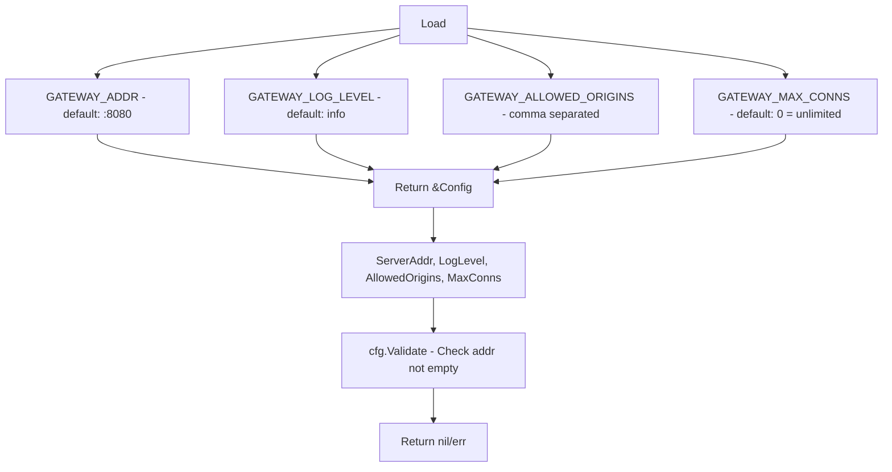
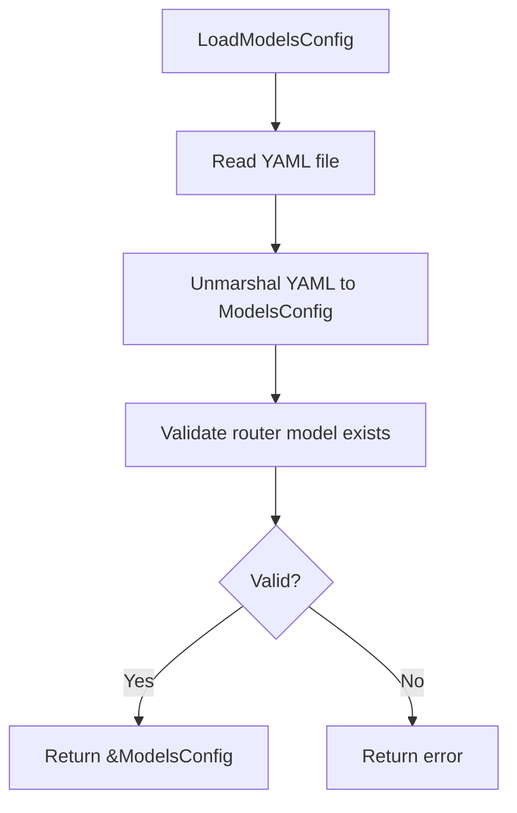
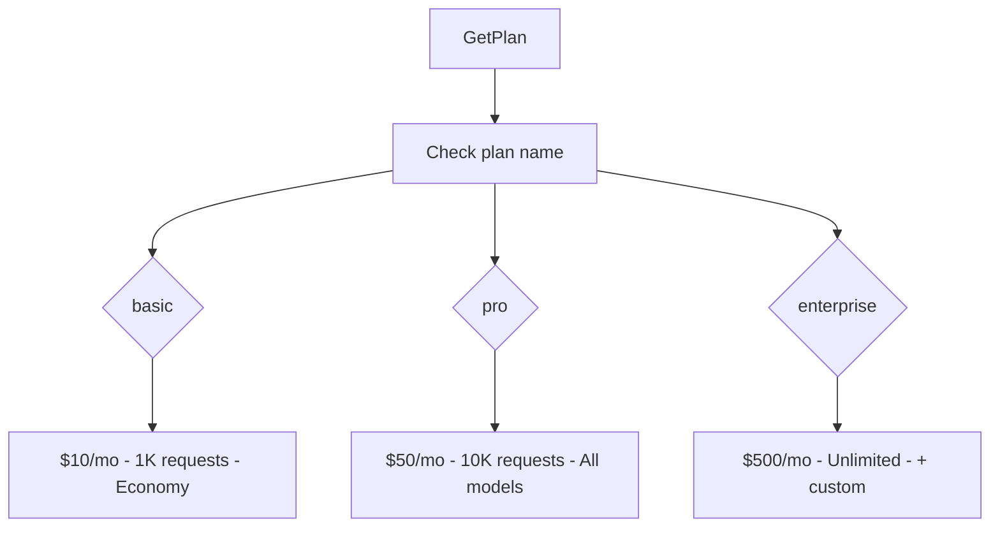

# config

Configuration loading for the gateway.

## Description

The config package provides:
- Environment-based configuration for server settings
- Model and router configuration loading from YAML files
- Subscription plan definitions with LLM credit allowances

## Server Configuration

### Config Loading Flow

### Server Configuration Fields

| Field | Type | Default | Description |
|-------|------|---------|-------------|
| `ServerAddr` | string | `:8080` | HTTP server bind address |
| `LogLevel` | string | `info` | Logging level |
| `AllowedOrigins` | []string | empty | WebSocket allowed origins |
| `MaxConns` | int | `0` (unlimited) | Max concurrent connections |

## Models Configuration

### Models Config Loading Flow

### Model Config Fields

| Field | Type | Description |
|-------|------|-------------|
| `provider` | string | LLM provider name |
| `input_cost_per_million` | float64 | Input token cost per million |
| `output_cost_per_million` | float64 | Output token cost per million |
| `max_tokens` | int | Maximum tokens for model |
| `tier` | string | Model tier (economy, premium, ultra) |

### Router Config Fields

| Field | Type | Description |
|-------|------|-------------|
| `model` | string | Default router model name |
| `timeout` | string | Request timeout duration |
| `max_retries` | int | Maximum retry attempts |

## Subscription Plans

### Plan Lookup Flow

### Available Plans

| Plan | Monthly Credits | Max Requests | Features |
|------|-----------------|--------------|----------|
| `basic` | $10.00 | 1,000 | economy_models, basic_routing |
| `pro` | $50.00 | 10,000 | all_models, smart_routing, priority_queue |
| `enterprise` | $500.00 | Unlimited | All features + custom_models, dedicated_support |

## Types and Functions

| Name | Kind | Location | Description |
|------|------|----------|-------------|
| Config | struct | [config.go#L11](../config/config.go#L11) | Server configuration struct |
| Load | func | [config.go#L19](../config/config.go#L19) | Loads server config from environment |
| Validate | func | [config.go#L63](../config/config.go#L63) | Validates server config |
| ModelConfig | struct | [models.go#L9](../config/models.go#L9) | Model configuration |
| RouterConfig | struct | [models.go#L15](../config/models.go#L15) | Router configuration |
| ModelsConfig | struct | [models.go#L21](../config/models.go#L21) | Models and router configuration |
| LoadModelsConfig | func | [models.go#L27](../config/models.go#L27) | Loads models config from YAML |
| Plan | struct | [plans.go#L7](../config/plans.go#L7) | Subscription plan |
| GetPlan | func | [plans.go#L42](../config/plans.go#L42) | Gets plan by name |
| GetAllPlans | func | [plans.go#L48](../config/plans.go#L48) | Returns all plans |
| HasFeature | func | [plans.go#L66](../config/plans.go#L66) | Checks plan feature |
