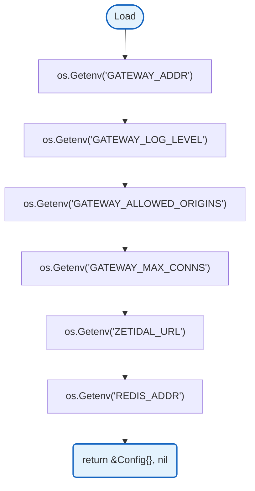
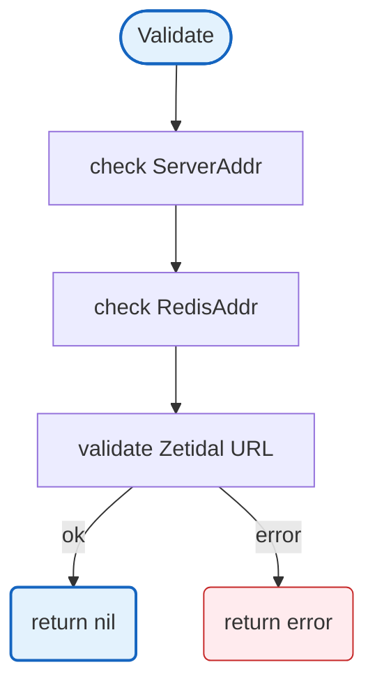

# Config

Centralized environment-based configuration loading for the gateway application. Provides typed configuration structs with environment variable binding, validation, and logger initialization.

## Overview

### Load



### Validate



## Structs

### Config

| Struct | Field | Type | Description |
|--------|-------|------|-------------|
| `Config` | `ServerAddr` | `string` | Server bind address |
| | `LogLevel` | `string` | Log level (debug, info, warn, error) |
| | `AllowedOrigins` | `[]string` | CORS allowed origins |
| | `MaxConns` | `int` | Max concurrent WebSocket connections |
| | `Auth` | `AuthConfig` | Zetidal API configuration |
| | `RedisAddr` | `string` | Redis server address |
| | `RedisPassword` | `string` | Redis password |

### AuthConfig

Defined in [`config/auth.go`](https://github.com/nevaria-ai/gateway/blob/main/config/auth.go).

| Struct | Field | Type | Description |
|--------|-------|------|-------------|
| `AuthConfig` | `URL` | `string` | Zetidal API base URL |

## Environment Variables

| Variable | Required | Default | Description |
|----------|----------|---------|-------------|
| `GATEWAY_ADDR` | No | `:8080` | Server bind address |
| `GATEWAY_LOG_LEVEL` | No | `info` | Log level (debug, info, warn, error) |
| `GATEWAY_ALLOWED_ORIGINS` | No | - | Comma-separated CORS allowed origins |
| `GATEWAY_MAX_CONNS` | No | `0` (unlimited) | Max concurrent WebSocket connections |
| `GATEWAY_MODEL_CONFIG` | No | `config/models.yaml` | Path to model configuration YAML |
| `ZETIDAL_URL` | No | `http://localhost:8081` | Zetidal API URL for session validation |
| `REDIS_ADDR` | Yes | - | Redis server address (required) |
| `REDIS_PASSWORD` | No | - | Redis password |
| `ENV` | No | - | Production mode flag (set to `production`) |
| `APP_ENV` | No | - | Alternative production mode flag (set to `prod`) |

\* Required only when `ENV=production` or `APP_ENV=prod`

## Design Notes

### AllowedOrigins Empty Default

**Q: Why is empty origins list "allow all" in development?**

| Aspect | Description |
|--------|-------------|
| Context | WebSocket and HTTP CORS configuration |
| Options considered | Allow all, Deny all, Require explicit |
| Rationale | Development convenience while warning operator |

**Current approach is recommended because:**
- Prevents accidental open CORS in production
- Clear warning message guides operators
- Development can use default without configuration
- Production requires explicit configuration

### Redis Required Configuration

**Q: Why is Redis required?**

| Aspect | Description |
|--------|-------------|
| Context | Redis for session caching, quota management, and rate limiting |
| Options considered | Required with HA, Optional, Not implemented |
| Rationale | Essential for production reliability and performance |

**Current approach is recommended because:**
- Session caching reduces API calls to zetidal
- Quota management requires persistent state
- Health checks and circuit breakers need Redis
- HA deployment ensures no data loss on failures

### Zetidal Session Validation

**Q: Why no configurable timeout for zetidal API?**

| Aspect | Description |
|--------|-------------|
| Context | Internal service-to-service communication |
| Options considered | Configurable timeout, Default timeout only |
| Rationale | Both services are internal, let zetidal control its own timeouts |

**Current approach is recommended because:**
- Gateway and zetidal are both internal services
- Zetidal manages its own request lifecycle
- Removes unnecessary configuration complexity
- Simpler operational model

## Test Coverage

### Unit Tests (`config_test.go`)

| Test Suite | Coverage |
|------------|----------|
| `TestLoadFromEnv` | Environment variable override |
| `TestDefaultValues` | Default configuration loading |
| `TestValidate` | Server address validation |
| `TestLoadAllowedOrigins` | CORS origins parsing |
| `TestLoadMaxConns` | Max connections validation |
| `TestValidateValidConfig` | Full config validation |
| `TestZetidalConfigDefaults` | Zetidal URL defaults |
| `TestZetidalConfigFromEnv` | Zetidal URL from env |

**Running:**
```bash
make test ./config
```

## Dependencies and Location

| Package | Purpose |
|---------|---------|
| `github.com/rs/zerolog` | Structured logging |

**File Locations:**
- [`config/config.go`](https://github.com/nevaria-ai/gateway/blob/main/config/config.go) - Main configuration
- [`config/auth.go`](https://github.com/nevaria-ai/gateway/blob/main/config/auth.go) - Zetidal configuration

## Related

- [Models Configuration](models.md) - LLM model configuration
- [Plans Configuration](plans.md) - Subscription plan definitions
