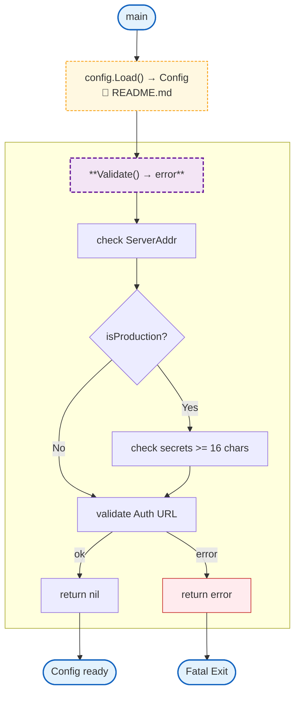

# config (config/)

Centralized environment-based configuration loading for the gateway application. Provides typed configuration structs with environment variable binding, validation, and logger initialization.

## Overview



## Structs

### Config

| Struct | Field | Type | Description |
|--------|-------|------|-------------|
| `Config` | `ServerAddr` | `string` | Server bind address |
| | `LogLevel` | `string` | Log level (debug, info, warn, error) |
| | `AllowedOrigins` | `[]string` | CORS allowed origins |
| | `MaxConns` | `int` | Max concurrent WebSocket connections |
| | `Auth` | `AuthConfig` | Auth service configuration |
| | `RedisAddr` | `string` | Redis server address |
| | `RedisPassword` | `string` | Redis password |

### AuthConfig

| Struct | Field | Type | Description |
|--------|-------|------|-------------|
| `AuthConfig` | `URL` | `string` | Auth service base URL |
| | `Timeout` | `time.Duration` | Auth request timeout |
| | `AuthInternalSecret` | `string` | Secret for calling auth service |
| | `InternalSecret` | `string` | Gateway's internal secret for /_internal/* |

## Environment Variables

| Variable | Required | Default | Description |
|----------|----------|---------|-------------|
| `GATEWAY_ADDR` | No | `:8080` | Server bind address |
| `GATEWAY_LOG_LEVEL` | No | `info` | Log level (debug, info, warn, error) |
| `GATEWAY_ALLOWED_ORIGINS` | No | - | Comma-separated CORS allowed origins |
| `GATEWAY_MAX_CONNS` | No | `0` (unlimited) | Max concurrent WebSocket connections |
| `GATEWAY_MODEL_CONFIG` | No | `config/models.yaml` | Path to model configuration YAML |
| `AUTH_SERVICE_URL` | No | `http://localhost:8081` | Auth service URL |
| `AUTH_TIMEOUT` | No | `2s` | Auth request timeout |
| `AUTH_INTERNAL_SECRET` | Prod* | - | Secret for auth service calls |
| `INTERNAL_SECRET` | Prod* | - | Gateway internal secret (/_internal/*) |
| `REDIS_ADDR` | No | - | Redis server address |
| `REDIS_PASSWORD` | No | - | Redis password |
| `ENV` | No | - | Production mode flag (set to `production`) |
| `APP_ENV` | No | - | Alternative production mode flag (set to `prod`) |

\* Required only when `ENV=production` or `APP_ENV=prod`

## Error Handling

| Error Type | Handler | Exit Code / Behavior |
|------------|---------|---------------------|
| Production without secrets | Returns error from `Validate()` | Caller handles (typically fatal) |
| Invalid `GATEWAY_ADDR` | Returns error from `Validate()` | Caller handles (typically fatal) |
| Invalid `AUTH_SERVICE_URL` | Returns error from `Validate()` | Caller handles (typically fatal) |
| Invalid `AUTH_TIMEOUT` | Returns error from `Load()` | Caller handles (typically fatal) |
| Secret < 16 characters | Returns error from `Validate()` | Caller handles (typically fatal) |

## Design Notes

### Auth Service Timeout

**Q: Why is the default auth timeout 2 seconds?**

| Aspect | Description |
|--------|-------------|
| Context | Auth service session validation |
| Options considered | 500ms, 1s, 2s, 5s |
| Rationale | 2s allows for network delays while failing fast on actual issues |

**Current approach is recommended because:**
- Fast enough for good UX
- Allows for network latency
- Fails fast on actual auth service issues
- Configurable via environment variable

### AllowedOrigins Empty Default

**Q: Why is empty origins list "allow all" in development?**

| Aspect | Description |
|--------|-------------|
| Context | WebSocket and HTTP CORS configuration |
| Options considered | Allow all, Deny all, Require explicit |
| Rationale | Development convenience while warning operator |

**Current approach is recommended because:**
- Prevents accidental open CORS in production
- Clear warning message guides operators
- Development can use default without configuration
- Production requires explicit configuration

### Redis Optional Configuration

**Q: Why is Redis configuration optional?**

| Aspect | Description |
|--------|-------------|
| Context | Redis for caching and rate limiting |
| Options considered | Required, Optional, Not implemented |
| Rationale | Allows operation without external dependencies |

**Current approach is recommended because:**
- Gateway can function without Redis
- Features that use Redis can degrade gracefully
- Development doesn't require Redis setup
- Production can enable Redis for performance

### Internal Secret Requirements

**Q: Why 16 character minimum for secrets?**

| Aspect | Description |
|--------|-------------|
| Context | Secret-based authentication |
| Options considered | 8, 16, 32 characters |
| Rationale | 16 characters provides good security/usability balance |

**Current approach is recommended because:**
- Sufficient entropy for HMAC/signing
- Not so long as to be unusable
- Standard security practice
- Easy to generate with password managers

## Test Coverage

### Unit Tests (`config_test.go`)

| Test Suite | Coverage |
|------------|----------|
| `TestLoad` | Default configuration loading |
| `TestLoad_FromEnv` | Environment variable override |
| `TestLoad_InvalidTimeout` | Invalid timeout duration handling |
| `TestValidate_ServerAddress` | Server address validation |
| `TestValidate_ProductionSecrets` | Production secret requirements |
| `TestValidate_SecretLength` | Secret length validation |
| `TestValidate_AuthURL` | Auth URL format validation |
| `TestNewLogger` | Logger creation for different environments |
| `TestParseLogLevel` | Log level parsing |
| `TestIsProduction` | Production detection |

**Running:**
```bash
make test ./config
```

## Dependencies and Location

| Package | Purpose |
|---------|---------|
| `github.com/rs/zerolog` | Structured logging |

**File Locations:**
- [`config/config.go`](../../config/config.go) - Main configuration
- [`config/auth.go`](../../config/auth.go) - Auth configuration

## Related

- [Models Configuration](models.md) - LLM model configuration
- [Plans Configuration](plans.md) - Subscription plan definitions
