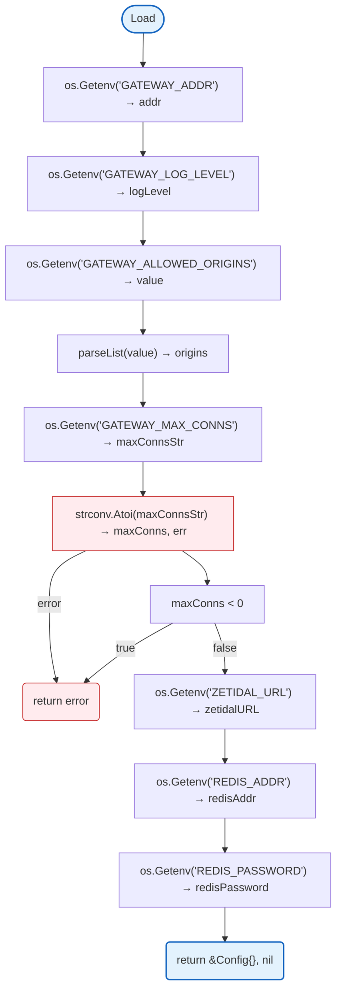

# Config

Environment-based configuration for the gateway application. Reads environment variables and provides the Config struct for use throughout the application.

## Overview

### Load



### Validate


## Structs and Environment Variables

| Config Struct | Field | Env Variable | Type | Default | Required | Description |
|---------------|-------|--------------|------|---------|----------|-------------|
| **Config** | `ServerAddr` | `GATEWAY_ADDR` | `string` | `:8080` | No | Server bind address |
| | `LogLevel` | `GATEWAY_LOG_LEVEL` | `string` | `info` | No | Log level (debug, info, warn, error) |
| | `AllowedOrigins` | `GATEWAY_ALLOWED_ORIGINS` | `[]string` | - | No* | Comma-separated CORS allowed origins |
| | `MaxConns` | `GATEWAY_MAX_CONNS` | `int` | `0` | No | Max concurrent WebSocket connections (0 = unlimited) |
| | `ZetidalURL` | `ZETIDAL_URL` | `string` | `http://localhost:8081` | No | Zetidal API URL for session validation |
| | `RedisAddr` | `REDIS_ADDR` | `string` | - | Yes | Redis server address |
| | `RedisPassword` | `REDIS_PASSWORD` | `string` | - | No | Redis password |

\* Empty origins denies all requests - use `"*"` for development only.

## Design Notes

### AllowedOrigins Empty Default

**Q: Why is empty origins list "allow all" in development?**

| Aspect | Description |
|--------|-------------|
| Context | WebSocket and HTTP CORS configuration |
| Options considered | Allow all, Deny all, Require explicit |
| Rationale | Development convenience while warning operator |

**Current approach is recommended because:**
- Prevents accidental open CORS in production
- Clear warning message guides operators
- Development can use default without configuration
- Production requires explicit configuration

### Redis Required Configuration

**Q: Why is Redis required?**

| Aspect | Description |
|--------|-------------|
| Context | Redis for session caching, quota management, and rate limiting |
| Options considered | Required with HA, Optional, Not implemented |
| Rationale | Essential for production reliability and performance |

**Current approach is recommended because:**
- Session caching reduces API calls to zetidal
- Quota management requires persistent state
- Health checks and circuit breakers need Redis
- HA deployment ensures no data loss on failures

### Zetidal Session Validation

**Q: Why no configurable timeout for zetidal API?**

| Aspect | Description |
|--------|-------------|
| Context | Internal service-to-service communication |
| Options considered | Configurable timeout, Default timeout only |
| Rationale | Both services are internal, let zetidal control its own timeouts |

**Current approach is recommended because:**
- Gateway and zetidal are both internal services
- Zetidal manages its own request lifecycle
- Removes unnecessary configuration complexity
- Simpler operational model

## Test Coverage

### Unit Tests (`config_test.go`)

| Test Suite | Coverage |
|------------|----------|
| `TestLoadFromEnv` | Environment variable override |
| `TestDefaultValues` | Default configuration loading |
| `TestValidate` | Server address validation |
| `TestLoadAllowedOrigins` | CORS origins parsing |
| `TestLoadMaxConns` | Max connections validation |
| `TestValidateValidConfig` | Full config validation |
| `TestZetidalConfigDefaults` | Zetidal URL defaults |
| `TestZetidalConfigFromEnv` | Zetidal URL from env |

**Running:**
```bash
make test ./config
```

## Dependencies and Location

| Package | Purpose |
|---------|---------|
| `github.com/rs/zerolog` | Structured logging |

**File Locations:**
- [`config/config.go`](https://github.com/nevaria-ai/gateway/blob/main/config/config.go) - Main configuration

## Related

- [Models Configuration](models.md) - LLM model configuration
- [Plans Configuration](plans.md) - Subscription plan definitions
