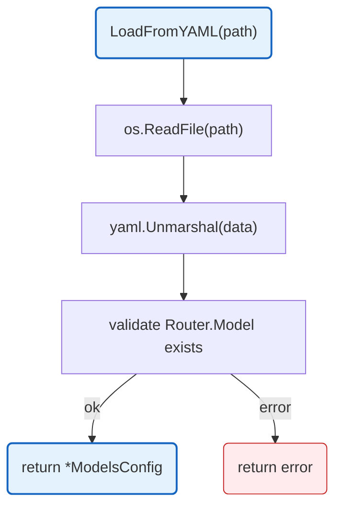

# Models Configuration

YAML-based LLM model and router configuration. Provides model cost definitions, provider mappings, and router settings.

## Overview



## Structs

### ModelsConfig

| Struct | Field | Type | Description |
|--------|-------|------|-------------|
| `ModelsConfig` | `Models` | `map[string]*ModelConfig` | Model name to config mapping |
| | `Router` | `RouterConfig` | Router configuration |

### ModelConfig

| Struct | Field | Type | Description |
|--------|-------|------|-------------|
| `ModelConfig` | `Provider` | `string` | Provider name (openai, anthropic, google) |
| | `InputCostPerMillion` | `float64` | Input token cost per million |
| | `OutputCostPerMillion` | `float64` | Output token cost per million |
| | `MaxTokens` | `int` | Maximum context tokens |
| | `Tier` | `string` | Pricing tier (economy, standard, premium) |

### RouterConfig

| Struct | Field | Type | Description |
|--------|-------|------|-------------|
| `RouterConfig` | `Model` | `string` | Model for routing decisions |
| | `Timeout` | `string` | Router request timeout |
| | `MaxRetries` | `int` | Maximum retry attempts |

## Functions

| Function | Signature | Description |
|----------|-----------|-------------|
| `LoadModelsConfig` | `(path string) (*ModelsConfig, error)` | Loads config from YAML file |
| `GetModel` | `(c *ModelsConfig, name string) (*ModelConfig, bool)` | Returns model by name |
| `GetAllModels` | `(c *ModelsConfig) []string` | Returns all model names |
| `GetModelsByProvider` | `(c *ModelsConfig, provider string) []*ModelConfig` | Returns models for provider |
| `GetModelsByTier` | `(c *ModelsConfig, tier string) []*ModelConfig` | Returns models in tier |

## Error Handling

| Error Type | Handler | Behavior |
|------------|---------|----------|
| File not found | Returns wrapped error | `failed to read config file` |
| Invalid YAML | Returns wrapped error | `failed to parse config` |
| Router model missing | Returns error | `router model "X" not found in models` |

## Environment Variables

| Variable | Required | Default | Description |
|----------|----------|---------|-------------|
| `GATEWAY_MODEL_CONFIG` | No | `config/models.yaml` | Path to model config YAML |

## Design Notes

### YAML-Based Configuration

**Q: Why use YAML for model configuration?**

| Aspect | Description |
|--------|-------------|
| Context | Model costs and providers change frequently |
| Options considered | Code constants, JSON, YAML, Database |
| Rationale | YAML is human-readable and easy to update without recompiling |

**Current approach is recommended because:**
- Easy to add new models without code changes
- Cost updates don't require deployment
- Version controlled alongside code
- Supports comments for documentation

## Test Coverage

### Unit Tests

| Test Suite | Coverage |
|------------|----------|
| `TestLoadModelsConfig` | Valid YAML loading |
| `TestLoadModelsConfig_FileNotFound` | Missing file handling |
| `TestLoadModelsConfig_InvalidYAML` | Parse error handling |
| `TestLoadModelsConfig_MissingRouterModel` | Validation error |
| `TestGetModel` | Model retrieval |
| `TestGetAllModels` | All models list |
| `TestGetModelsByProvider` | Provider filtering |
| `TestGetModelsByTier` | Tier filtering |

**Running:**
```bash
make test ./config
```

## Dependencies and Location

| Package | Purpose |
|---------|---------|
| `gopkg.in/yaml.v3` | YAML parsing |

**File Location:** [`config/models.go`](../../config/models.go)

## Related

- [Config README](README.md) - Main configuration
- [Plans](plans.md) - Subscription plan definitions
- [LLM Proxy Models](../internal/llm-proxy/models.md) - Model registry usage
