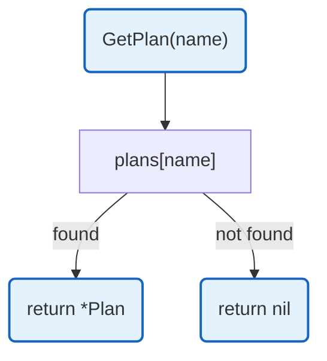

# Plans Configuration

Subscription plan definitions with LLM credit allowances. Provides plan lookup and feature checking.

## Overview



## Constants

| Constant | Type | Value | Description |
|----------|------|-------|-------------|
| `basic` | Plan | struct | Basic tier: $10 credits, 1000 requests |
| `pro` | Plan | struct | Pro tier: $50 credits, 10000 requests |
| `enterprise` | Plan | struct | Enterprise tier: $500 credits, unlimited |

## Structs

### Plan

| Struct | Field | Type | Description |
|--------|-------|------|-------------|
| `Plan` | `Name` | `string` | Plan identifier |
| | `DisplayName` | `string` | Human-readable name |
| | `MonthlyLLMCredits` | `float64` | Monthly credit allowance |
| | `MaxRequests` | `int` | Maximum requests (-1 = unlimited) |
| | `Features` | `[]string` | Feature flags |

## Functions

| Function | Signature | Description |
|----------|-----------|-------------|
| `GetPlan` | `(name string) *Plan` | Returns plan by name |
| `GetAllPlans` | `() []*Plan` | Returns all available plans |
| `GetPlanNames` | `() []string` | Returns all plan names |
| `HasFeature` | `(planName, feature string) bool` | Checks if plan has feature |
| `ValidatePlan` | `(planName string) bool` | Validates plan name exists |

## Plan Features

| Feature | Basic | Pro | Enterprise |
|---------|-------|-----|------------|
| `economy_models` | Yes | - | - |
| `basic_routing` | Yes | - | - |
| `all_models` | - | Yes | Yes |
| `smart_routing` | - | Yes | Yes |
| `priority_queue` | - | Yes | Yes |
| `custom_models` | - | - | Yes |
| `dedicated_support` | - | - | Yes |

## Design Notes

### Hardcoded Plans

**Q: Why are plans hardcoded instead of database-stored?**

| Aspect | Description |
|--------|-------------|
| Context | Subscription tiers rarely change |
| Options considered | Database, Config file, Hardcoded |
| Rationale | Plans are business-level contracts, not operational config |

**Current approach is recommended because:**
- Plan changes require business review
- Type-safe access in code
- No database query overhead
- Easy to reason about available features

### -1 for Unlimited Requests

**Q: Why use -1 for unlimited instead of 0 or a special type?**

| Aspect | Description |
|--------|-------------|
| Context | MaxRequests field semantics |
| Options considered | 0, -1, special Unlimited type, pointer |
| Rationale | -1 is explicit and won't conflict with 0 (disabled) |

**Current approach is recommended because:**
- Clear semantic meaning
- Simple integer comparison
- Won't be confused with disabled (0)
- Common pattern in many systems

## Test Coverage

### Unit Tests

| Test Suite | Coverage |
|------------|----------|
| `TestGetPlan` | Plan retrieval by name |
| `TestGetPlan_Invalid` | Invalid plan returns nil |
| `TestGetAllPlans` | All plans returned |
| `TestGetPlanNames` | Plan names list |
| `TestHasFeature` | Feature checking |
| `TestHasFeature_InvalidPlan` | Invalid plan returns false |
| `TestValidatePlan` | Plan validation |

**Running:**
```bash
make test ./config
```

## Dependencies and Location

| Package | Purpose |
|---------|---------|
| (none) | Uses only standard library |

**File Location:** [`config/plans.go`](../../config/plans.go)

## Related

- [Config README](README.md) - Main configuration
- [Models](models.md) - Model configuration
- [Quota](../internal/llm-proxy/quota.md) - Quota management using plans
