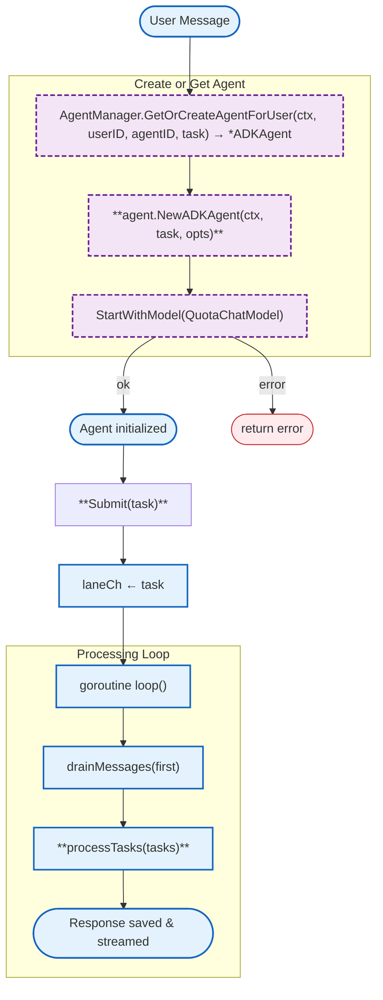

# internal/agent (internal/agent)

Core agent implementation with Eino ADK ChatModelAgent and Runner integration.

## Overview



### Variables

| Variable | Type | Description |
|----------|------|-------------|
| N/A | - | This package defines structs with fields, not package-level variables. |

### Constants

| Constant | Type | Value | Description |
|----------|------|-------|-------------|
| `defaultIdleTimeout` | `time.Duration` | `5 * time.Minute` | Default idle timeout before agent exits |
| `defaultLaneQueueSize` | `int` | `100` | Default buffer size for lane channel |

### Structs

| Struct | Field | Type | Description |
|--------|-------|------|-------------|
| `WSConnRef` | `mu` | `sync.RWMutex` | Thread-safe lock for connection access |
| `WSConnRef` | `conn` | `*websocket.Conn` | Reference to websocket connection (swappable) |
| `ADKAgent` | `agentID` | `string` | Unique agent identifier |
| `ADKAgent` | `userID` | `string` | User who owns this agent |
| `ADKAgent` | `ctx` | `context.Context` | Agent lifecycle context |
| `ADKAgent` | `cancel` | `context.CancelFunc` | Function to cancel agent context |
| `ADKAgent` | `laneCh` | `chan Task` | Channel for message queue |
| `ADKAgent` | `mu` | `sync.Mutex` | Lock shared with session handler for idle exit coordination |
| `ADKAgent` | `connRef` | `*WSConnRef` | Swappable websocket connection reference |
| `ADKAgent` | `einoAgent` | `*adk.ChatModelAgent` | Eino ADK ChatModelAgent instance |
| `ADKAgent` | `einoRunner` | `*adk.Runner` | Eino ADK Runner instance |
| `ADKAgent` | `idleTimeout` | `time.Duration` | Time before agent exits on inactivity |

### Error Handling

| Error Type | Handler | Exit Code / Behavior |
|------------|---------|---------------------|
| Context canceled | `ctx.Err()` check | Loop exits gracefully |
| Idle timeout | `len(laneCh) == 0` check | Loop exits after lock coordination |
| Eino init error | Return from `StartWithModel()` | Agent created but not started |

### Embedded Files

| File | Variable | Description |
|------|----------|-------------|
| N/A | - | This package does not embed any files. |

### Environment Variables

| Variable | Required | Default | Description |
|----------|----------|---------|-------------|
| N/A | - | - | This package does not use environment variables directly. |

## Test Coverage

### Unit Tests (`*_test.go`)

| Test Suite | Coverage |
|------------|----------|
| `TestNewADKAgent_CreatesLaneCh` | Validates ADKAgent creation and channel initialization |
| `TestNewADKAgent_QueuesFirstMessage` | Ensures first message is queued during creation |
| `TestADKAgent_Stop` | Validates context cancellation on Stop() |
| `TestADKAgent_Loop_DrainsMessages` | Tests message coalescing in loop |
| `TestADKAgent_Loop_IdleExit` | Tests idle timeout with lock coordination |
| `TestADKAgent_Loop_ContextCancel` | Tests loop exit on context cancellation |
| `TestADKAgent_DrainMessages` | Tests message draining logic |
| `TestWSConnRef_GetSetClear` | Tests WSConnRef connection reference management |
| `TestWSConnRef_Concurrent` | Tests thread-safety of WSConnRef |
| `TestWSConnRef_SetReplacesConnection` | Tests connection swapping behavior |
| `TestGetGlobalTools_ReturnsTools` | Tests DuckDuckGo tool initialization |
| `TestBuildInstruction_WithMemories` | Tests instruction builder with memory injection |
| `TestBuildInstruction_NoMemories` | Tests instruction builder without memories |

**Running:**
```bash
make test-unit TEST_PATH=./internal/agent/...
```

### Integration Tests (`*_integration_test.go`)

| Test Suite | Coverage |
|------------|----------|
| `TestADKAgent_FullFlow_Integration` | Tests full agent flow with Eino components |
| `TestADKAgent_WithTools_Integration` | Tests agent with DuckDuckGo search tool |
| `TestADKAgent_MultipleMessages_Integration` | Tests multiple message coalescing |

**Running:**
```bash
make test-integration TEST_PATH=./tests/integration/agent/...
```

### Dependencies and Location

| Package | Version | Purpose |
|---------|---------|---------|
| `github.com/cloudwego/eino/adk` | latest | Eino Agent Development Kit |
| `github.com/cloudwego/eino/components/model` | latest | ToolCallingChatModel interface |
| `github.com/cloudwego/eino/components/tool` | latest | Tool interface for DuckDuckGo |
| `github.com/cloudwego/eino/compose` | latest | Compose primitives |
| `github.com/cloudwego/eino-ext/components/tool/duckduckgo` | latest | DuckDuckGo search tool |
| `github.com/gorilla/websocket` | latest | WebSocket connection |

**File Location:** [`internal/agent/adk_agent.go`](../internal/agent/adk_agent.go)
**File Location:** [`internal/agent/conn_ref.go`](../internal/agent/conn_ref.go)

## Design Notes

### [Design Topic Name] Agent Independence

**Q: Why are agents independent from socket lifetime?**

| Aspect | Description |
|--------|-------------|
| Context | Users may disconnect temporarily but expect background tasks to complete |
| Options considered | 1. Bind agent to socket, 2. Swappable connection, 3. Separate channel queue |
| Rationale | Swappable WSConnRef allows agent to continue processing while socket reconnects |

**Q: How does message coalescing work?**

| Aspect | Description |
|--------|-------------|
| Context | Multiple messages may arrive before agent processes first one |
| Options considered | 1. Process immediately, 2. Queue and drain all, 3. Separate queue with batching |
| Rationale | Drain pattern (non-blocking channel drain) provides good balance of throughput and simplicity |

**Alternative approaches:**
```go
// Alternative: Process each message immediately (not recommended)
func (a *ADKAgent) processImmediate(task Task) {
    a.einoRunner.Query(a.ctx, task.Message)
}

// Alternative: Fixed-size batches (complex)
func (a *ADKAgent) processBatch(batch []Task) {
    // More complex buffer management
}
```

**Current approach is recommended because:**
- Simple drain pattern is easy to understand and maintain
- Natural backpressure through channel buffering
- Fair message ordering preserved

### [Design Topic Name] Idle Exit Coordination

**Q: Why use lock for idle exit?**

| Aspect | Description |
|--------|-------------|
| Context | Race condition: goroutine checks channel, handler adds message simultaneously |
| Options considered | 1. Atomic channel length, 2. Dedicated exit channel, 3. Mutex-protected check |
| Rationale | Mutex allows goroutine to atomically check channel length and decide to exit |

**Alternative approaches:**
```go
// Alternative: Atomic counter (not thread-safe with channel)
type Agent struct {
    messageCount atomic.Int32
}
```

**Current approach is recommended because:**
- Lock guarantees exclusive access between goroutine and handler
- Check-empty-then-exit pattern is well-understood
- No additional synchronization primitives needed

### [Design Topic Name] Eino ADK Integration

**Q: Why use Eino ChatModelAgent instead of custom implementation?**

| Aspect | Description |
|--------|-------------|
| Context | Reuse battle-tested LLM orchestration instead of building custom ReAct loop |
| Options considered | 1. Custom loop with tool calling, 2. Eino ChatModelAgent, 3. LangChain |
| Rationale | Eino provides production-ready ReAct loop with proper error handling |

**Alternative approaches:**
```go
// Alternative: Custom ReAct loop (not recommended)
func (a *ADKAgent) customReActLoop(input string) {
    for {
        response, toolCalls := callLLM(input)
        if len(toolCalls) == 0 {
            return response
        }
        results := executeTools(toolCalls)
        input += formatResults(results)
    }
}
```

**Current approach is recommended because:**
- Eino handles edge cases (max iterations, tool failures)
- Automatic tool parallelization via ToolsNodeConfig
- Built-in retry logic and middleware support
