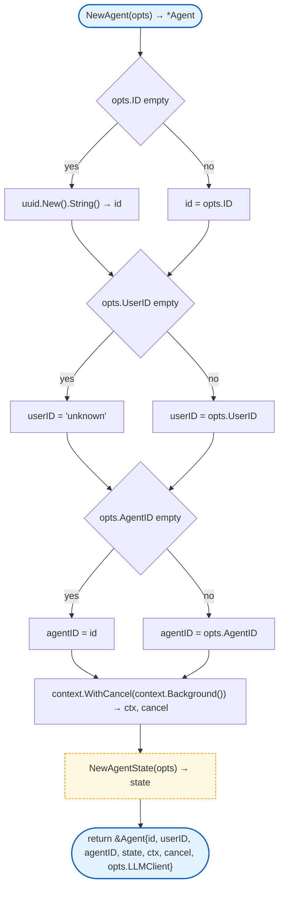
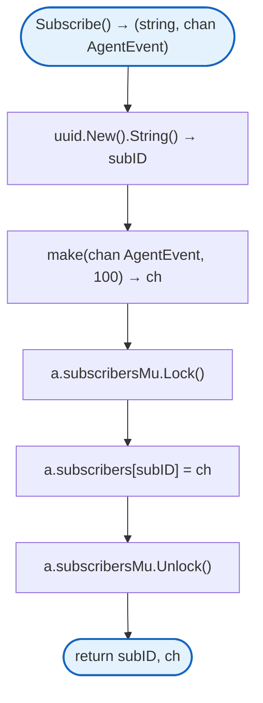
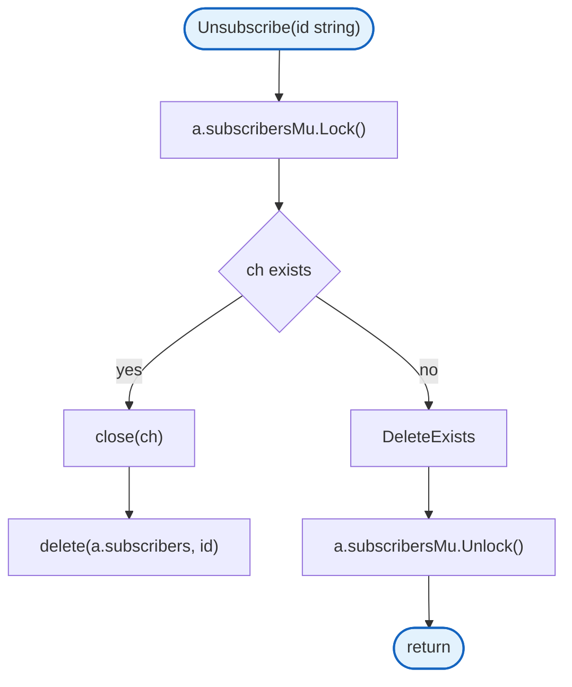
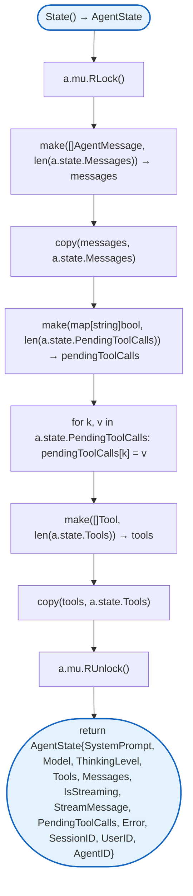
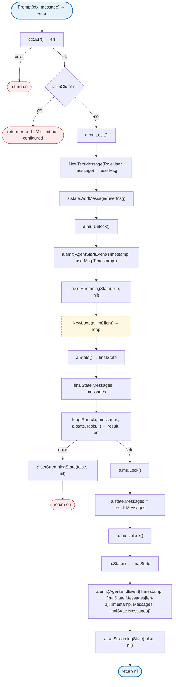
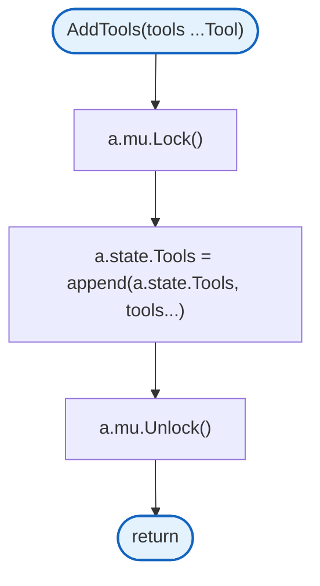
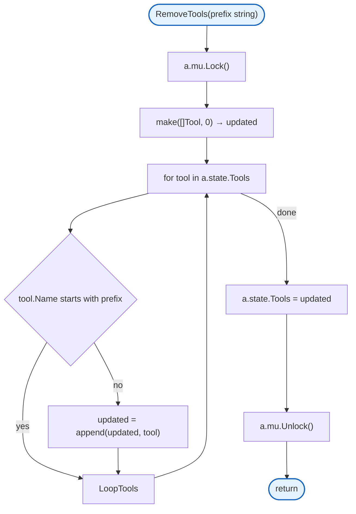

# Agent

Core agent runtime framework with state management, event streaming, and tool execution loop.

## Structs

### Agent

| Struct | Field | Type | Description |
|--------|-------|------|-------------|
| `Agent` | `mu` | `sync.RWMutex` | State mutex |
| | `state` | `AgentState` | Current agent state |
| | `id` | `string` | Unique agent instance ID |
| | `userID` | `string` | User identifier (multi-agent isolation) |
| | `agentID` | `string` | Agent identifier (multi-agent routing) |
| | `subscribers` | `map[string]chan AgentEvent` | Event subscribers |
| | `ctx` | `context.Context` | Agent context |
| | `cancel` | `context.CancelFunc` | Context cancel function |
| | `llmClient` | `LLMClient` | LLM client for tool calling |

### AgentState

| Struct | Field | Type | Description |
|--------|-------|------|-------------|
| `AgentState` | `SystemPrompt` | `string` | System prompt for LLM |
| | `Model` | `Model` | Model configuration |
| | `ThinkingLevel` | `ThinkingLevel` | Thinking intensity |
| | `Tools` | `[]Tool` | Available tools |
| | `Messages` | `[]AgentMessage` | Conversation history |
| | `IsStreaming` | `bool` | Currently streaming |
| | `StreamMessage` | `*AgentMessage` | Current streaming message |
| | `PendingToolCalls` | `map[string]bool` | Pending tool call IDs |
| | `Error` | `string` | Error state |
| | `SessionID` | `string` | Session identifier |
| | `UserID` | `string` | User identifier |
| | `AgentID` | `string` | Agent identifier |

### AgentOptions

| Struct | Field | Type | Description |
|--------|-------|------|-------------|
| `AgentOptions` | `ID` | `string` | Custom agent ID |
| | `SystemPrompt` | `string` | System prompt |
| | `SessionID` | `string` | Session ID |
| | `UserID` | `string` | User ID |
| | `AgentID` | `string` | Agent ID |
| | `LLMClient` | `LLMClient` | LLM client |

## NewAgent



## Subscribe



## Unsubscribe



## State



## Prompt



## AddTools



## RemoveTools



## Design Notes

### Thread-Safe State Access

**Q: Why return a copy of state from State()?**

| Aspect | Description |
|--------|-------------|
| Context | Concurrent access to agent state |
| Options considered | Return pointer, return copy, lock externally |
| Rationale | Prevents external mutation of internal state |

**Current approach is recommended because:**
- Callers can't accidentally mutate state
- No need for external locking
- Safe to pass state to goroutines
- Standard immutable data pattern

### Event Channel Buffer

**Q: Why buffer events at 100?**

| Aspect | Description |
|--------|-------------|
| Context | Event channel capacity |
| Options considered | 10, 100, 1000, unbuffered |
| Rationale | 100 handles burst events without blocking |

**Current approach is recommended because:**
- Handles message streaming bursts
- Won't block sender on slow receiver
- Memory-efficient for most cases
- Subscriber can still fall behind gracefully

### Skip Full Channels

**Q: Why skip subscribers with full channels instead of blocking?**

| Aspect | Description |
|--------|-------------|
| Context | Event broadcasting |
| Options considered | Block, skip, drop oldest |
| Rationale | Prevent slow subscribers from blocking agent |

**Current approach is recommended because:**
- Agent never blocks on broadcast
- Fast subscribers get all events
- Slow subscribers gracefully degrade
- Non-blocking pattern for event systems

## Test Coverage

### Unit Tests (`agent_test.go`)

| Test Suite | Coverage |
|------------|----------|
| `TestNewAgent` | Agent creation |
| `TestNewAgent_WithID` | Custom ID |
| `TestSubscribe` | Event subscription |
| `TestUnsubscribe` | Event unsubscription |
| `TestState` | State retrieval |
| `TestPrompt_NoLLMClient` | Error without LLM client |

**Running:**
```bash
make test ./internal/agent
```

## Dependencies and Location

| Package | Purpose |
|---------|---------|
| `github.com/google/uuid` | UUID generation |

**File Locations:**
- [`internal/agent/agent.go`](https://github.com/nevaria-ai/gateway/blob/main/internal/agent/agent.go) - Main agent implementation

## Subpackages

| Package | Description |
|---------|-------------|
| [loop.md](loop.md) | Tool calling loop |
| [tool.md](tool.md) | Tool execution |
| [events.md](events.md) | Event system |
| [types.md](types.md) | Core types |
| [tools.md](tools.md) | Built-in tools |

## Related

- [WebSocket Handler](../websocket.md) - Multi-agent routing via agent_id
- [Storage](../storage/README.md) - Workspace persistence
- [Mem0](../mem0/README.md) - Long-term memory tools
