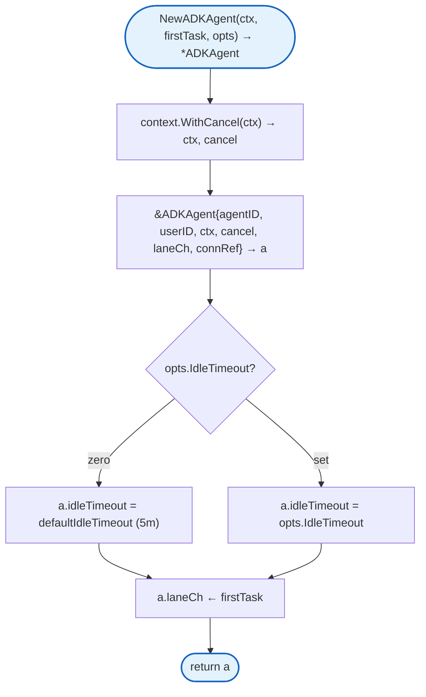
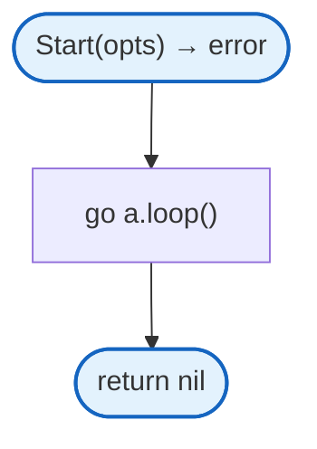
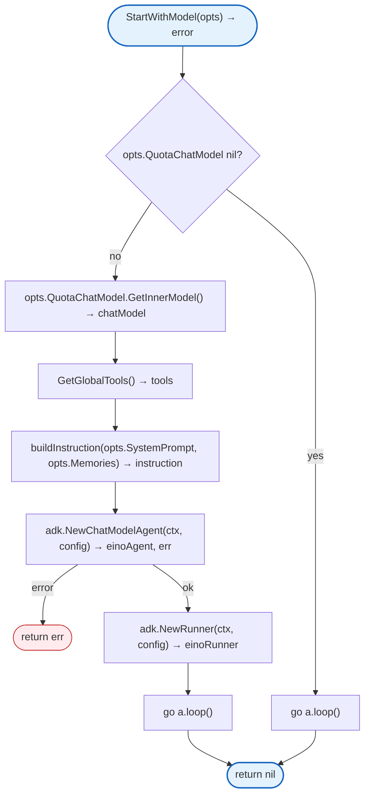
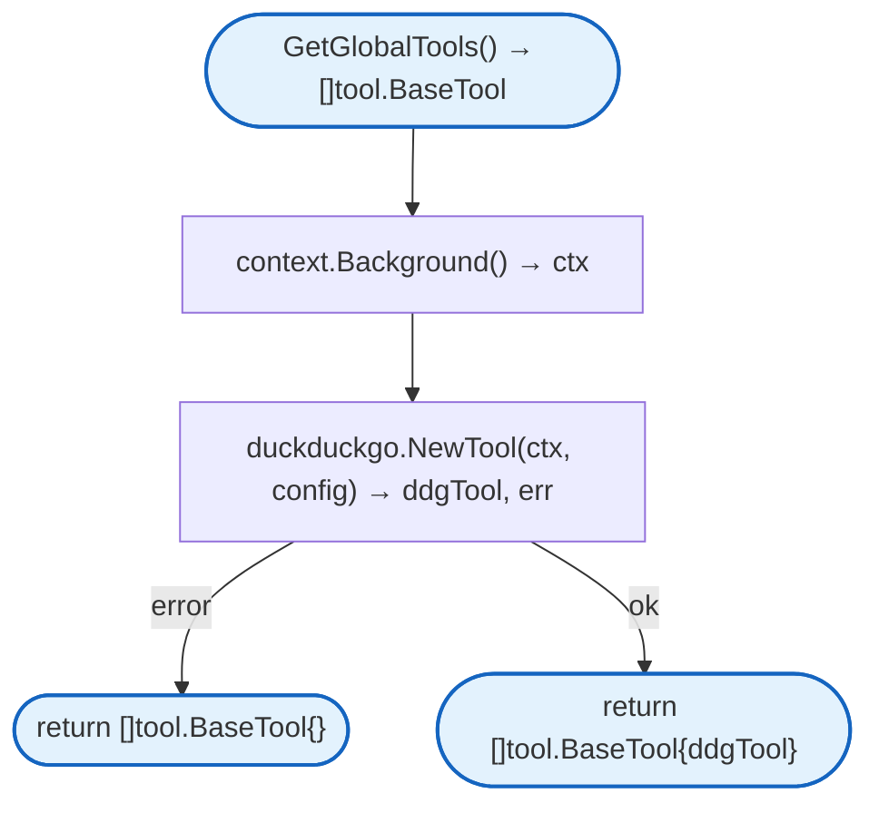
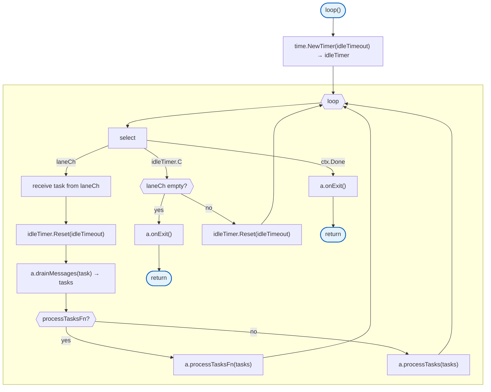
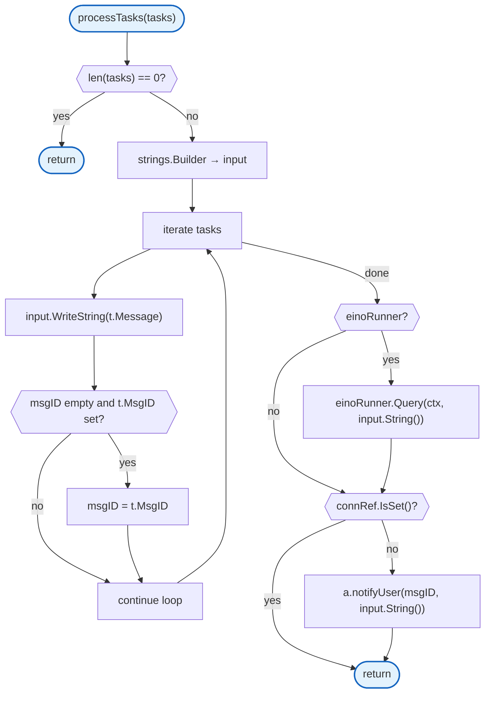
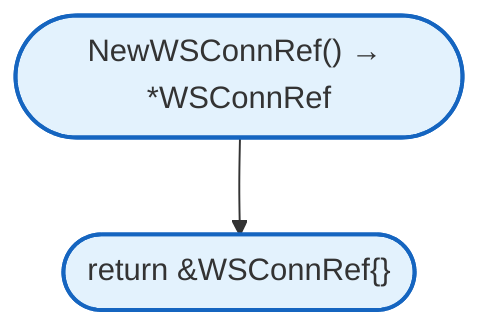

# Agent

ADK-based agent runtime using Eino ADK's ChatModelAgent and Runner for LLM integration with tool execution.

## Constants

| Constant | Type | Value | Description |
|----------|------|-------|-------------|
| `defaultIdleTimeout` | `time.Duration` | `5 * time.Minute` | Default idle timeout before agent exits |
| `defaultLaneQueueSize` | `int` | `100` | Default task queue buffer size |

## Structs

### ADKAgent

| Struct | Field | Type | Description |
|--------|-------|------|-------------|
| `ADKAgent` | `agentID` | `string` | Unique agent instance ID |
| | `userID` | `string` | User identifier (multi-agent isolation) |
| | `ctx` | `context.Context` | Agent context |
| | `cancel` | `context.CancelFunc` | Context cancel function |
| | `laneCh` | `chan Task` | Task queue channel |
| | `mu` | `sync.Mutex` | State mutex |
| | `connRef` | `*WSConnRef` | Swappable WebSocket connection |
| | `einoAgent` | `*adk.ChatModelAgent` | Eino ADK agent |
| | `einoRunner` | `*adk.Runner` | Eino ADK runner |
| | `idleTimeout` | `time.Duration` | Idle timeout before exit |

### ADKAgentOptions

| Struct | Field | Type | Description |
|--------|-------|------|-------------|
| `ADKAgentOptions` | `AgentID` | `string` | Agent identifier |
| | `UserID` | `string` | User ID |
| | `Description` | `string` | Agent description |
| | `SystemPrompt` | `string` | System prompt for LLM |
| | `QuotaChatModel` | `QuotaChatModelInterface` | LLM client with quota |
| | `Memories` | `[]string` | User memories for context |
| | `IdleTimeout` | `time.Duration` | Idle timeout |

### Task

| Struct | Field | Type | Description |
|--------|-------|------|-------------|
| `Task` | `Message` | `string` | Task message content |
| | `MsgID` | `string` | Message identifier |

## Methods

Simple getters, setters, and lifecycle methods.

| Method | Signature | Description |
|--------|-----------|-------------|
| `Stop` | `()` | Cancels agent context |
| `GetContext` | `() context.Context` | Returns agent context |
| `GetAgentID` | `() string` | Returns agent ID |
| `GetUserID` | `() string` | Returns user ID |
| `Submit` | `(task Task)` | Submits task to lane queue |
| `GetConnRef` | `() *WSConnRef` | Returns WebSocket connection reference |
| `SetProcessTasksFn` | `(fn func([]Task))` | Sets custom task processor |
| `SetOnExit` | `(fn func())` | Sets exit callback |
| `GetStatus` | `() map[string]interface{}` | Returns agent status map with agent_id, user_id, queue_len, active |

## NewADKAgent



## Start



## StartWithModel



## GetGlobalTools



## loop

Private method that runs the agent's main event loop.



## processTasks

Private method that processes accumulated tasks.



## WSConnRef

Swappable WebSocket connection reference for thread-safe connection management.

### WSConnRef Methods

| Method | Description |
|--------|-------------|
| `Get()` | Returns current connection (thread-safe) |
| `Set(conn)` | Sets new connection (thread-safe) |
| `Clear()` | Clears connection reference |
| `IsSet()` | Returns true if connection is set |

### NewWSConnRef



## Design Notes

### Eino ADK Integration

**Q: Why use Eino ADK's ChatModelAgent instead of custom implementation?**

| Aspect | Description |
|--------|-------------|
| Context | LLM agent implementation |
| Options considered | Custom implementation, Eino ADK, other frameworks |
| Rationale | Eino ADK provides battle-tested agent patterns with tool calling |

**Current approach is recommended because:**
- Standard tool calling patterns
- Built-in message coalescing
- Runner handles orchestration
- Easier to maintain and upgrade

### Message Coalescing with drainMessages

**Q: Why drain messages instead of processing one at a time?**

| Aspect | Description |
|--------|-------------|
| Context | High-frequency message handling |
| Options considered | Process each, batch process, drain |
| Rationale | Reduces LLM API calls for rapid user input |

**Current approach is recommended because:**
- Combines multiple rapid messages
- Reduces API costs
- Better user experience
- Handles mobile network fluctuations

### Idle Timeout Pattern

**Q: Why use idle timeout instead of explicit cleanup?**

| Aspect | Description |
|--------|-------------|
| Context | Agent lifecycle management |
| Options considered | Explicit cleanup, idle timeout, never cleanup |
| Rationale | Balances resource usage with conversation continuity |

**Current approach is recommended because:**
- Agents auto-cleanup after inactivity
- User can reconnect and continue
- Prevents resource leaks
- Configurable timeout

### WSConnRef for Connection Swapping

**Q: Why use WSConnRef instead of direct connection?**

| Aspect | Description |
|--------|-------------|
| Context | WebSocket reconnection handling |
| Options considered | Direct connection, connection reference, channel-based |
| Rationale | Allows connection swapping without agent restart |

**Current approach is recommended because:**
- Agent survives connection drops
- User can reconnect seamlessly
- Thread-safe connection access
- Clean separation of concerns

## Test Coverage

### Unit Tests (`adk_agent_test.go`, `conn_ref_test.go`)

| Test Suite | Coverage |
|------------|----------|
| `TestNewADKAgent_CreatesLaneCh` | Agent creation with channel |
| `TestNewADKAgent_QueuesFirstMessage` | First task queued |
| `TestADKAgent_Stop` | Context cancellation |
| `TestADKAgent_Loop_DrainsMessages` | Message draining |
| `TestADKAgent_Loop_IdleExit` | Idle timeout exit |
| `TestADKAgent_Loop_ContextCancel` | Context cancel exit |
| `TestBuildInstruction` | Instruction building with memories |
| `TestGetGlobalTools_ReturnsTools` | Tool retrieval |
| `TestWSConnRef_GetSetClear` | Connection reference operations |
| `TestWSConnRef_Concurrent` | Thread safety |

**Running:**
```bash
make test ./internal/agent
```

## Dependencies and Location

| Package | Purpose |
|---------|---------|
| `github.com/cloudwego/eino/adk` | Eino ADK agent framework |
| `github.com/cloudwego/eino/components/model` | LLM model interface |
| `github.com/cloudwego/eino/components/tool` | Tool interface |
| `github.com/cloudwego/eino-ext/components/tool/duckduckgo` | DuckDuckGo search tool |
| `github.com/gorilla/websocket` | WebSocket connection |
| `sync` | Thread safety |

**File Locations:**
- [`internal/agent/adk_agent.go`](https://github.com/nevaria-ai/gateway/blob/main/internal/agent/adk_agent.go) - ADKAgent implementation
- [`internal/agent/conn_ref.go`](https://github.com/nevaria-ai/gateway/blob/main/internal/agent/conn_ref.go) - WSConnRef
- [`internal/agent/types.go`](https://github.com/nevaria-ai/gateway/blob/main/internal/agent/types.go) - Core types

## Subpackages

| Package | Description |
|---------|-------------|
| [types.md](types.md) | Core types (AgentMessage, Tool, etc.) |
| [tools.md](tools.md) | Built-in tools |

## Related

- [WebSocket Handler](../websocket.md) - Agent lifecycle management
- [Storage](../storage/README.md) - Workspace persistence
- [Mem0](../mem0/README.md) - Long-term memory tools
