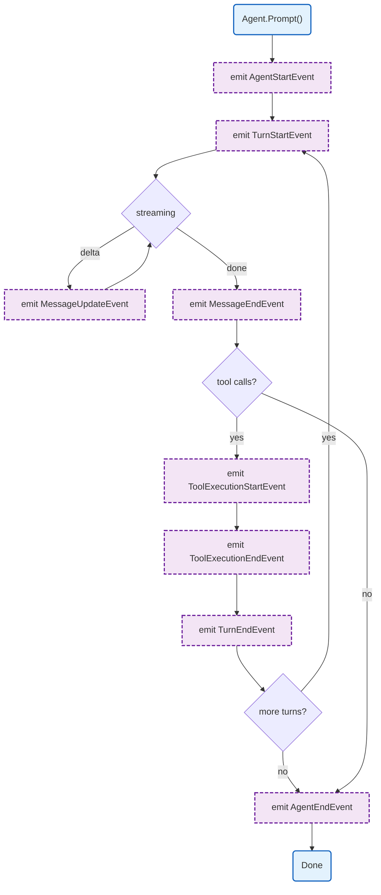

# Agent Events

Agent event system for real-time broadcasting of agent lifecycle, message generation, and tool execution.

## Overview



## Interface

### AgentEvent

```go
type AgentEvent interface {
    isAgentEvent()
}
```

All event types implement this sealed interface.

## Event Types

### Agent Lifecycle

| Event | Field | Type | Description |
|-------|-------|------|-------------|
| `AgentStartEvent` | `Timestamp` | `int64` | Agent begins processing |
| `AgentEndEvent` | `Timestamp` | `int64` | Agent finishes processing |
| | `Messages` | `[]AgentMessage` | Final message history |

### Turn Lifecycle

| Event | Field | Type | Description |
|-------|-------|------|-------------|
| `TurnStartEvent` | `Timestamp` | `int64` | New interaction cycle begins |
| `TurnEndEvent` | `Timestamp` | `int64` | Interaction cycle completes |
| | `Message` | `AgentMessage` | Final message |
| | `ToolResults` | `[]AgentMessage` | Tool result messages |

### Message Generation

| Event | Field | Type | Description |
|-------|-------|------|-------------|
| `MessageStartEvent` | `Timestamp` | `int64` | Message generation starts |
| | `Message` | `AgentMessage` | Initial message |
| `MessageUpdateEvent` | `Timestamp` | `int64` | Streaming content delta |
| | `Message` | `AgentMessage` | Current message state |
| | `Delta` | `string` | Content delta |
| `MessageEndEvent` | `Timestamp` | `int64` | Message is complete |
| | `Message` | `AgentMessage` | Final message |

### Tool Execution

| Event | Field | Type | Description |
|-------|-------|------|-------------|
| `ToolExecutionStartEvent` | `Timestamp` | `int64` | Tool execution begins |
| | `ToolCallID` | `string` | Tool call identifier |
| | `ToolName` | `string` | Tool name |
| | `Args` | `map[string]any` | Tool arguments |
| `ToolExecutionUpdateEvent` | `Timestamp` | `int64` | Partial tool result |
| | `ToolCallID` | `string` | Tool call identifier |
| | `ToolName` | `string` | Tool name |
| | `PartialResult` | `any` | Partial result |
| `ToolExecutionEndEvent` | `Timestamp` | `int64` | Tool execution completes |
| | `ToolCallID` | `string` | Tool call identifier |
| | `ToolName` | `string` | Tool name |
| | `Result` | `any` | Final result |
| | `IsError` | `bool` | Error flag |

### Token Usage

| Event | Field | Type | Description |
|-------|-------|------|-------------|
| `TokenUsageEvent` | `Timestamp` | `int64` | Token usage available |
| | `TokensInput` | `int64` | Input tokens |
| | `TokensOutput` | `int64` | Output tokens |

## Design Notes

### Sealed Interface Pattern

**Q: Why use sealed interface with private method?**

| Aspect | Description |
|--------|-------------|
| Context | Event type safety |
| Options considered | Empty interface, struct embedding, sealed interface |
| Rationale | Compile-time type safety for event types |

**Current approach is recommended because:**
- Only package-internal types can implement
- Type switch exhaustiveness checked
- Clear event type boundaries
- Standard Go sealed interface pattern

### Timestamp in Every Event

**Q: Why include timestamp in every event?**

| Aspect | Description |
|--------|-------------|
| Context | Event timing |
| Options considered | Single timestamp, per-event timestamp |
| Rationale | Each event has independent timing needs |

**Current approach is recommended because:**
- Events may be processed out of order
- Timing analysis per event type
- No need for external clock
- Consistent event structure

## Test Coverage

### Unit Tests

| Test Suite | Coverage |
|------------|----------|
| `TestAgentStartEvent` | Event implements interface |
| `TestAgentEndEvent` | Event with messages |
| `TestMessageEvents` | Message lifecycle events |
| `TestToolEvents` | Tool execution events |
| `TestTokenUsageEvent` | Token usage event |

**Running:**
```bash
make test ./internal/agent
```

## Dependencies and Location

| Package | Purpose |
|---------|---------|
| (none) | Pure type definitions |

**File Location:** [`internal/agent/events.go`](https://github.com/nevaria-ai/gateway/blob/main/internal/agent/events.go)

## Related

- [Agent README](README.md) - Main agent package
- [Types](types.md) - AgentMessage type
