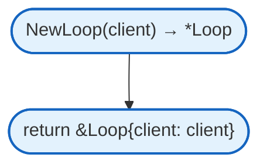
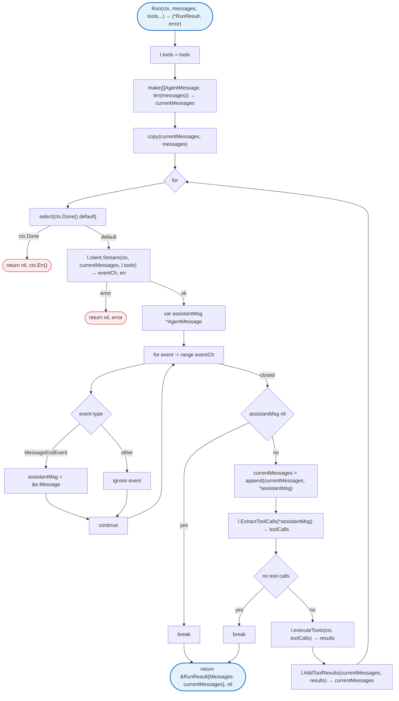
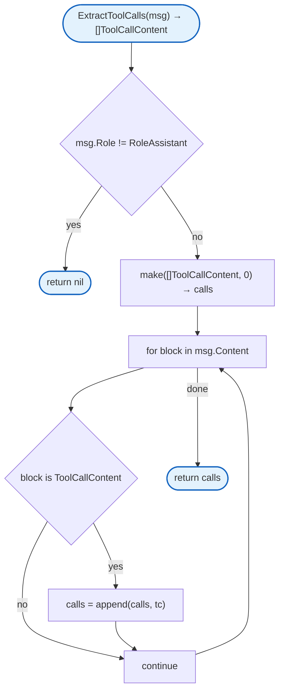
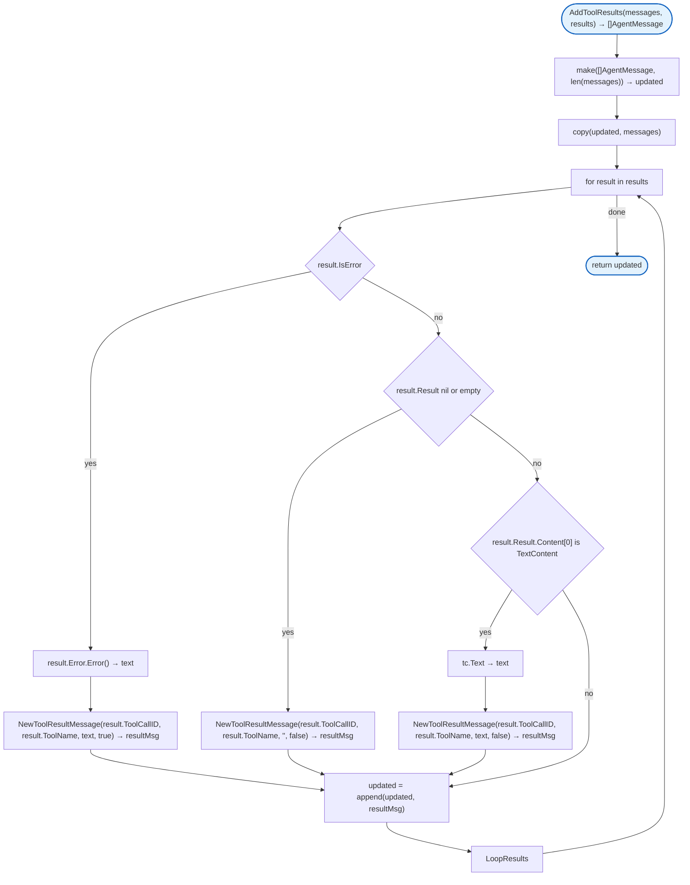

# Agent Loop

Tool calling execution loop. Handles LLM streaming, tool call extraction, and result collection.

## NewLoop



## Run



## ExtractToolCalls



## AddToolResults



## Structs

### Loop

| Struct | Field | Type | Description |
|--------|-------|------|-------------|
| `Loop` | `client` | `LLMClient` | LLM client for streaming |
| | `tools` | `[]Tool` | Available tools |

### RunResult

| Struct | Field | Type | Description |
|--------|-------|------|-------------|
| `RunResult` | `Messages` | `[]AgentMessage` | Final message history |

### ToolExecutionResult

| Struct | Field | Type | Description |
|--------|-------|------|-------------|
| `ToolExecutionResult` | `ToolCallID` | `string` | Tool call ID |
| | `ToolName` | `string` | Tool name |
| | `Result` | `*ToolResult` | Execution result |
| | `Error` | `error` | Execution error |
| | `IsError` | `bool` | Error flag |

## Functions

| Function | Description |
|----------|-------------|
| `executeTools` | Internal - executes tool calls |

## Design Notes

### Sequential Tool Execution

**Q: Why execute tools sequentially instead of in parallel?**

| Aspect | Description |
|--------|-------------|
| Context | Tool call execution |
| Options considered | Sequential, parallel, limited parallelism |
| Rationale | Simpler error handling, predictable order |

**Current approach is recommended because:**
- Deterministic execution order
- Simpler error handling
- No goroutine management overhead
- Tools may have dependencies

### Continue on Tool Error

**Q: Why continue the loop when a tool fails instead of aborting?**

| Aspect | Description |
|--------|-------------|
| Context | Tool execution error handling |
| Options considered | Abort, continue with error, retry |
| Rationale | LLM can decide how to handle errors |

**Current approach is recommended because:**
- LLM sees error and can adapt
- Other tools still execute
- Agent can retry or try alternatives
- Standard pattern in agent systems

## Test Coverage

### Unit Tests (`loop_test.go`)

| Test Suite | Coverage |
|------------|----------|
| `TestNewLoop` | Loop creation |
| `TestRun_NoToolCalls` | Simple message flow |
| `TestRun_WithToolCalls` | Tool execution flow |
| `TestRun_ContextCanceled` | Context cancellation |
| `TestExtractToolCalls` | Tool call extraction |
| `TestAddToolResults` | Result message creation |

**Running:**
```bash
make test ./internal/agent
```

## Dependencies and Location

| Package | Purpose |
|---------|---------|
| `context` | Context handling |
| `fmt` | Error formatting |

**File Location:** [`internal/agent/loop.go`](https://github.com/nevaria-ai/gateway/blob/main/internal/agent/loop.go)

## Related

- [Agent README](README.md) - Main agent package
- [Tool](tool.md) - Tool execution
- [Types](types.md) - Message types
