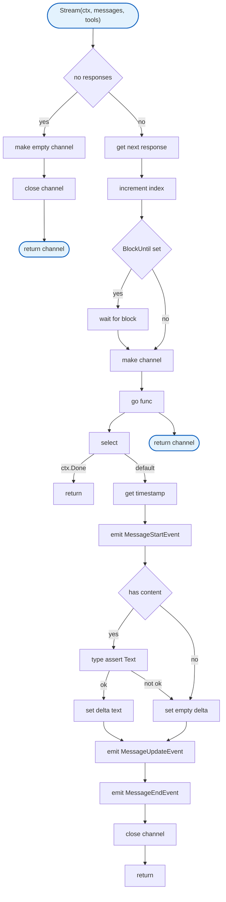

# Agent Mock

Mock implementations for testing the agent runtime.

## Overview



## Structs

### MockLLMClient

| Struct | Field | Type | Description |
|--------|-------|------|-------------|
| `MockLLMClient` | `Responses` | `[]MockResponse` | Canned responses |
| | `responseIndex` | `int` | Current response index |

### MockResponse

| Struct | Field | Type | Description |
|--------|-------|------|-------------|
| `MockResponse` | `Message` | `AgentMessage` | Response message |
| | `BlockUntil` | `chan struct{}` | Block until channel closed |

### MockToolConfig

| Struct | Field | Type | Description |
|--------|-------|------|-------------|
| `MockToolConfig` | `Name` | `string` | Tool name |
| | `Description` | `string` | Tool description |
| | `Result` | `*ToolResult` | Canned result |
| | `Error` | `error` | Canned error |
| | `ExecuteFunc` | `func(ctx context.Context, args map[string]any) (*ToolResult, error)` | Custom execution |

## Interface

### LLMClient

```go
type LLMClient interface {
    Stream(ctx context.Context, messages []AgentMessage, tools []Tool) (<-chan AgentEvent, error)
}
```

## Functions

| Function | Signature | Description |
|----------|-----------|-------------|
| `NewMockLLMClient` | N/A (struct literal) | Create mock client |
| `Stream` | `(ctx, messages, tools) (<-chan AgentEvent, error)` | Returns canned responses |
| `Reset` | `()` | Resets response index |
| `MockTool` | `(config MockToolConfig) Tool` | Creates mock tool |
| `MockEchoTool` | `(name string) Tool` | Creates echo tool |
| `MockFailingTool` | `(name string, err error) Tool` | Creates failing tool |
| `MockResultTool` | `(name string, result *ToolResult) Tool` | Creates result tool |

## Design Notes

### Response Cycling

**Q: Why cycle through responses instead of consuming them?**

| Aspect | Description |
|--------|-------------|
| Context | Mock response management |
| Options considered | Consume, cycle, infinite repeat |
| Rationale | Cycling allows reuse in multi-turn tests |

**Current approach is recommended because:**
- Tests can run multiple prompts
- Predictable response sequence
- Reset() available for explicit reset
- Avoids test setup complexity

### BlockUntil Channel

**Q: Why have BlockUntil instead of sleep/delay?**

| Aspect | Description |
|--------|-------------|
| Context | Testing async behavior |
| Options considered | time.Sleep, channel signal |
| Rationale | Channel signal is deterministic and instant |

**Current approach is recommended because:**
- Tests control exact timing
- No flaky sleep-based tests
- Can test concurrent scenarios
- Instant when unblocked

## Test Coverage

Used extensively in agent package tests. Not directly tested itself.

**Running:**
```bash
make test ./internal/agent
```

## Dependencies and Location

| Package | Purpose |
|---------|---------|
| `context` | Context handling |
| `time` | Timestamp generation |

**File Location:** [`internal/agent/mock.go`](https://github.com/nevaria-ai/gateway/blob/main/internal/agent/mock.go)

## Related

- [Agent README](README.md) - Main agent package
- [Loop](loop.md) - Uses MockLLMClient
