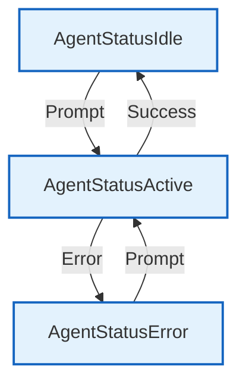

# Agent Status

Agent status enumeration for tracking agent lifecycle state.

## Overview



## Constants

| Constant | Type | Value | Description |
|----------|------|-------|-------------|
| `AgentStatusIdle` | `AgentStatus` | `"idle"` | Agent is idle, waiting for input |
| `AgentStatusActive` | `AgentStatus` | `"active"` | Agent is processing a request |
| `AgentStatusError` | `AgentStatus` | `"error"` | Agent encountered an error |

## Type Definition

```go
type AgentStatus string
```

## Methods

| Method | Signature | Description |
|--------|-----------|-------------|
| `String` | `() string` | Returns string representation |

## Design Notes

### String Type for Status

**Q: Why use string type instead of int enum?**

| Aspect | Description |
|--------|-------------|
| Context | Status serialization |
| Options considered | int, int const, string |
| Rationale | String is self-documenting in JSON/logs |

**Current approach is recommended because:**
- JSON serialization is readable
- Logs show meaningful values
- No mapping needed for display
- Type-safe with compiler checks

## Test Coverage

### Unit Tests

| Test Suite | Coverage |
|------------|----------|
| `TestAgentStatus_String` | String conversion |

**Running:**
```bash
make test ./internal/agent
```

## Dependencies and Location

| Package | Purpose |
|---------|---------|
| (none) | Pure type definition |

**File Location:** [`internal/agent/status.go`](../../internal/agent/status.go)
