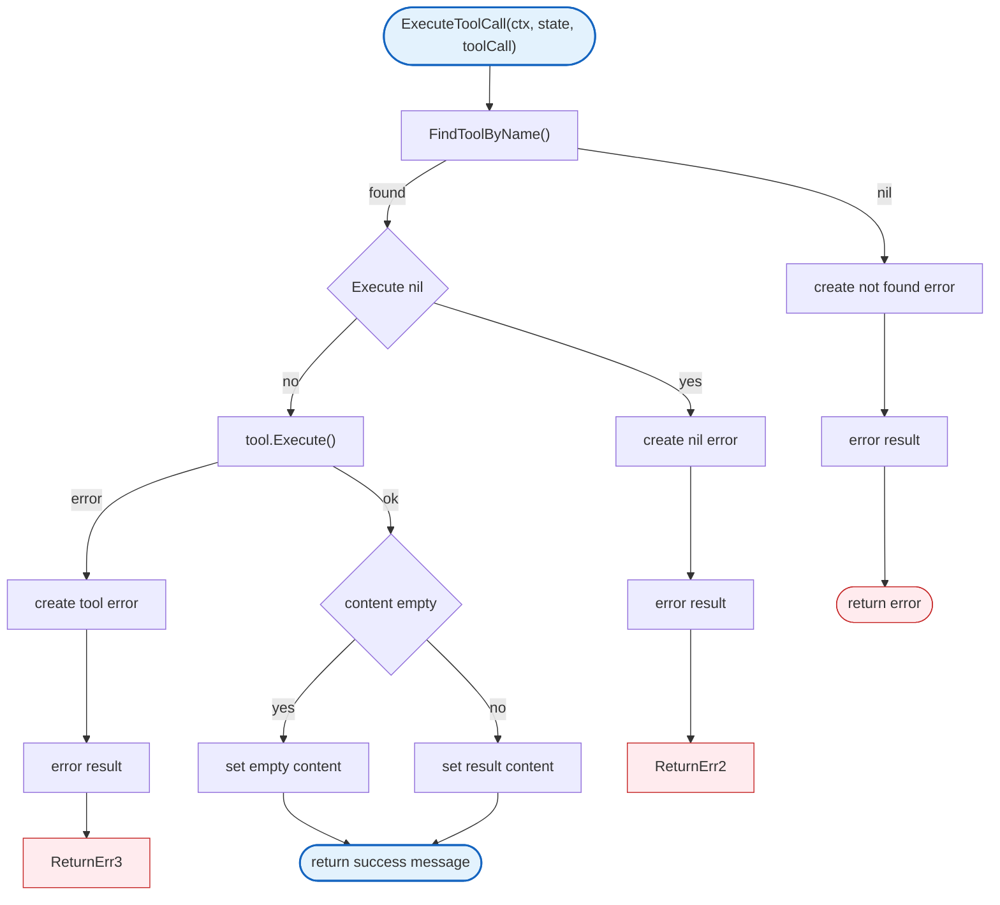

# Agent Tool

Tool execution framework for the agent runtime.

## Overview



## Functions

| Function | Signature | Description |
|----------|-----------|-------------|
| `ExecuteToolCall` | `(ctx context.Context, state *AgentState, toolCall ToolCallContent) (AgentMessage, error)` | Executes a tool call |
| `FindToolByName` | `(state *AgentState, name string) *Tool` | Finds tool by name |

## Design Notes

### Error as Tool Result

**Q: Why return tool execution errors as messages instead of errors?**

| Aspect | Description |
|--------|-------------|
| Context | Tool error handling |
| Options considered | Return error, return error message, both |
| Rationale | LLM needs to see errors in conversation |

**Current approach is recommended because:**
- LLM can see error and adapt
- Error becomes part of conversation
- Agent can retry or try alternatives
- Consistent with OpenAI/Anthropic patterns

### Pointer Return for FindToolByName

**Q: Why return *Tool instead of Tool?**

| Aspect | Description |
|--------|-------------|
| Context | Tool lookup |
| Options considered | Tool with ok bool, *Tool, index |
| Rationale | Nil clearly indicates not found |

**Current approach is recommended because:**
- Nil is clear "not found" signal
- Avoids extra bool return
- Pointer allows caller to check fields
- Standard Go pattern for lookups

## Test Coverage

### Unit Tests (`tool_test.go`)

| Test Suite | Coverage |
|------------|----------|
| `TestExecuteToolCall_Success` | Successful execution |
| `TestExecuteToolCall_NotFound` | Tool not found |
| `TestExecuteToolCall_NilExecute` | Nil Execute function |
| `TestExecuteToolCall_Error` | Tool returns error |
| `TestFindToolByName` | Tool lookup |
| `TestFindToolByName_NotFound` | Not found returns nil |

**Running:**
```bash
make test ./internal/agent
```

## Dependencies and Location

| Package | Purpose |
|---------|---------|
| `context` | Context handling |
| `fmt` | Error formatting |
| `time` | Timestamp generation |

**File Location:** [`internal/agent/tool.go`](https://github.com/nevaria-ai/gateway/blob/main/internal/agent/tool.go)

## Related

- [Agent README](README.md) - Main agent package
- [Loop](loop.md) - Tool calling loop
- [Types](types.md) - Tool and ToolResult types
