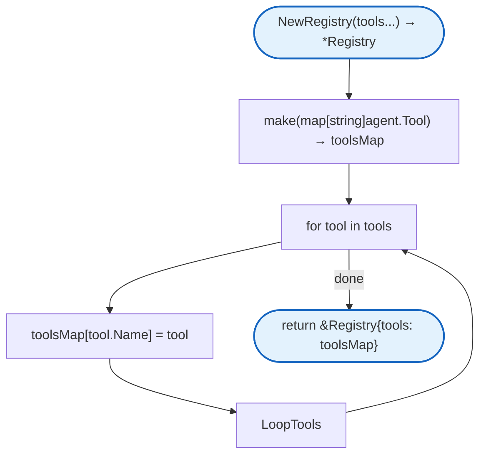
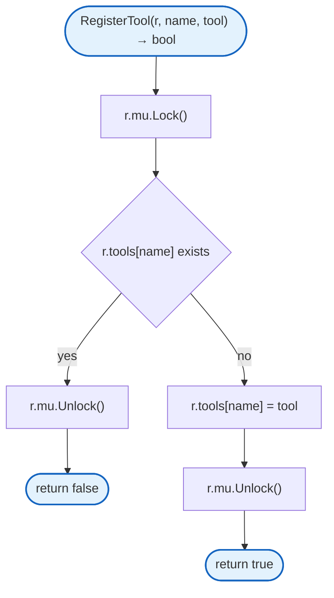
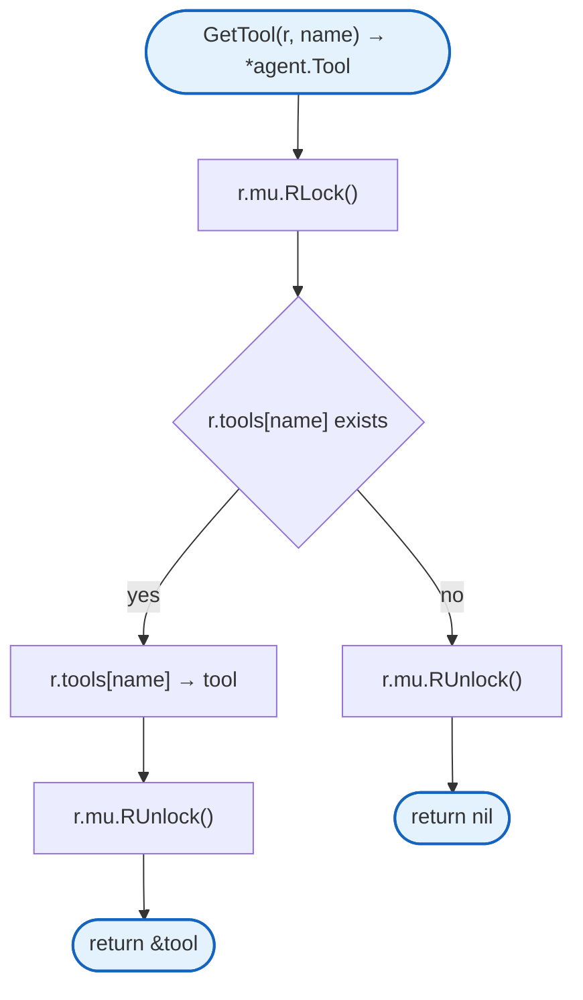
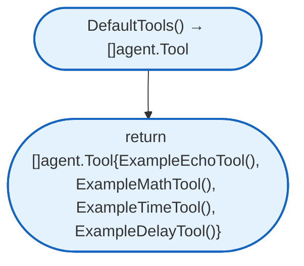
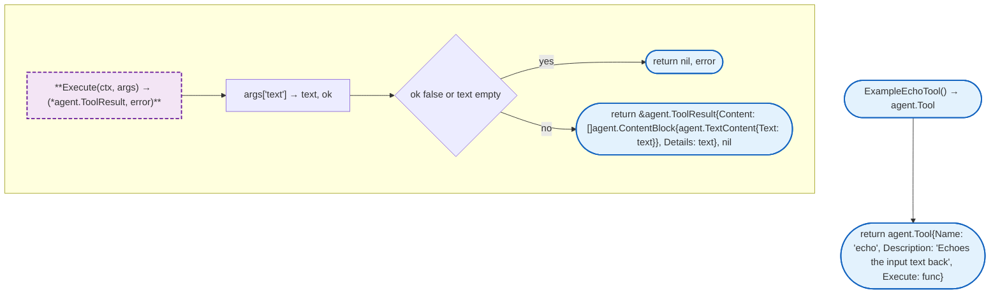
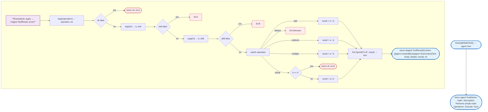
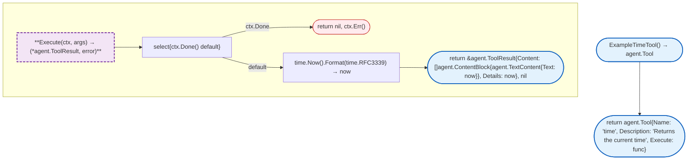

# Agent Tools

Built-in agent tools and tool registry for the agent runtime.

## NewRegistry



## RegisterTool



## GetTool



## DefaultTools



## ExampleEchoTool



## ExampleMathTool



## ExampleTimeTool



## ExampleDelayTool

```mermaid
flowchart TB
    Start(["ExampleDelayTool() → agent.Tool"]) --> ReturnTool(["return agent.Tool{Name: 'delay', Description: 'Waits for specified duration', Execute: func}"])

    subgraph SGExecute [" "]
        HExecute["**Execute(ctx, args) → (*agent.ToolResult, error)**"]
        HExecute --> GetDuration["args['duration_ms'] → durationMsFloat, ok"]
        GetDuration --> CheckFloat{ok false}
        CheckFloat -->|yes| CheckInt["args['duration_ms'] → durationMsInt, okInt"]
        CheckInt --> CheckIntOk{okInt false}
        CheckIntOk -->|yes| ErrInt(["return nil, error"])
        CheckIntOk -->|no| ConvertFloat["float64(durationMsInt) → durationMsFloat"]
        ConvertFloat --> CheckNeg
        CheckFloat -->|no| CheckNeg
        CheckNeg{"durationMsFloat < 0"}
        CheckNeg -->|yes| ErrNeg(["return nil, error"])
        CheckNeg -->|no| CalcDuration["time.Duration(durationMsFloat) * time.Millisecond → duration"]
        CalcDuration --> NewTimer["time.NewTimer(duration) → timer"]
        NewTimer --> DeferTimer["defer timer.Stop()"]
        DeferTimer --> Select["select{ctx.Done() <-timer.C}"]
        Select -->|ctx.Done| ReturnErr(["return nil, ctx.Err()"])
        Select -->|timer| FormatResult["fmt.Sprintf('waited %d ms', int(durationMsFloat)) → result"]
        FormatResult --> ReturnOk(["return &agent.ToolResult{Content: []agent.ContentBlock{agent.TextContent{Text: result}}, Details: durationMsFloat}, nil"])
    end

    classDef mainFn fill:#e3f2fd,stroke:#1565c0,stroke-width:2px
    classDef internalFn fill:#f3e5f5,stroke:#6a1b9a,stroke-width:2px,stroke-dasharray:6 3
    classDef errorFlow fill:#ffebee,stroke:#c62828,stroke-width:1px

    class Start,ReturnTool,ReturnOk mainFn
    class HExecute internalFn
    class ErrInt,ErrNeg,ReturnErr errorFlow
```



## ReadAgentFileTool

```mermaid
flowchart TB
    Start(["ReadAgentFileTool(client) → agent.Tool"]) --> ReturnTool(["return agent.Tool{Name: 'read_agent_file', Description: 'Read from agent workspace', Execute: func}"])

    subgraph SGExecute [" "]
        HExecute["**Execute(ctx, args) → (*agent.ToolResult, error)**"]
        HExecute --> GetUserID["ctxpkg.GetUserIDFromContext(ctx) → userID"]
        GetUserID --> GetAgentID["ctxpkg.GetAgentIDFromContext(ctx) → agentID"]
    GetAgentID --> CheckIDs{"userID empty or agentID empty"}
    CheckIDs -->|yes| ErrIDs(["return &agent.ToolResult{Content: []agent.ContentBlock{agent.TextContent{Text: 'Error'}}, fmt.Errorf('IDs not found in context')"])
    CheckIDs -->|no| GetPath["args['path'] → path, ok"]
    GetPath --> CheckPath{"ok false or path empty"}
        CheckPath -->|yes| ErrPath(["return &agent.ToolResult{Content: []agent.ContentBlock{agent.TextContent{Text: 'Error'}}, fmt.Errorf('missing path')"])
        CheckPath -->|no| BuildS3Path["path.Join(userID, agentID, 'workspace', filePath) → s3Path"]
        BuildS3Path --> GetFile["client.Get(ctx, s3Path) → data, err"]
        GetFile -->|error| ErrFile(["return &agent.ToolResult{Content: []agent.ContentBlock{agent.TextContent{Text: 'Error'}}, err"])
        GetFile -->|ok| ReturnOk(["return &agent.ToolResult{Content: []agent.ContentBlock{agent.TextContent{Text: string(data)}}, nil"])
    end

    click GetUserID,GetAgentID href "../../ctx/README.md"

    classDef mainFn fill:#e3f2fd,stroke:#1565c0,stroke-width:2px
    classDef internalFn fill:#f3e5f5,stroke:#6a1b9a,stroke-width:2px,stroke-dasharray:6 3
    classDef localPkgs fill:#fff8e1,stroke:#f9a825,stroke-width:1.5px,stroke-dasharray:4 2
    classDef errorFlow fill:#ffebee,stroke:#c62828,stroke-width:1px

    class Start,ReturnTool,ReturnOk mainFn
    class HExecute internalFn
    class GetUserID,GetAgentID localPkgs
    class ErrIDs,ErrPath,ErrFile errorFlow
```



## WriteAgentFileTool

```mermaid
flowchart TB
    Start(["WriteAgentFileTool(client) → agent.Tool"]) --> ReturnTool(["return agent.Tool{Name: 'write_agent_file', Description: 'Write to agent workspace', Execute: func}"])

    subgraph SGExecute [" "]
        HExecute["**Execute(ctx, args) → (*agent.ToolResult, error)**"]
        HExecute --> GetUserID["ctxpkg.GetUserIDFromContext(ctx) → userID"]
        GetUserID --> GetAgentID["ctxpkg.GetAgentIDFromContext(ctx) → agentID"]
        GetAgentID --> CheckIDs{"userID empty or agentID empty"}
        CheckIDs -->|yes| ErrIDs(["return &agent.ToolResult{Content: []agent.ContentBlock{agent.TextContent{Text: 'Error'}}, fmt.Errorf('IDs not found in context')"])
    CheckIDs -->|no| GetPath["args['path'] → path, ok"]
    GetPath --> CheckPath{"ok false or path empty"}
        CheckPath -->|yes| ErrPath(["return &agent.ToolResult{Content: []agent.ContentBlock{agent.TextContent{Text: 'Error'}}, fmt.Errorf('missing path')"])
        CheckPath -->|no| GetContent["args['content'] → content, ok"]
        GetContent --> CheckContent{ok false}
        CheckContent -->|yes| ErrContent(["return &agent.ToolResult{Content: []agent.ContentBlock{agent.TextContent{Text: 'Error'}}, fmt.Errorf('missing content')"])
        CheckContent -->|no| BuildS3Path["path.Join(userID, agentID, 'workspace', filePath) → s3Path"]
        BuildS3Path --> PutFile["client.Put(ctx, s3Path, []byte(content)) → err"]
        PutFile -->|error| ErrFile(["return &agent.ToolResult{Content: []agent.ContentBlock{agent.TextContent{Text: 'Error'}}, err"])
        PutFile -->|ok| ReturnOk(["return &agent.ToolResult{Content: []agent.ContentBlock{agent.TextContent{Text: 'Success'}}, nil"])
    end

    click GetUserID,GetAgentID href "../../ctx/README.md"

    classDef mainFn fill:#e3f2fd,stroke:#1565c0,stroke-width:2px
    classDef internalFn fill:#f3e5f5,stroke:#6a1b9a,stroke-width:2px,stroke-dasharray:6 3
    classDef localPkgs fill:#fff8e1,stroke:#f9a825,stroke-width:1.5px,stroke-dasharray:4 2
    classDef errorFlow fill:#ffebee,stroke:#c62828,stroke-width:1px

    class Start,ReturnTool,ReturnOk mainFn
    class HExecute internalFn
    class GetUserID,GetAgentID localPkgs
    class ErrIDs,ErrPath,ErrContent,ErrFile errorFlow
```



## Files

| File | Description |
|------|-------------|
| [`registry.go`](https://github.com/nevaria-ai/gateway/blob/main/internal/agent/tools/registry.go) | Tool registry for registration and lookup |
| [`example.go`](https://github.com/nevaria-ai/gateway/blob/main/internal/agent/tools/example.go) | Example tools (echo, math, time, delay) |
| [`files.go`](https://github.com/nevaria-ai/gateway/blob/main/internal/agent/tools/files.go) | Agent workspace file operations |
| [`mem0.go`](https://github.com/nevaria-ai/gateway/blob/main/internal/agent/tools/mem0.go) | Long-term memory tools |
| [`node.go`](https://github.com/nevaria-ai/gateway/blob/main/internal/agent/tools/node.go) | Remote node tool integration |

## Tool Categories

### Example Tools

| Tool | Description |
|------|-------------|
| `echo` | Echoes input text back |
| `math` | Performs simple math operations |
| `time` | Returns current time |
| `delay` | Waits for specified duration |

### File Tools

| Tool | Description |
|------|-------------|
| `read_agent_file` | Read from agent workspace |
| `write_agent_file` | Write to agent workspace |

### Memory Tools

| Tool | Description |
|------|-------------|
| `mem0_search` | Search stored memories |
| `mem0_store` | Store in long-term memory |

### Node Tools

| Pattern | Description |
|---------|-------------|
| `{platform}_{nodeID}_{toolName}` | Execute on node in Docker |
| `{platform}_{nodeID}_{toolName}_onhost` | Execute on node directly |

## Registry

### Structs

| Struct | Field | Type | Description |
|--------|-------|------|-------------|
| `Registry` | `mu` | `sync.RWMutex` | Thread-safe lock |
| | `tools` | `map[string]agent.Tool` | Tool storage |

## Design Notes

### Thread-Safe Registry

**Q: Why use sync.RWMutex instead of sync.Map?**

| Aspect | Description |
|--------|-------------|
| Context | Tool registry concurrency |
| Options considered | sync.Map, sync.RWMutex, channel-based |
| Rationale | RWMutex is simpler for read-heavy pattern |

**Current approach is recommended because:**
- Reads don't block each other
- Simple lock/unlock pattern
- Clear critical sections
- Standard Go pattern

### Tool Name Prefix for Removal

**Q: Why remove tools by prefix instead of exact name?**

| Aspect | Description |
|--------|-------------|
| Context | Dynamic tool management |
| Options considered | Exact name, prefix, tag-based |
| Rationale | Node tools share platform_nodeID prefix |

**Current approach is recommended because:**
- Efficient batch removal
- Groups related tools
- Works well with node lifecycle
- Simple string comparison

## Test Coverage

### Unit Tests

| Test Suite | Coverage |
|------------|----------|
| `TestRegistry` | Tool registration and lookup |
| `TestExampleEchoTool` | Echo tool execution |
| `TestExampleMathTool` | Math operations |
| `TestExampleTimeTool` | Time tool |
| `TestExampleDelayTool` | Delay with context |
| `TestFileTools` | File read/write |
| `TestMem0Tools` | Memory search/store |
| `TestNodeToolRegistry` | Node tool management |

**Running:**
```bash
make test ./internal/agent/tools
```

## Dependencies and Location

| Package | Purpose |
|---------|---------|
| `sync` | Thread safety |
| `context` | Context handling |
| `path` | Path joining for S3 keys |
| `internal/agent` | Agent types |
| `internal/ctx` | Context utilities |
| `internal/storage` | S3 client |
| `internal/mem0` | Memory client |
| `internal/node` | Node types |

**File Locations:**
- [`internal/agent/tools/registry.go`](https://github.com/nevaria-ai/gateway/blob/main/internal/agent/tools/registry.go)
- [`internal/agent/tools/example.go`](https://github.com/nevaria-ai/gateway/blob/main/internal/agent/tools/example.go)
- [`internal/agent/tools/files.go`](https://github.com/nevaria-ai/gateway/blob/main/internal/agent/tools/files.go)
- [`internal/agent/tools/mem0.go`](https://github.com/nevaria-ai/gateway/blob/main/internal/agent/tools/mem0.go)
- [`internal/agent/tools/node.go`](https://github.com/nevaria-ai/gateway/blob/main/internal/agent/tools/node.go)

## Related

- [Agent README](README.md) - Main agent package
- [Storage](../storage/README.md) - Workspace storage
- [Mem0](../mem0/README.md) - Memory service
- [Node](../node/README.md) - Node service
