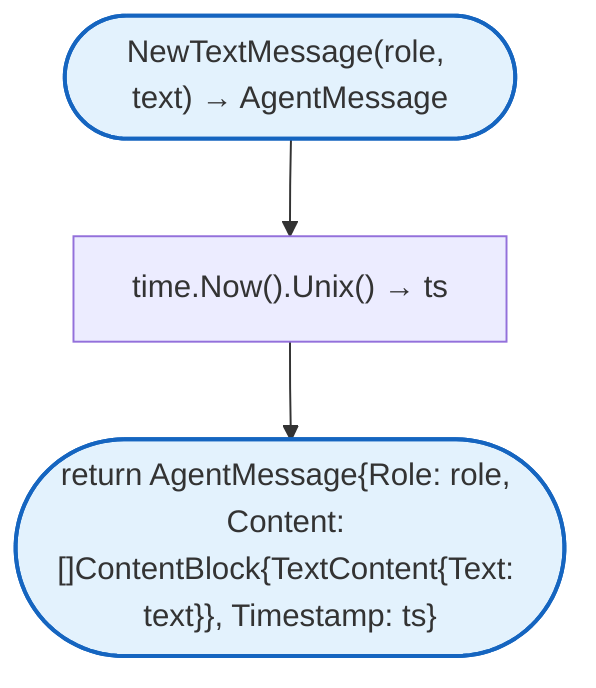
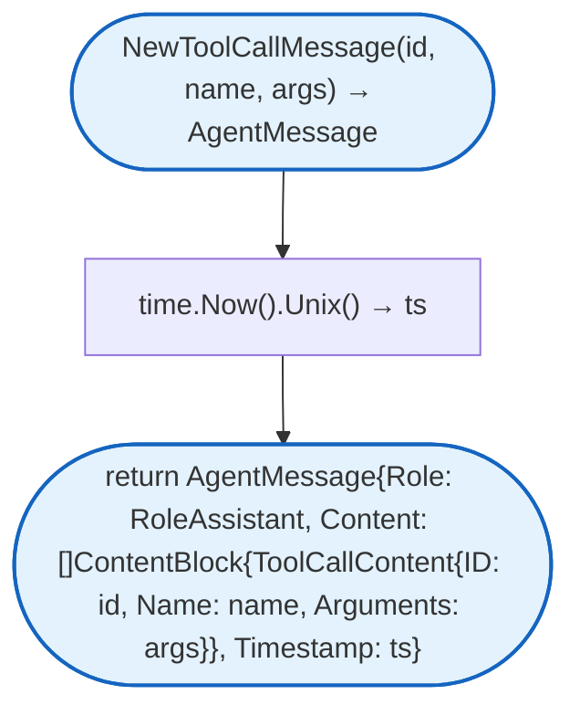
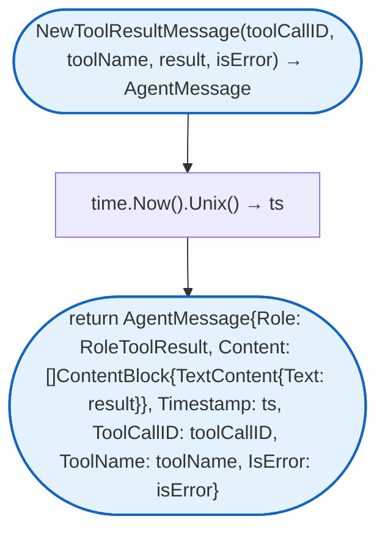
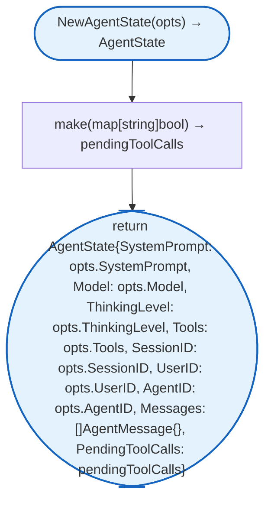

# Agent Types

Core type definitions for the agent runtime: messages, content blocks, roles, and state.

## NewTextMessage



## NewToolCallMessage



## NewToolResultMessage



## NewAgentState



## Constants

### Role

| Constant | Type | Value | Description |
|----------|------|-------|-------------|
| `RoleUser` | `Role` | `"user"` | From user |
| `RoleAssistant` | `Role` | `"assistant"` | From AI assistant |
| `RoleToolResult` | `Role` | `"toolResult"` | From tool execution |

### ThinkingLevel

| Constant | Type | Value | Description |
|----------|------|-------|-------------|
| `ThinkingLevelOff` | `ThinkingLevel` | `"off"` | Disabled |
| `ThinkingLevelMinimal` | `ThinkingLevel` | `"minimal"` | Minimal thinking |
| `ThinkingLevelLow` | `ThinkingLevel` | `"low"` | Low thinking |
| `ThinkingLevelMedium` | `ThinkingLevel` | `"medium"` | Medium thinking |
| `ThinkingLevelHigh` | `ThinkingLevel` | `"high"` | High thinking |

## Structs

### AgentMessage

| Struct | Field | Type | Description |
|--------|-------|------|-------------|
| `AgentMessage` | `Role` | `Role` | Message role |
| | `Content` | `[]ContentBlock` | Message content blocks |
| | `Timestamp` | `int64` | Unix timestamp |
| | `ToolCallID` | `string` | Tool call ID (for results) |
| | `ToolName` | `string` | Tool name (for results) |
| | `IsError` | `bool` | Error flag (for results) |

### ContentBlock Types

#### TextContent

| Struct | Field | Type | Description |
|--------|-------|------|-------------|
| `TextContent` | `Text` | `string` | Text content |

#### ImageContent

| Struct | Field | Type | Description |
|--------|-------|------|-------------|
| `ImageContent` | `Data` | `string` | Base64-encoded image data |
| | `MimeType` | `string` | MIME type (e.g., image/png) |

#### ToolCallContent

| Struct | Field | Type | Description |
|--------|-------|------|-------------|
| `ToolCallContent` | `ID` | `string` | Tool call identifier |
| | `Name` | `string` | Tool name |
| | `Arguments` | `map[string]any` | Tool arguments |

### Tool

| Struct | Field | Type | Description |
|--------|-------|------|-------------|
| `Tool` | `Name` | `string` | Tool identifier |
| | `Description` | `string` | Tool description for LLM |
| | `Execute` | `func(ctx context.Context, args map[string]any) (*ToolResult, error)` | Execution function |

### ToolResult

| Struct | Field | Type | Description |
|--------|-------|------|-------------|
| `ToolResult` | `Content` | `[]ContentBlock` | Result content blocks |
| | `Details` | `any` | Additional details |

### Model

| Struct | Field | Type | Description |
|--------|-------|------|-------------|
| `Model` | `ID` | `string` | Model identifier |
| | `API` | `string` | API type |
| | `Provider` | `string` | Provider name |
| | `BaseURL` | `string` | Base URL (for custom) |

### ToolExecutionError

| Struct | Field | Type | Description |
|--------|-------|------|-------------|
| `ToolExecutionError` | `ToolName` | `string` | Tool name |
| | `Message` | `string` | Error message |

### AgentState

| Struct | Field | Type | Description |
|--------|-------|------|-------------|
| `AgentState` | `SystemPrompt` | `string` | System prompt for LLM |
| | `Model` | `Model` | Model configuration |
| | `ThinkingLevel` | `ThinkingLevel` | Thinking intensity |
| | `Tools` | `[]Tool` | Available tools |
| | `Messages` | `[]AgentMessage` | Conversation history |
| | `IsStreaming` | `bool` | Currently streaming |
| | `StreamMessage` | `*AgentMessage` | Current streaming message |
| | `PendingToolCalls` | `map[string]bool` | Pending tool call IDs |
| | `Error` | `string` | Error state |
| | `SessionID` | `string` | Session identifier |
| | `UserID` | `string` | User identifier |
| | `AgentID` | `string` | Agent identifier |

## Functions

| Function | Description |
|----------|-------------|
| `AddMessage` | Adds message to history |
| `SetStreaming` | Sets streaming state |
| `AddPendingToolCall` | Marks tool call as pending |
| `RemovePendingToolCall` | Removes pending tool call |
| `HasPendingToolCall` | Checks if tool call pending |
| `Role.String()` | Returns string representation |
| `ThinkingLevel.String()` | Returns string representation |
| `ThinkingLevel.IsOff()` | Checks if thinking disabled |
| `ThinkingLevel.IsEnabled()` | Checks if thinking enabled |
| `ToolExecutionError.Error()` | Returns error message |

## Design Notes

### Sealed ContentBlock Interface

**Q: Why use sealed interface for ContentBlock?**

| Aspect | Description |
|--------|-------------|
| Context | Content block polymorphism |
| Options considered | Any type, interface with type field, sealed interface |
| Rationale | Type safety with known content types |

**Current approach is recommended because:**
- Only defined types can be content blocks
- JSON marshaling with type discrimination
- Type switch exhaustiveness
- Prevents invalid content types

### Custom JSON Marshaling

**Q: Why implement custom MarshalJSON/UnmarshalJSON?**

| Aspect | Description |
|--------|-------------|
| Context | JSON serialization of polymorphic content |
| Options considered | Default marshaling, custom marshaling |
| Rationale | Need type field for discrimination during decode |

**Current approach is recommended because:**
- Adds `type` field for discrimination
- Handles polymorphic content blocks
- Consistent with provider APIs
- Allows backward-compatible additions

## Test Coverage

### Unit Tests (`types_test.go`)

| Test Suite | Coverage |
|------------|----------|
| `TestRole_String` | Role string conversion |
| `TestThinkingLevel` | Thinking level methods |
| `TestNewTextMessage` | Text message creation |
| `TestNewToolCallMessage` | Tool call message creation |
| `TestNewToolResultMessage` | Tool result message creation |
| `TestAgentMessage_JSON` | JSON marshaling/unmarshaling |
| `TestContentBlock_JSON` | Content block JSON handling |
| `TestToolExecutionError` | Error formatting |

**Running:**
```bash
make test ./internal/agent
```

## Dependencies and Location

| Package | Purpose |
|---------|---------|
| `encoding/json` | JSON marshaling |
| `time` | Timestamp generation |

**File Location:** [`internal/agent/types.go`](https://github.com/nevaria-ai/gateway/blob/main/internal/agent/types.go)

## Related

- [Agent README](README.md) - Main agent package
- [Events](events.md) - Event types using AgentMessage
- [Loop](loop.md) - Message processing
