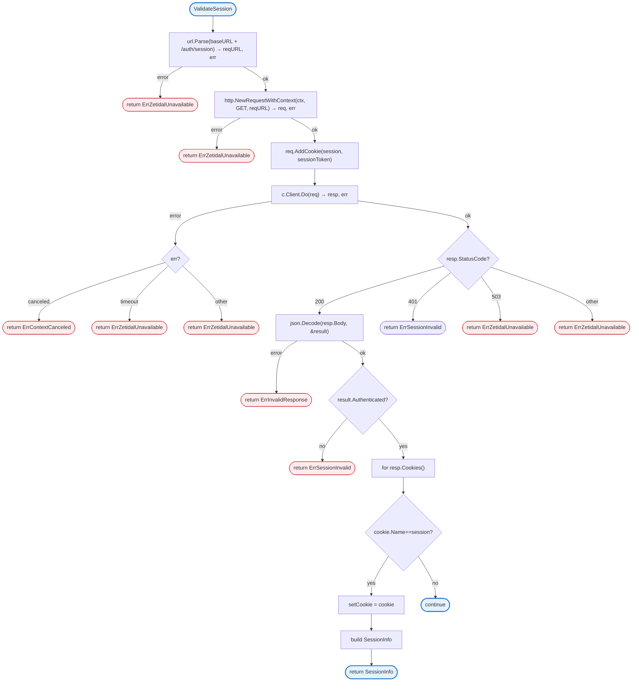
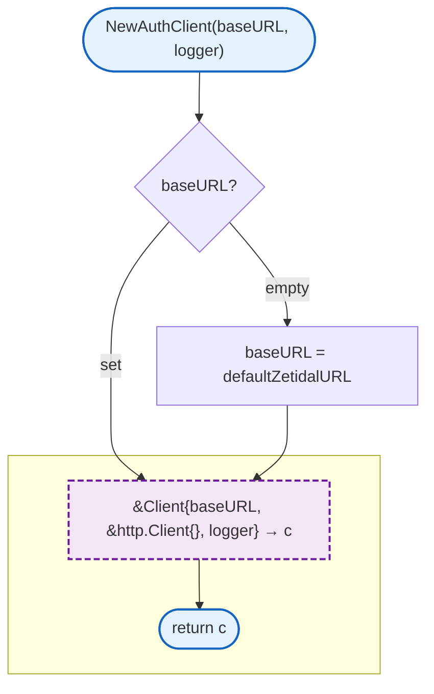
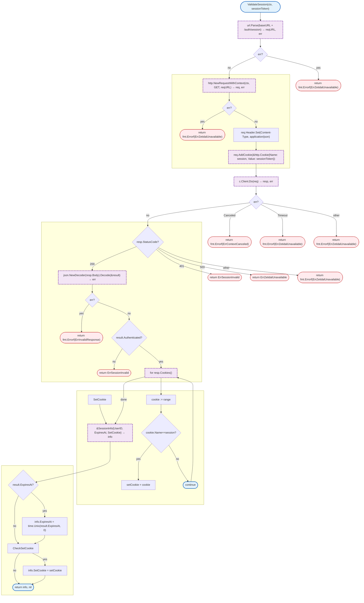

# Auth

Zetidal API client for session validation. Validates session tokens via HTTP calls to the zetidal API.

## Overview



## Constants

| Constant | Type | Value | Description |
|----------|------|-------|-------------|
| `defaultZetidalURL` | string | `http://localhost:8081` | Default zetidal API URL |
| `sessionCookieName` | string | `session` | Session cookie name |

## Structs

### Client

| Struct | Field | Type | Description |
|--------|-------|------|-------------|
| `Client` | `baseURL` | `string` | Zetidal API base URL |
| | `Client` | `*http.Client` | HTTP client (exported for testing) |
| | `logger` | `interface{}` | Logger (zerolog.Logger) |

### SessionInfo

| Struct | Field | Type | Description |
|--------|-------|------|-------------|
| `SessionInfo` | `UserID` | `string` | Validated user ID |
| | `ExpiresAt` | `time.Time` | Session expiration time |
| | `SetCookie` | `*http.Cookie` | Cookie for sliding expiration |

## Functions

### NewAuthClient



### ValidateSession



## Design Notes

### Sliding Expiration

**Q: Why capture SetCookie for sliding expiration?**

| Aspect | Description |
|--------|-------------|
| Context | Session refresh from zetidal API |
| Options considered | Ignore, Pass through, Re-fetch |
| Rationale | Zetidal controls session lifetime |

**Current approach is recommended because:**
- Zetidal decides when to extend sessions
- Gateway just forwards the cookie
- No session state in gateway
- Consistent session management

## Test Coverage

### Unit Tests (`auth_test.go`)

| Test Suite | Coverage |
|------------|----------|
| `TestNewAuthClient` | Client creation with defaults |
| `TestValidateSession_Success` | Successful validation |
| `TestValidateSession_InvalidSession` | 401 response handling |
| `TestValidateSession_ZetidalUnavailable` | 503 response handling |
| `TestValidateSession_Timeout` | Request timeout |
| `TestValidateSession_ContextCanceled` | Context cancellation |

**Running:**
```bash
make test ./internal/auth
```

## Dependencies and Location

| Package | Purpose |
|---------|---------|
| Standard library | HTTP client, JSON, context |

**File Location:** [`internal/auth/client.go`](https://github.com/nevaria-ai/gateway/blob/main/internal/auth/client.go)

## Related

- [Server Middleware](../server/README.md) - Auth middleware usage
- [Config](../../config/README.md) - Zetidal configuration
