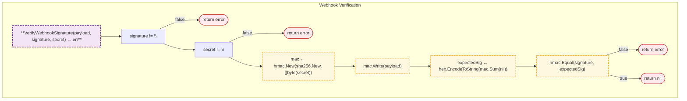
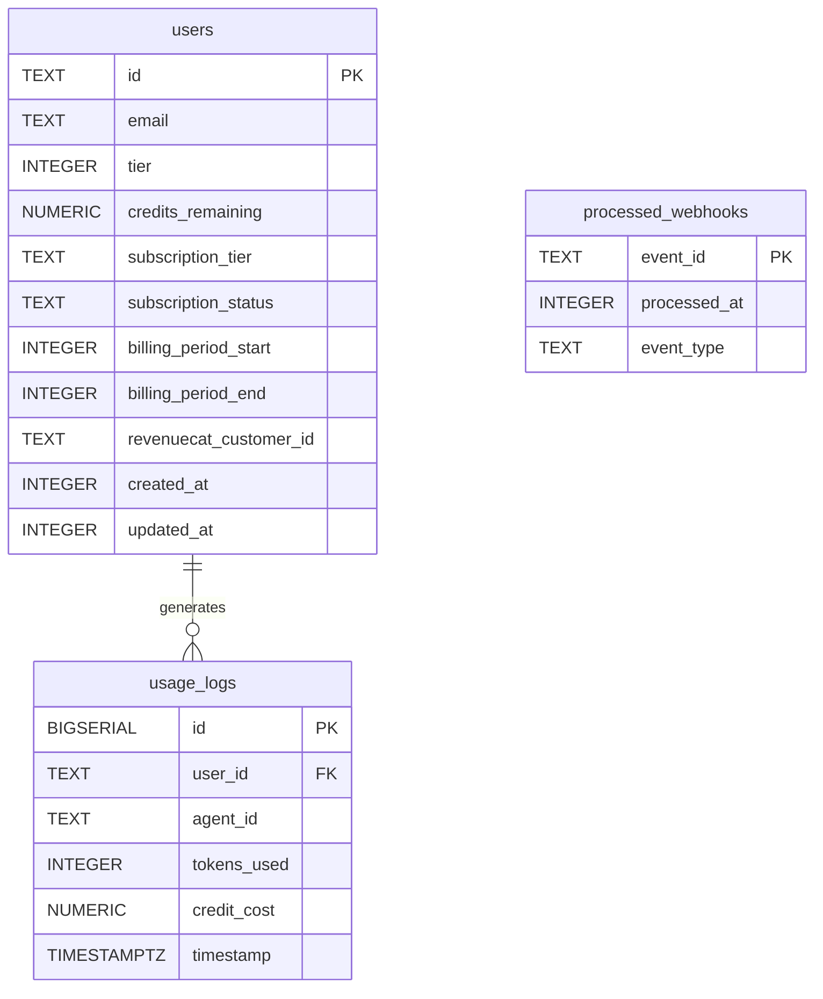

# Billing

RevenueCat webhook handling, quota management, and database migrations for subscription billing.

## Overview



## Structs

### QuotaManager

| Struct | Field | Type | Description |
|--------|-------|------|-------------|
| `QuotaManager` | `db` | `*pgxpool.Pool` | Database connection pool |

### Migration

| Struct | Field | Type | Description |
|--------|-------|------|-------------|
| `Migration` | `Name` | `string` | Migration name |
| | `SQL` | `string` | SQL to execute |

### MigrationResult

| Struct | Field | Type | Description |
|--------|-------|------|-------------|
| `MigrationResult` | `MigrationName` | `string` | Migration name |
| | `AlreadyExists` | `bool` | Already applied |
| | `Error` | `error` | Error if any |

## Constants

| Constant | Type | Value | Description |
|----------|------|-------|-------------|
| `TierFree` | `int` | `0` | Free tier |
| `TierPro` | `int` | `1` | Pro tier |
| `TierEnterprise` | `int` | `2` | Enterprise tier |

## Database Schema



### Relationships

| Relationship | Type | Description |
|--------------|------|-------------|
| `users` → `usage_logs` | 1:N | Usage tracking per user |

### Cascade Behavior

| Table | On Delete | Behavior |
|-------|-----------|----------|
| `users` | CASCADE | Delete all usage logs for user |

### Key Constraints

| Table | Constraints |
|-------|-------------|
| `users` | CHECK (tier IN (0, 1, 2)) |

## Functions

| Function | Signature | Description |
|----------|-----------|-------------|
| `VerifyWebhookSignature` | `(payload []byte, signature, secret string) error` | Verifies HMAC-SHA256 signature |
| `NewQuotaManager` | `(db *pgxpool.Pool) *QuotaManager` | Creates quota manager |
| `CheckQuota` | `(ctx context.Context, userID string, creditsNeeded float64) error` | Checks credit availability |
| `ReserveCredit` | `(ctx context.Context, userID string, amount float64) error` | Reserves credits |
| `DeductCredit` | `(ctx context.Context, userID, agentID string, tokensUsed int, creditCost float64) error` | Deducts credits |
| `RunMigrations` | `(ctx context.Context, dbURL string) error` | Runs all migrations |
| `CheckMigrations` | `(ctx context.Context, dbURL string) ([]MigrationResult, error)` | Checks migration status |

## Design Notes

### HMAC-SHA256 Verification

**Q: Why HMAC-SHA256 for webhook signatures?**

| Aspect | Description |
|--------|-------------|
| Context | Webhook authenticity |
| Options considered | Plain hash, HMAC, asymmetric |
| Rationale | RevenueCat standard, prevents tampering |

**Current approach is recommended because:**
- Industry standard for webhooks
- Prevents replay attacks with timestamp
- Shared secret is simple to manage
- Supported by all major payment providers

### Stub Implementation

**Q: Why are quota methods stub implementations?**

| Aspect | Description |
|--------|-------------|
| Context | Wave 4 implementation |
| Options considered | Full implementation, stub, skip |
| Rationale | Incremental delivery with clear TODOs |

**Current approach is recommended because:**
- Clear interface definition
- Explicit Wave 4 markers
- Tests can verify structure
- Implementation can be completed later

## Test Coverage

### Unit Tests

| Test Suite | Coverage |
|------------|----------|
| `TestVerifyWebhookSignature` | HMAC verification |
| `TestVerifyWebhookSignature_Invalid` | Invalid signature rejection |
| `TestMigrations` | Migration execution |
| `TestCheckMigrations` | Status checking |

**Running:**
```bash
make test ./internal/billing
```

## Dependencies and Location

| Package | Purpose |
|---------|---------|
| `github.com/jackc/pgx/v5` | PostgreSQL driver |
| `github.com/jackc/pgx/v5/pgxpool` | Connection pooling |

**File Locations:**
- [`internal/billing/webhook.go`](https://github.com/nevaria-ai/gateway/blob/main/internal/billing/webhook.go) - Webhook handling
- [`internal/billing/quota.go`](https://github.com/nevaria-ai/gateway/blob/main/internal/billing/quota.go) - Quota management
- [`internal/billing/migrations.go`](https://github.com/nevaria-ai/gateway/blob/main/internal/billing/migrations.go) - Database migrations

## Related

- [LLM Proxy Quota](../llm-proxy/quota.md) - Quota checking integration
- [Config Plans](../../config/plans.md) - Plan definitions
