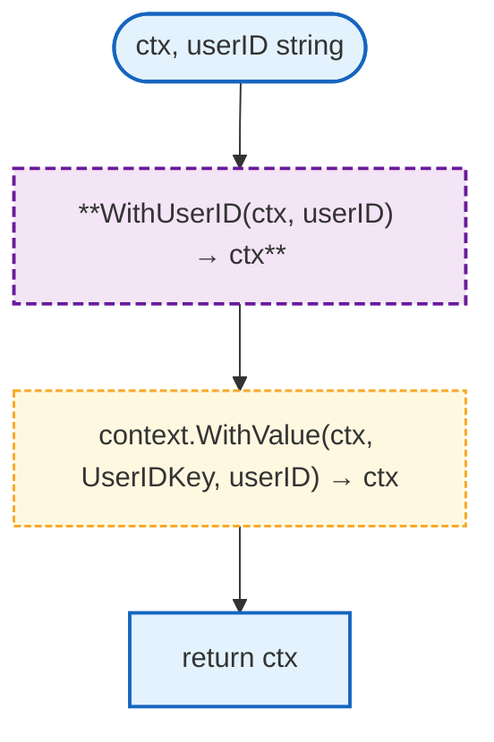
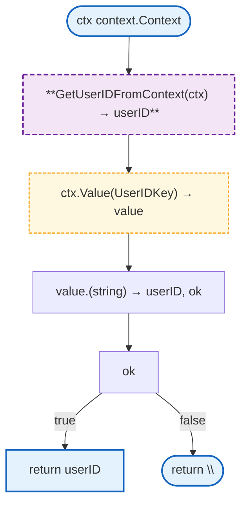
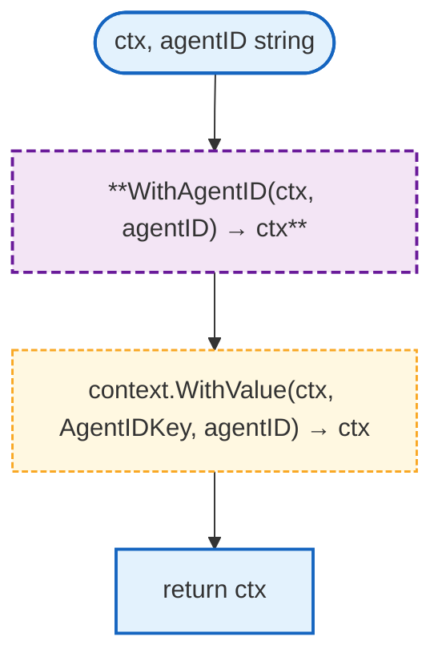
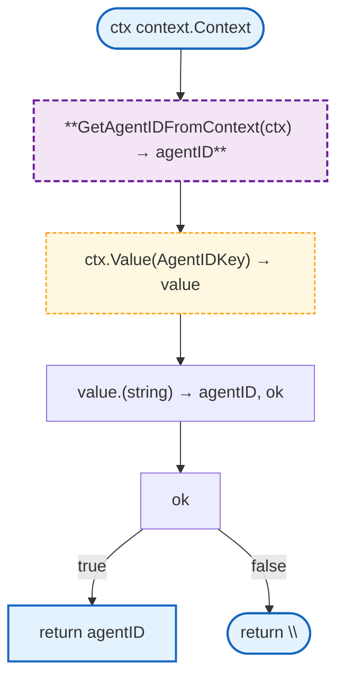

# Context

Context utilities for propagating user ID and agent ID through request lifecycles.

## Overview

<!-- Overview replaced by individual function flowcharts below -->

## Constants

| Constant | Type | Value | Description |
|----------|------|-------|-------------|
| `UserIDKey` | `contextKey` | `"user_id"` | Context key for user ID |
| `AgentIDKey` | `contextKey` | `"agent_id"` | Context key for agent ID |

## Functions

### WithUserID



### GetUserIDFromContext



### WithAgentID



### GetAgentIDFromContext



## Design Notes

### Custom Context Key Type

**Q: Why use custom contextKey type instead of string?**

| Aspect | Description |
|--------|-------------|
| Context | Context key collision prevention |
| Options considered | string, int, custom type |
| Rationale | Go best practice to avoid key collisions |

**Current approach is recommended because:**
- Type system prevents accidental collisions
- Compiler catches type mismatches
- Standard Go pattern
- Clear ownership of keys

### Empty String Default

**Q: Why return empty string instead of error when key not found?**

| Aspect | Description |
|--------|-------------|
| Context | Context value retrieval |
| Options considered | Return error, return empty, panic |
| Rationale | Empty string is natural zero value |

**Current approach is recommended because:**
- Simpler API (no error handling needed)
- Empty string is falsy in conditionals
- Matches Go's context.Value convention
- Callers can check `if userID == ""`

## Test Coverage

### Unit Tests (`context_test.go`)

| Test Suite | Coverage |
|------------|----------|
| `TestWithUserID` | Adding user ID to context |
| `TestGetUserIDFromContext` | Retrieving user ID |
| `TestGetUserIDFromContext_Missing` | Missing key returns empty |
| `TestWithAgentID` | Adding agent ID to context |
| `TestGetAgentIDFromContext` | Retrieving agent ID |
| `TestGetAgentIDFromContext_Missing` | Missing key returns empty |

**Running:**
```bash
make test ./internal/ctx
```

## Dependencies and Location

| Package | Purpose |
|---------|---------|
| `context` | Standard library context |

**File Location:** [`internal/ctx/context.go`](https://github.com/nevaria-ai/gateway/blob/main/internal/ctx/context.go)

## Related

- [Agent Tools](agent/tools.md) - Tools use context for userID/agentID
- [WebSocket Handler](websocket.md) - Sets context values from session
