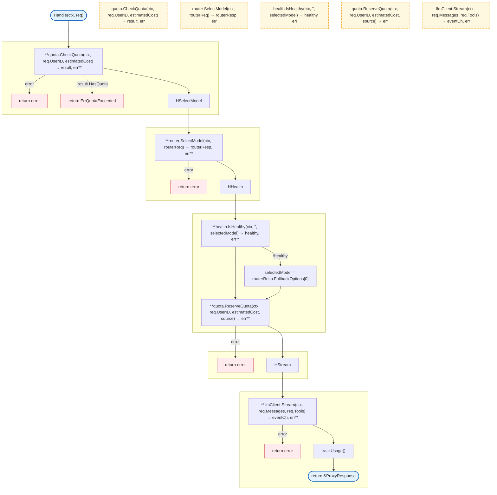

# LLM Proxy

LLM proxy with intelligent routing, quota management, health monitoring, and usage tracking.

## Overview



## Structs

### Handler

| Struct | Field | Type | Description |
|--------|-------|------|-------------|
| `Handler` | `llmClient` | `LLMClient` | LLM client |
| | `quota` | `QuotaChecker` | Quota checker |
| | `health` | `HealthChecker` | Health checker |
| | `router` | `Router` | Model router |
| | `usage` | `UsageTracker` | Usage tracker |

### ProxyRequest

| Struct | Field | Type | Description |
|--------|-------|------|-------------|
| `ProxyRequest` | `UserID` | `string` | User identifier |
| | `SessionID` | `string` | Session identifier |
| | `Query` | `string` | User query |
| | `Tools` | `[]agent.Tool` | Available tools |
| | `Messages` | `[]agent.AgentMessage` | Conversation history |

### ProxyResponse

| Struct | Field | Type | Description |
|--------|-------|------|-------------|
| `ProxyResponse` | `Stream` | `<-chan agent.AgentEvent` | Event stream |
| | `UsingAddon` | `bool` | Using addon credits |
| | `AddonRemaining` | `float64` | Addon credits remaining |

### UserContext

| Struct | Field | Type | Description |
|--------|-------|------|-------------|
| `UserContext` | `UserID` | `string` | User identifier |
| | `PlanTier` | `string` | Subscription tier |
| | `QuotaRemaining` | `float64` | Remaining quota |
| | `QuotaRemainingPercent` | `int` | Quota percentage |
| | `HasAddonCredits` | `bool` | Has addon credits |
| | `AddonRemaining` | `float64` | Addon credits |
| | `DaysUntilReset` | `int` | Days until reset |
| | `IsUsingAddon` | `bool` | Currently using addon |

### UsageEvent

| Struct | Field | Type | Description |
|--------|-------|------|-------------|
| `UsageEvent` | `UserID` | `string` | User identifier |
| | `SessionID` | `string` | Session identifier |
| | `Model` | `string` | Model used |
| | `Provider` | `string` | Provider name |
| | `TokensInput` | `int` | Input tokens |
| | `TokensOutput` | `int` | Output tokens |
| | `CostTotal` | `float64` | Total cost |
| | `ChargedFrom` | `string` | "plan" or "addon" |
| | `Timestamp` | `int64` | Unix timestamp |

### ProviderHealth

| Struct | Field | Type | Description |
|--------|-------|------|-------------|
| `ProviderHealth` | `Status` | `string` | Health status |
| | `FailureCount` | `int` | Total failures |
| | `LastFailure` | `time.Time` | Last failure time |
| | `LastSuccess` | `time.Time` | Last success time |
| | `ConsecutiveFailures` | `int` | Consecutive failures |
| | `CircuitOpenUntil` | `time.Time` | Circuit breaker timeout |

## Interfaces

### QuotaChecker

```go
type QuotaChecker interface {
    CheckQuota(ctx context.Context, userID string, estimatedCost float64) (*QuotaCheckResult, error)
    ReserveQuota(ctx context.Context, userID string, cost float64, source string) error
    DeductQuota(ctx context.Context, userID string, reserved, actual float64, source string) error
}
```

### HealthChecker

```go
type HealthChecker interface {
    IsHealthy(ctx context.Context, provider, model string) (bool, error)
    RecordSuccess(ctx context.Context, provider, model string) error
    RecordFailure(ctx context.Context, provider, model string) error
}
```

### Router

```go
type Router interface {
    SelectModel(ctx context.Context, req RouterRequest) (*RouterResponse, error)
}
```

### UsageTracker

```go
type UsageTracker interface {
    Track(ctx context.Context, event UsageEvent) error
}
```

## Errors

| Error | Description |
|-------|-------------|
| `ErrQuotaExceeded` | User has no remaining quota |
| `ErrNoHealthyModel` | No healthy model available |
| `ErrRouterFailed` | Model selection failed |

## Subpackages

| Package | Description |
|---------|-------------|
| [models/](models.md) | Model registry and cost calculation |
| [router/](router.md) | LLM-based model selection |
| [quota/](quota.md) | Quota management with Redis |
| [health/](health.md) | Circuit breaker and health monitoring |
| [usage/](usage.md) | Usage tracking with Redis fallback |

## Design Notes

### Request Flow Order

**Q: Why check quota before router?**

| Aspect | Description |
|--------|-------------|
| Context | Request processing order |
| Options considered | Router first, quota first, parallel |
| Rationale | Don't waste router call if no quota |

**Current approach is recommended because:**
- Router uses LLM credits itself
- Fast quota check before expensive routing
- Clear error if user can't proceed
- Consistent behavior

### Async Usage Tracking

**Q: Why track usage asynchronously?**

| Aspect | Description |
|--------|-------------|
| Context | Usage event recording |
| Options considered | Sync tracking, async, fire-and-forget |
| Rationale | Don't block stream on tracking |

**Current approach is recommended because:**
- Stream continues without delay
- Tracking failures don't affect response
- Can retry tracking later
- Standard pattern for observability

## Test Coverage

### Unit Tests

| Test Suite | Coverage |
|------------|----------|
| `TestHandler_Handle` | Full request flow |
| `TestHandler_QuotaExceeded` | Quota check |
| `TestHandler_HealthFallback` | Model fallback |
| `TestTrackUsage` | Usage tracking |

**Running:**
```bash
make test ./internal/llm-proxy
```

## Dependencies and Location

| Package | Purpose |
|---------|---------|
| `internal/agent` | Agent types |
| `internal/llm` | LLM client |

**File Locations:**
- [`internal/llm-proxy/handler.go`](https://github.com/nevaria-ai/gateway/blob/main/internal/llm-proxy/handler.go) - Main handler
- [`internal/llm-proxy/types.go`](https://github.com/nevaria-ai/gateway/blob/main/internal/llm-proxy/types.go) - Types
- [`internal/llm-proxy/client.go`](https://github.com/nevaria-ai/gateway/blob/main/internal/llm-proxy/client.go) - Agent client adapter

## Related

- [LLM Client](../llm.md) - Provider clients
- [Config Models](../../config/models.md) - Model configuration
- [Billing Quota](../billing.md) - Billing integration
