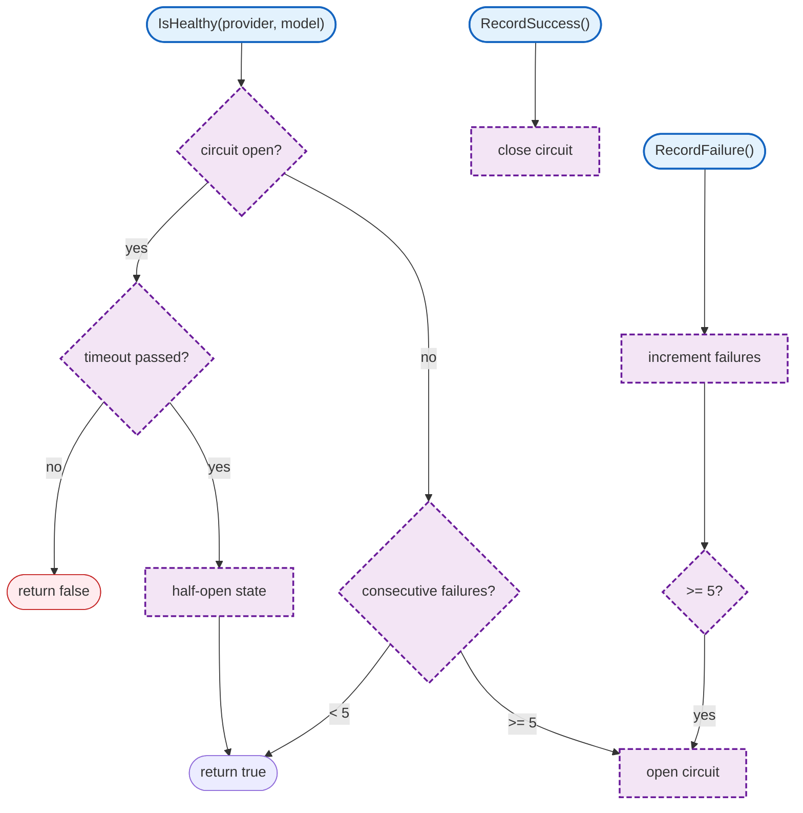

# internal/llm-proxy/health (internal/llm-proxy/health/)

Circuit breaker pattern for provider health monitoring.

## Overview

## Structs

### CircuitBreaker

| Struct | Field | Type | Description |
|--------|-------|------|-------------|
| `CircuitBreaker` | `failures` | `int` | Consecutive failures |
| | `lastFailure` | `time.Time` | Last failure time |
| | `state` | `CircuitState` | Current state |
| | `openUntil` | `time.Time` | Circuit open timeout |

### RedisHealthStore

| Struct | Field | Type | Description |
|--------|-------|------|-------------|
| `RedisHealthStore` | `redis` | `*redis.Client` | Redis client |

## Functions

| Function | Signature | Description |
|----------|-----------|-------------|
| `NewCircuitBreaker` | `(opts CircuitBreakerOptions) *CircuitBreaker` | Creates circuit breaker |
| `IsHealthy` | `(ctx context.Context, provider, model string) (bool, error)` | Checks health |
| `RecordSuccess` | `(ctx context.Context, provider, model string) error` | Records success |
| `RecordFailure` | `(ctx context.Context, provider, model string) error` | Records failure |

## Circuit States

| State | Description |
|-------|-------------|
| `Closed` | Normal operation |
| `Open` | Failing, reject requests |
| `HalfOpen` | Testing recovery |

## Configuration

| Setting | Default | Description |
|---------|---------|-------------|
| Failure threshold | 5 | Failures before opening |
| Timeout | 30s | Time before half-open |

## Related

- [LLM Proxy README](README.md) - Main proxy documentation
