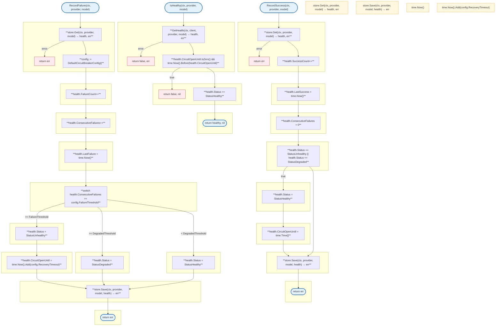

# LLM Proxy Health

Circuit breaker pattern for provider health monitoring.

## Overview

## Structs

### Service

| Struct | Field | Type | Description |
|--------|-------|------|-------------|
| `Service` | `store` | `*Store` | Health store |

### Store

| Struct | Field | Type | Description |
|--------|-------|------|-------------|
| `Store` | `client` | `*redis.Client` | Redis client |
| | `config` | `*CircuitBreakerConfig` | Circuit breaker config |

### ProviderHealth

| Struct | Field | Type | Description |
|--------|-------|------|-------------|
| `ProviderHealth` | `Status` | `HealthStatus` | Health status |
| | `FailureCount` | `int` | Total failures |
| | `SuccessCount` | `int` | Total successes |
| | `LastFailure` | `time.Time` | Last failure time |
| | `LastSuccess` | `time.Time` | Last success time |
| | `ConsecutiveFailures` | `int` | Consecutive failures |
| | `CircuitOpenUntil` | `time.Time` | Circuit open timeout |

### CircuitBreakerConfig

| Struct | Field | Type | Description |
|--------|-------|------|-------------|
| `CircuitBreakerConfig` | `FailureThreshold` | `int` | Failures to trip circuit |
| | `RecoveryTimeout` | `time.Duration` | Time before recovery attempt |
| | `SuccessThreshold` | `int` | Successes to close circuit |
| | `DegradedThreshold` | `int` | Failures to mark degraded |

## HealthStatus

| Constant | Type | Value | Description |
|----------|------|-------|-------------|
| `StatusHealthy` | `HealthStatus` | `"healthy"` | Normal operation |
| `StatusDegraded` | `HealthStatus` | `"degraded"` | Some failures |
| `StatusUnhealthy` | `HealthStatus` | `"unhealthy"` | Circuit open |

## Functions

| Function | Signature | Description |
|----------|-----------|-------------|
| `NewService` | `(client *redis.Client, config *CircuitBreakerConfig) *Service` | Creates health service |
| `GetHealth` | `(ctx context.Context, client *redis.Client, provider, model string) (*ProviderHealth, error)` | Gets health data |
| `IsHealthy` | `(ctx context.Context, client *redis.Client, provider, model string) (bool, error)` | Checks if healthy |
| `RecordSuccess` | `(ctx context.Context, client *redis.Client, provider, model string) error` | Records success |
| `RecordFailure` | `(ctx context.Context, client *redis.Client, provider, model string) error` | Records failure |
| `GetAllHealth` | `(ctx context.Context, client *redis.Client) (map[string]*ProviderHealth, error)` | Gets all health data |
| `ResetHealth` | `(ctx context.Context, client *redis.Client, provider, model string) error` | Resets health |
| `GetUnhealthyModels` | `(ctx context.Context, client *redis.Client) ([]string, error)` | Gets unhealthy models |
| `GetDegradedModels` | `(ctx context.Context, client *redis.Client) ([]string, error)` | Gets degraded models |
| `ShouldRateLimit` | `(ctx context.Context, client *redis.Client, provider, model string) (bool, error)` | Checks if should rate limit |
| `DefaultCircuitBreakerConfig` | `() *CircuitBreakerConfig` | Returns default config |

## Functions (store.go)

| Function | Signature | Description |
|----------|-----------|-------------|
| `NewStore` | `(client *redis.Client, config *CircuitBreakerConfig) *Store` | Creates store |
| `Get` | `(ctx context.Context, provider, model string) (*ProviderHealth, error)` | Gets health data |
| `Save` | `(ctx context.Context, provider, model string, health *ProviderHealth) error` | Saves health data |
| `Delete` | `(ctx context.Context, provider, model string) error` | Deletes health data |
| `GetAll` | `(ctx context.Context) (map[string]*ProviderHealth, error)` | Gets all health data |

## Configuration

| Setting | Default | Description |
|---------|---------|-------------|
| FailureThreshold | 3 | Failures before opening circuit |
| RecoveryTimeout | 60s | Time before half-open |
| SuccessThreshold | 2 | Successes to close circuit |
| DegradedThreshold | 2 | Failures to mark degraded |

## Redis Keys

| Key Pattern | Description |
|-------------|-------------|
| `health:{provider}:{model}` | Health data for provider:model |

Health data is stored as JSON with 24-hour expiration.

## Related

- [LLM Proxy README](README.md) - Main proxy documentation
