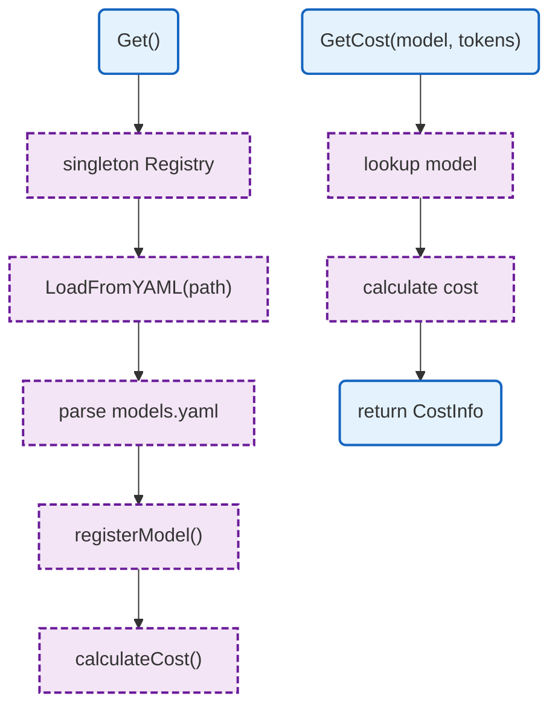

# LLM Proxy Models

Model registry with cost calculation and metadata.

## Overview



## Structs

### Registry

| Struct | Field | Type | Description |
|--------|-------|------|-------------|
| `Registry` | `models` | `map[string]*Model` | Model storage |
| | `routerModel` | `string` | Model for routing |
| | `mu` | `sync.RWMutex` | Thread-safe lock |

### Model

| Struct | Field | Type | Description |
|--------|-------|------|-------------|
| `Model` | `Name` | `string` | Model name |
| | `Provider` | `string` | Provider name |
| | `InputCostPerMillion` | `float64` | Input token cost |
| | `OutputCostPerMillion` | `float64` | Output token cost |
| | `MaxTokens` | `int` | Maximum context |
| | `Tier` | `string` | Pricing tier |

## Functions

| Function | Signature | Description |
|----------|-----------|-------------|
| `Get` | `() *Registry` | Returns singleton registry |
| `LoadFromYAML` | `(path string) error` | Loads models from YAML |
| `GetModel` | `(name string) (*Model, bool)` | Gets model by name |
| `GetRouterModel` | `() string` | Returns router model |
| `GetCost` | `(model string, inputTokens, outputTokens int) (*CostInfo, error)` | Calculates cost |
| `GetAllModels` | `() []string` | Returns all model names |
| `GetModelsByProvider` | `(provider string) []*Model` | Returns provider's models |
| `GetModelsByTier` | `(tier string) []*Model` | Returns tier's models |

## Design Notes

### Singleton Pattern

**Q: Why use singleton for registry?**

| Aspect | Description |
|--------|-------------|
| Context | Model registry lifecycle |
| Options considered | Singleton, dependency injection, global |
| Rationale | Single source of truth, loaded once |

**Current approach is recommended because:**
- Models don't change at runtime
- Consistent pricing across requests
- Simple access from anywhere
- Loaded at startup

## Test Coverage

### Unit Tests

| Test Suite | Coverage |
|------------|----------|
| `TestRegistry_LoadFromYAML` | YAML loading |
| `TestRegistry_GetModel` | Model lookup |
| `TestRegistry_GetCost` | Cost calculation |
| `TestRegistry_GetModelsByProvider` | Provider filtering |
| `TestRegistry_GetModelsByTier` | Tier filtering |

**Running:**
```bash
make test ./internal/llm-proxy/models
```

## Dependencies and Location

| Package | Purpose |
|---------|---------|
| `gopkg.in/yaml.v3` | YAML parsing |

**File Locations:**
- [`internal/llm-proxy/models/registry.go`](../../../internal/llm-proxy/models/registry.go)
- [`internal/llm-proxy/models/types.go`](../../../internal/llm-proxy/models/types.go)
- [`internal/llm-proxy/models/costs.go`](../../../internal/llm-proxy/models/costs.go)

## Related

- [Config Models](../../../config/models.md) - Configuration source
- [LLM Proxy README](README.md) - Main proxy documentation
