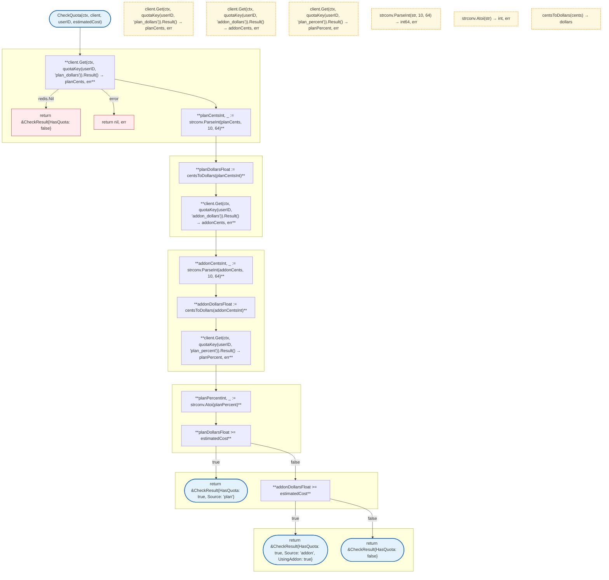
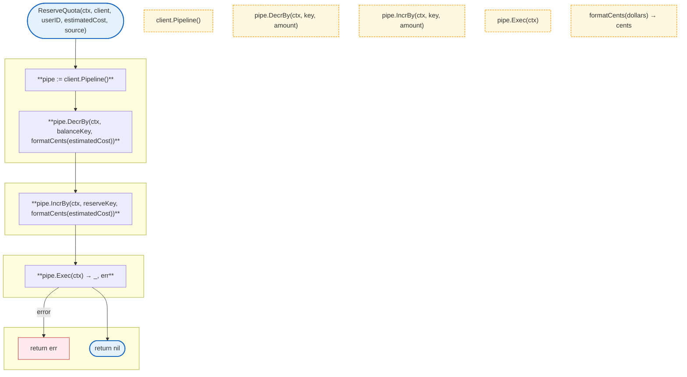
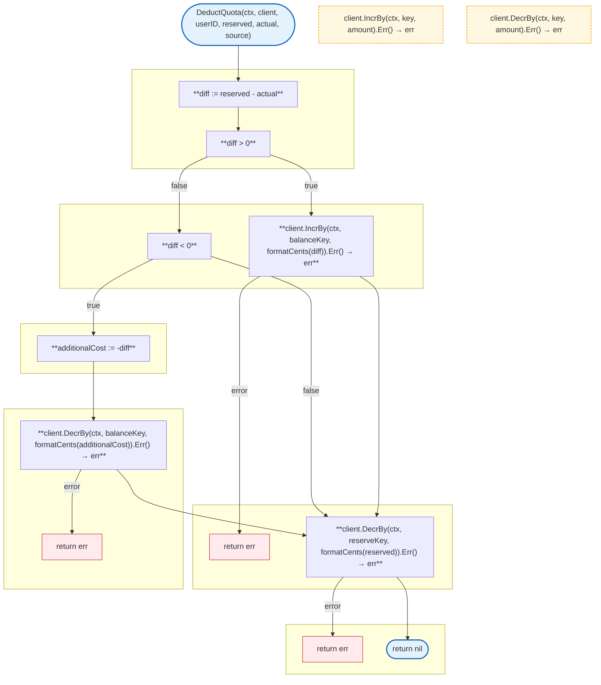
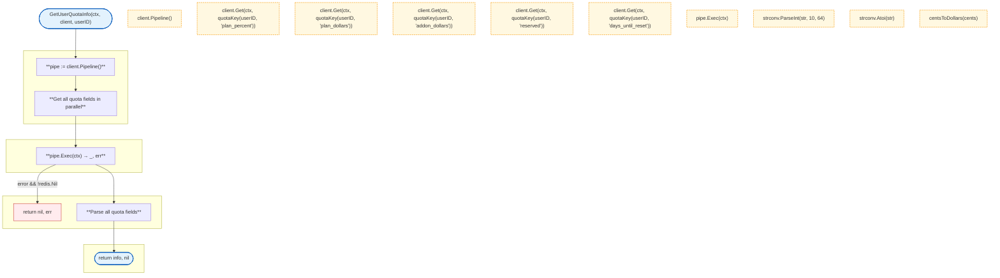
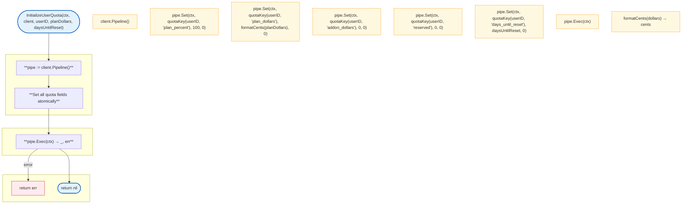
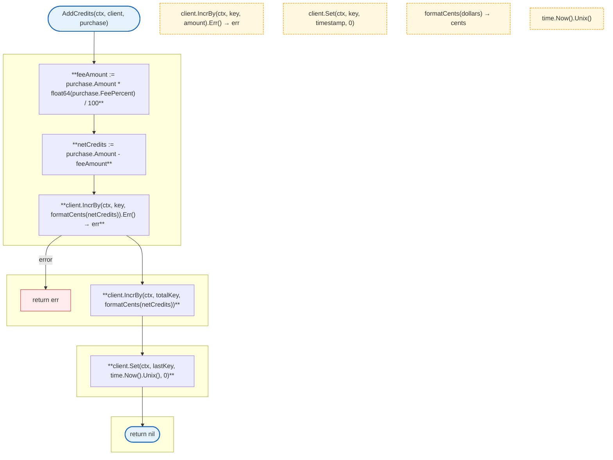
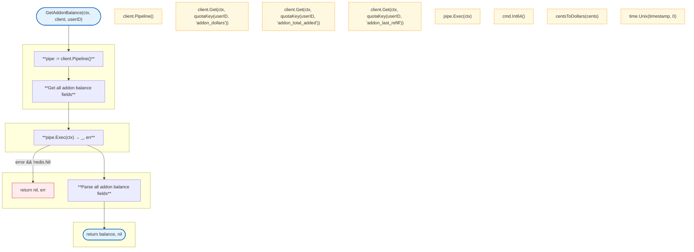
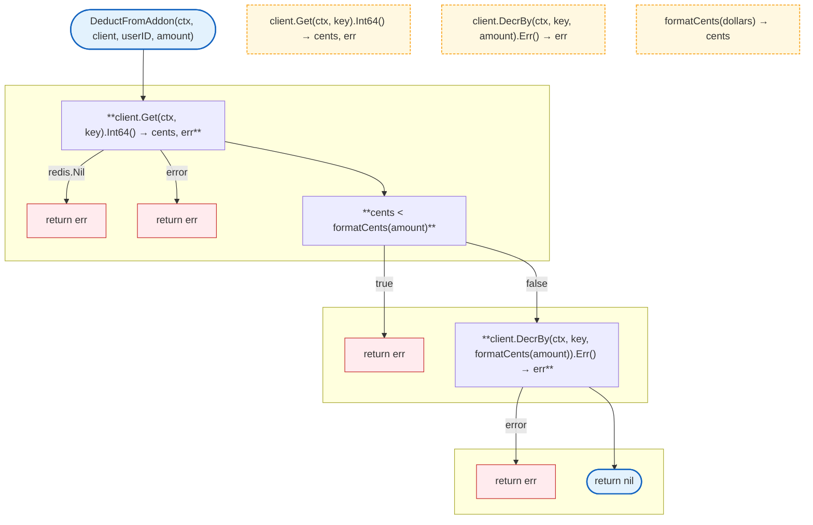
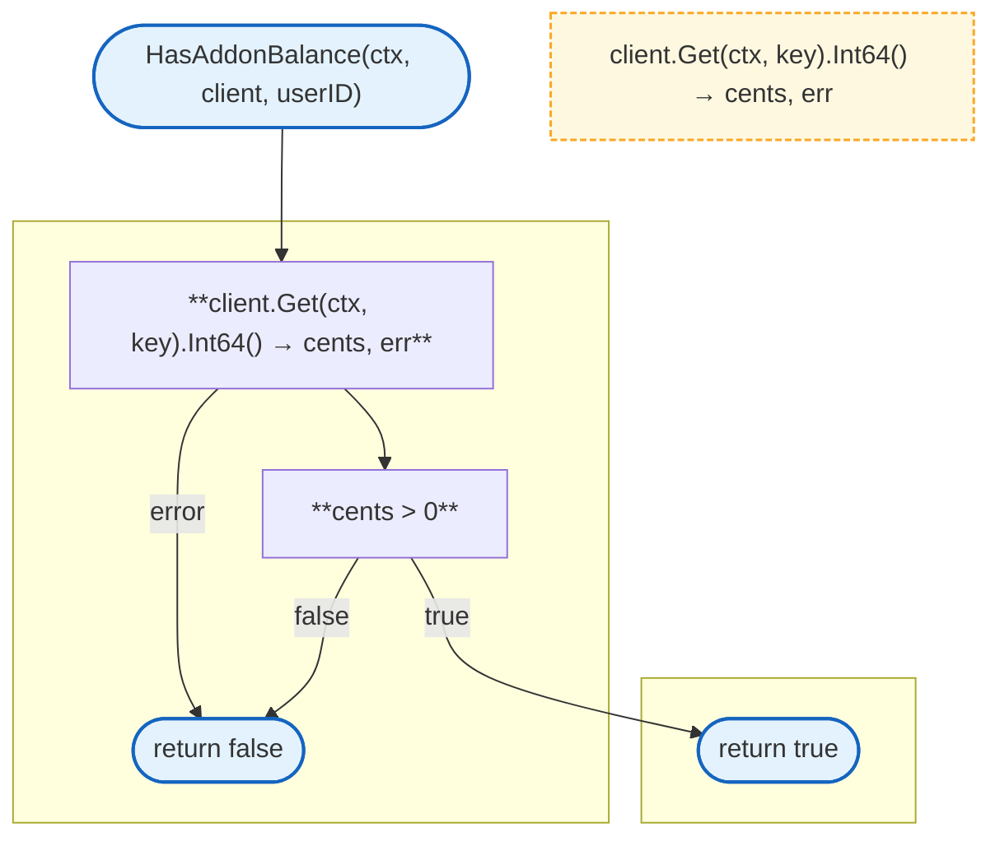
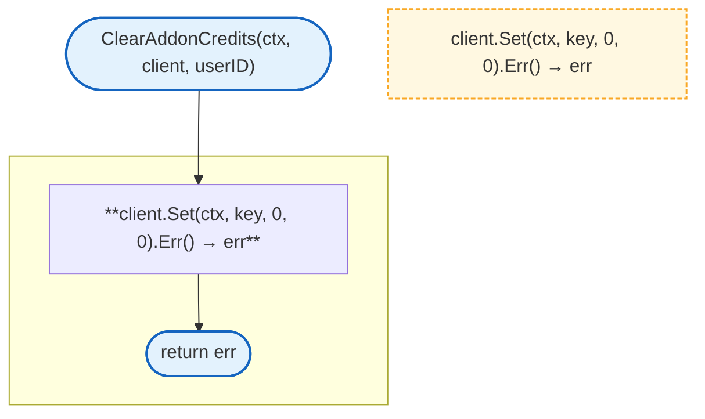

# LLM Proxy Quota

Quota management with Redis backend and plan/addon credit tracking.

### CheckQuota

### ReserveQuota

### DeductQuota

### GetUserQuotaInfo

### InitializeUserQuota

### AddCredits

### GetAddonBalance

### DeductFromAddon

### HasAddonBalance

### ClearAddonCredits

## Structs

### Service

| Struct | Field | Type | Description |
|--------|-------|------|-------------|
| `Service` | `client` | `*redis.Client` | Redis client |

### CheckResult

| Struct | Field | Type | Description |
|--------|-------|------|-------------|
| `CheckResult` | `HasQuota` | `bool` | Has sufficient quota |
| | `Source` | `string` | "plan" or "addon" |
| | `PlanPercent` | `int` | Plan usage percent |
| | `PlanDollars` | `float64` | Plan dollars remaining |
| | `AddonDollars` | `float64` | Addon dollars remaining |
| | `UsingAddon` | `bool` | Using addon credits |
| | `EstimatedCost` | `float64` | Estimated cost |

### UserQuotaInfo

| Struct | Field | Type | Description |
|--------|-------|------|-------------|
| `UserQuotaInfo` | `PlanPercent` | `int` | Plan usage percent |
| | `PlanDollars` | `float64` | Plan dollars |
| | `AddonDollars` | `float64` | Addon dollars |
| | `Reserved` | `float64` | Reserved amount |
| | `DaysUntilReset` | `int` | Days until reset |

### AddonPurchase

| Struct | Field | Type | Description |
|--------|-------|------|-------------|
| `AddonPurchase` | `UserID` | `string` | User identifier |
| | `Amount` | `float64` | Purchase amount |
| | `CreditAmount` | `float64` | Credit amount |
| | `FeePercent` | `int` | Fee percentage |
| | `Timestamp` | `time.Time` | Purchase time |

### AddonBalance

| Struct | Field | Type | Description |
|--------|-------|------|-------------|
| `AddonBalance` | `UserID` | `string` | User identifier |
| | `Balance` | `float64` | Current balance |
| | `TotalAdded` | `float64` | Total added |
| | `LastRefill` | `time.Time` | Last refill time |

## Redis Keys

| Key Pattern | Description |
|-------------|-------------|
| `quota:{userID}:plan_dollars` | Plan credit balance |
| `quota:{userID}:addon_dollars` | Addon credit balance |
| `quota:{userID}:plan_percent` | Plan usage percentage |
| `quota:{userID}:reserved` | Reserved amount |
| `quota:{userID}:days_until_reset` | Days until reset |
| `quota:{userID}:addon_total_added` | Total addon credits added |
| `quota:{userID}:addon_last_refill` | Last addon refill timestamp |

## Redis Key Format

Values are stored as integer cents (multiplied by 1000) to support DecrBy operations:
- `formatCents(dollars float64) int64`: Convert dollars to cents
- `centsToDollars(cents int64) float64`: Convert cents to dollars

## Related

- [LLM Proxy README](README.md) - Main proxy documentation
- [Config Plans](../../../config/plans.md) - Plan definitions
