# LLM Proxy Quota

Quota management with Redis backend and plan/addon credit tracking.

## Overview

```mermaid
flowchart TB
    StartCheck(["Check(ctx, userID, estimatedCost)"]) --> HCheckQuota

    subgraph SGCheckQuota [" "]
        HCheckQuota["**CheckQuota(ctx, client, userID, estimatedCost) → result, err**"]
        HCheckQuota -->|!result.HasQuota| DoneCheck(["return result"])
        HCheckQuota --> DoneCheck
    end

    StartReserve(["Reserve(ctx, userID, estimatedCost, source)"]) --> HReserveQuota

    subgraph SGReserveQuota [" "]
        HReserveQuota["**ReserveQuota(ctx, client, userID, estimatedCost, source) → err**"]
        HReserveQuota -->|error| E1["return err"]
        HReserveQuota --> DoneReserve(["return nil"])
    end

    StartDeduct(["Deduct(ctx, userID, reserved, actual, source)"]) --> HDeductQuota

    subgraph SGDeductQuota [" "]
        HDeductQuota["**DeductQuota(ctx, client, userID, reserved, actual, source) → err**"]
        HDeductQuota -->|error| E2["return err"]
        HDeductQuota --> DoneDeduct(["return nil"])
    end

    GetPlan["client.Get(ctx, quotaKey(userID, 'plan_dollars')) → planCents"]
    GetAddon["client.Get(ctx, quotaKey(userID, 'addon_dollars')) → addonCents"]
    GetPercent["client.Get(ctx, quotaKey(userID, 'plan_percent')) → planPercent"]
    DecrBalance["client.DecrBy(ctx, balanceKey, formatCents(estimatedCost))"]
    IncrReserve["client.IncrBy(ctx, reserveKey, formatCents(estimatedCost))"]
    ExecPipe["pipe.Exec(ctx)"]

    click GetPlan href "https://pkg.go.dev/github.com/redis/go-redis/v9#Client.Get"
    click GetAddon href "https://pkg.go.dev/github.com/redis/go-redis/v9#Client.Get"
    click GetPercent href "https://pkg.go.dev/github.com/redis/go-redis/v9#Client.Get"
    click DecrBalance href "https://pkg.go.dev/github.com/redis/go-redis/v9#Client.DecrBy"
    click IncrReserve href "https://pkg.go.dev/github.com/redis/go-redis/v9#Client.IncrBy"
    click ExecPipe href "https://pkg.go.dev/github.com/redis/go-redis/v9#Pipeline.Exec"

    classDef mainFn fill:#e3f2fd,stroke:#1565c0,stroke-width:2px
    classDef localPkgs fill:#fff8e1,stroke:#f9a825,stroke-width:1.5px,stroke-dasharray:4 2
    classDef errorFlow fill:#ffebee,stroke:#c62828,stroke-width:1px

    class StartCheck,DoneCheck,StartReserve,DoneReserve,StartDeduct,DoneDeduct mainFn
    class GetPlan,GetAddon,GetPercent,DecrBalance,IncrReserve,ExecPipe localPkgs
    class E1,E2 errorFlow
```

## Structs

### Service

| Struct | Field | Type | Description |
|--------|-------|------|-------------|
| `Service` | `client` | `*redis.Client` | Redis client |

### CheckResult

| Struct | Field | Type | Description |
|--------|-------|------|-------------|
| `CheckResult` | `HasQuota` | `bool` | Has sufficient quota |
| | `Source` | `string` | "plan" or "addon" |
| | `PlanPercent` | `int` | Plan usage percent |
| | `PlanDollars` | `float64` | Plan dollars remaining |
| | `AddonDollars` | `float64` | Addon dollars remaining |
| | `UsingAddon` | `bool` | Using addon credits |
| | `EstimatedCost` | `float64` | Estimated cost |

### UserQuotaInfo

| Struct | Field | Type | Description |
|--------|-------|------|-------------|
| `UserQuotaInfo` | `PlanPercent` | `int` | Plan usage percent |
| | `PlanDollars` | `float64` | Plan dollars |
| | `AddonDollars` | `float64` | Addon dollars |
| | `Reserved` | `float64` | Reserved amount |
| | `DaysUntilReset` | `int` | Days until reset |

### AddonPurchase

| Struct | Field | Type | Description |
|--------|-------|------|-------------|
| `AddonPurchase` | `UserID` | `string` | User identifier |
| | `Amount` | `float64` | Purchase amount |
| | `CreditAmount` | `float64` | Credit amount |
| | `FeePercent` | `int` | Fee percentage |
| | `Timestamp` | `time.Time` | Purchase time |

### AddonBalance

| Struct | Field | Type | Description |
|--------|-------|------|-------------|
| `AddonBalance` | `UserID` | `string` | User identifier |
| | `Balance` | `float64` | Current balance |
| | `TotalAdded` | `float64` | Total added |
| | `LastRefill` | `time.Time` | Last refill time |

## Functions

| Function | Signature | Description |
|----------|-----------|-------------|
| `NewService` | `(client *redis.Client) *Service` | Creates quota service |
| `Check` | `(ctx context.Context, userID string, estimatedCost float64) (*CheckResult, error)` | Checks quota |
| `Reserve` | `(ctx context.Context, userID string, estimatedCost float64, source string) error` | Reserves credits |
| `Deduct` | `(ctx context.Context, userID string, reserved, actual float64, source string) error` | Deducts credits |
| `GetInfo` | `(ctx context.Context, userID string) (*UserQuotaInfo, error)` | Gets quota info |
| `Initialize` | `(ctx context.Context, userID string, planDollars float64, daysUntilReset int) error` | Initializes user quota |
| `AddCredits` | `(ctx context.Context, userID string, amount float64) error` | Adds addon credits |
| `SetPlanQuota` | `(ctx context.Context, userID string, planDollars float64, planPercent int, daysUntilReset int) error` | Sets plan quota |
| `GetReservedAmount` | `(ctx context.Context, userID string) (float64, error)` | Gets reserved amount |
| `ReleaseAllReservations` | `(ctx context.Context, userID string) error` | Releases all reservations |

## Functions (quota.go)

| Function | Signature | Description |
|----------|-----------|-------------|
| `CheckQuota` | `(ctx context.Context, client *redis.Client, userID string, estimatedCost float64) (*CheckResult, error)` | Checks quota availability |
| `ReserveQuota` | `(ctx context.Context, client *redis.Client, userID string, estimatedCost float64, source string) error` | Reserves quota atomically |
| `DeductQuota` | `(ctx context.Context, client *redis.Client, userID string, reserved, actual float64, source string) error` | Adjusts quota after completion |
| `GetUserQuotaInfo` | `(ctx context.Context, client *redis.Client, userID string) (*UserQuotaInfo, error)` | Gets user quota info |
| `InitializeUserQuota` | `(ctx context.Context, client *redis.Client, userID string, planDollars float64, daysUntilReset int) error` | Initializes user quota |
| `quotaKey` | `(userID, field string) string` | Generates Redis key |
| `formatCents` | `(dollars float64) int64` | Converts dollars to cents |
| `centsToDollars` | `(cents int64) float64` | Converts cents to dollars |

## Functions (addon.go)

| Function | Signature | Description |
|----------|-----------|-------------|
| `AddCredits` | `(ctx context.Context, client *redis.Client, purchase *AddonPurchase) error` | Adds addon credits with fee |
| `GetAddonBalance` | `(ctx context.Context, client *redis.Client, userID string) (*AddonBalance, error)` | Gets addon balance |
| `DeductFromAddon` | `(ctx context.Context, client *redis.Client, userID string, amount float64) error` | Deducts from addon |
| `HasAddonBalance` | `(ctx context.Context, client *redis.Client, userID string) bool` | Checks if has addon balance |
| `ClearAddonCredits` | `(ctx context.Context, client *redis.Client, userID string) error` | Clears addon credits |

## Redis Keys

| Key Pattern | Description |
|-------------|-------------|
| `quota:{userID}:plan_dollars` | Plan credit balance |
| `quota:{userID}:addon_dollars` | Addon credit balance |
| `quota:{userID}:plan_percent` | Plan usage percentage |
| `quota:{userID}:reserved` | Reserved amount |
| `quota:{userID}:days_until_reset` | Days until reset |
| `quota:{userID}:addon_total_added` | Total addon credits added |
| `quota:{userID}:addon_last_refill` | Last addon refill timestamp |

## Redis Key Format

Values are stored as integer cents (multiplied by 1000) to support DecrBy operations:
- `formatCents(dollars float64) int64`: Convert dollars to cents
- `centsToDollars(cents int64) float64`: Convert cents to dollars

## Related

- [LLM Proxy README](README.md) - Main proxy documentation
- [Config Plans](../../../config/plans.md) - Plan definitions
