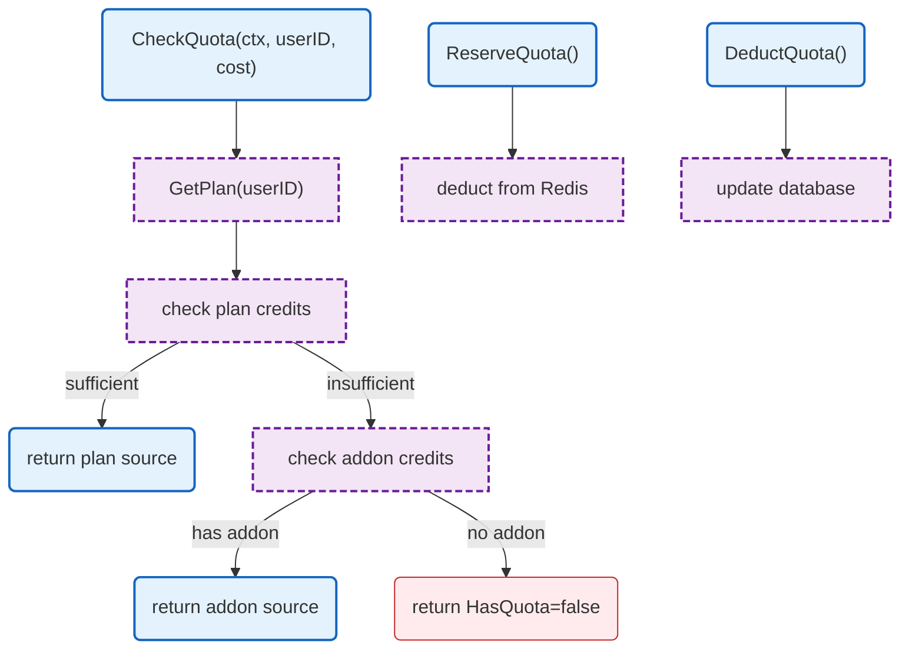

# LLM Proxy Quota

Quota management with Redis backend and plan/addon credit tracking.

## Overview

## Structs

### RedisQuotaChecker

| Struct | Field | Type | Description |
|--------|-------|------|-------------|
| `RedisQuotaChecker` | `redis` | `*redis.Client` | Redis client |
| | `logger` | `zerolog.Logger` | Logger |

### QuotaCheckResult

| Struct | Field | Type | Description |
|--------|-------|------|-------------|
| `QuotaCheckResult` | `HasQuota` | `bool` | Has sufficient quota |
| | `Source` | `string` | "plan" or "addon" |
| | `PlanPercent` | `int` | Plan usage percent |
| | `PlanDollars` | `float64` | Plan dollars remaining |
| | `AddonDollars` | `float64` | Addon dollars remaining |
| | `UsingAddon` | `bool` | Using addon credits |
| | `UserContext` | `UserContext` | Full user context |

## Functions

| Function | Signature | Description |
|----------|-----------|-------------|
| `NewRedisQuotaChecker` | `(redis *redis.Client, logger zerolog.Logger) *RedisQuotaChecker` | Creates checker |
| `CheckQuota` | `(ctx context.Context, userID string, estimatedCost float64) (*QuotaCheckResult, error)` | Checks quota |
| `ReserveQuota` | `(ctx context.Context, userID string, cost float64, source string) error` | Reserves credits |
| `DeductQuota` | `(ctx context.Context, userID string, reserved, actual float64, source string) error` | Deducts credits |

## Redis Keys

| Key Pattern | Description |
|-------------|-------------|
| `quota:{userID}:plan` | Plan credit balance |
| `quota:{userID}:addon` | Addon credit balance |
| `quota:{userID}:period` | Period usage |

## Related

- [LLM Proxy README](README.md) - Main proxy documentation
- [Config Plans](../../../config/plans.md) - Plan definitions
