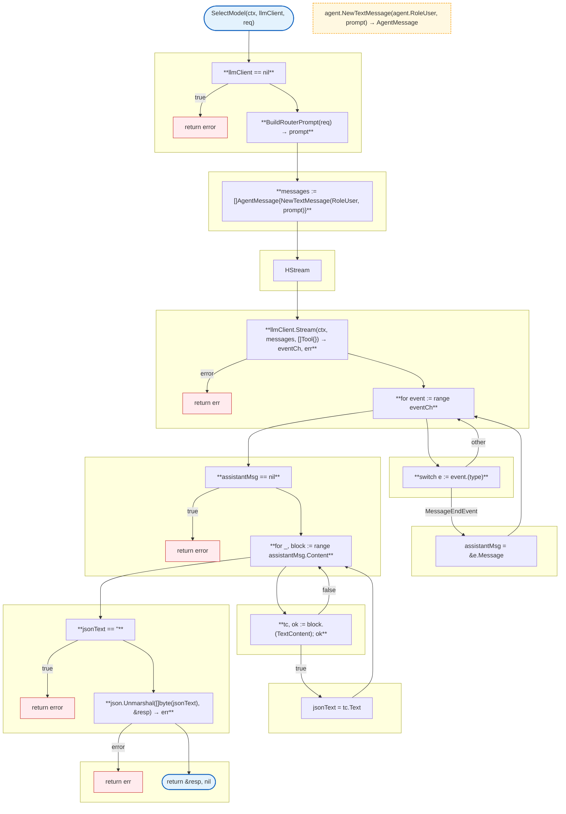
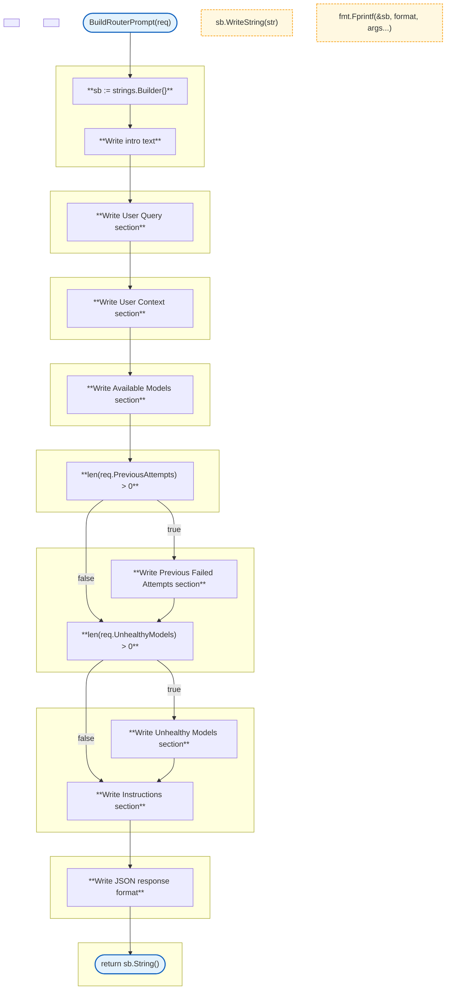

# LLM Proxy Router

LLM-based model selection router.

### SelectModel



### BuildRouterPrompt



## Structs

### RouterRequest

| Struct | Field | Type | Description |
|--------|-------|------|-------------|
| `RouterRequest` | `UserQuery` | `string` | User query |
| | `AvailableModels` | `[]string` | Available models |
| | `UserContext` | `UserContext` | User context |
| | `ModelCosts` | `map[string]CostInfo` | Model costs |
| | `PreviousAttempts` | `[]RouterAttempt` | Previous failed attempts |
| | `UnhealthyModels` | `[]string` | Unhealthy models |

### RouterResponse

| Struct | Field | Type | Description |
|--------|-------|------|-------------|
| `RouterResponse` | `SelectedModel` | `string` | Selected model |
| | `Reasoning` | `string` | Selection reasoning |
| | `Confidence` | `string` | Confidence level |
| | `FallbackOptions` | `[]string` | Fallback models |
| | `EstimatedTokens` | `TokenEstimate` | Token estimate |
| | `EstimatedCost` | `CostEstimate` | Cost estimate |

### RouterAttempt

| Struct | Field | Type | Description |
|--------|-------|------|-------------|
| `RouterAttempt` | `Model` | `string` | Model attempted |
| | `Error` | `string` | Error message |

## Router Prompt Sections

The `BuildRouterPrompt` function creates a structured prompt with these sections:

| Section | Content |
|---------|---------|
| User Query | The user's query text |
| User Context | Plan tier, quota remaining, addon credits, days until reset |
| Available Models | List of models with costs per million tokens |
| Previous Attempts | List of failed models with errors (if any) |
| Unhealthy Models | List of unhealthy models to avoid (if any) |
| Instructions | Selection criteria and response format |

## Response Format

The router model responds with JSON in this format:

```json
{
  "selected_model": "model-name",
  "reasoning": "brief explanation",
  "confidence": "high|medium|low",
  "fallback_options": ["model1", "model2"],
  "estimated_tokens": {"input": 100, "output": 50},
  "estimated_cost": {"input": 0.0001, "output": 0.0002, "total": 0.0003}
}
```

## Related

- [LLM Proxy README](README.md) - Main proxy documentation
- [Models](models.md) - Model registry
- [Agent](../agent/README.md) - Agent message types
