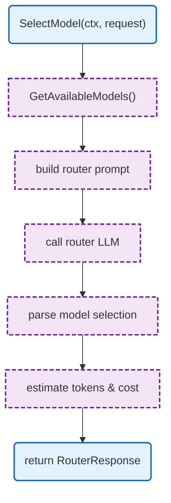

# LLM Proxy Router

LLM-based model selection router.

## Overview

## Structs

### LLMRouter

| Struct | Field | Type | Description |
|--------|-------|------|-------------|
| `LLMRouter` | `llmClient` | `LLMClient` | LLM client for routing |
| | `modelRegistry` | `*models.Registry` | Model registry |
| | `routerModel` | `string` | Model for routing |

### RouterResponse

| Struct | Field | Type | Description |
|--------|-------|------|-------------|
| `RouterResponse` | `SelectedModel` | `string` | Selected model |
| | `EstimatedTokens` | `TokenEstimate` | Token estimate |
| | `EstimatedCost` | `CostEstimate` | Cost estimate |
| | `FallbackOptions` | `[]string` | Fallback models |

## Functions

| Function | Signature | Description |
|----------|-----------|-------------|
| `NewLLMRouter` | `(opts RouterOptions) *LLMRouter` | Creates router |
| `SelectModel` | `(ctx context.Context, req RouterRequest) (*RouterResponse, error)` | Selects best model |

## Related

- [LLM Proxy README](README.md) - Main proxy documentation
- [Models](models.md) - Model registry
