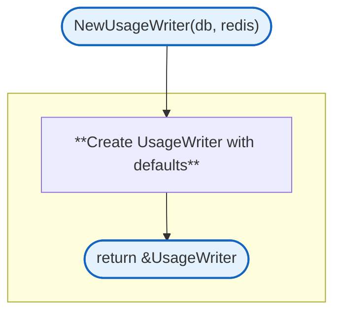
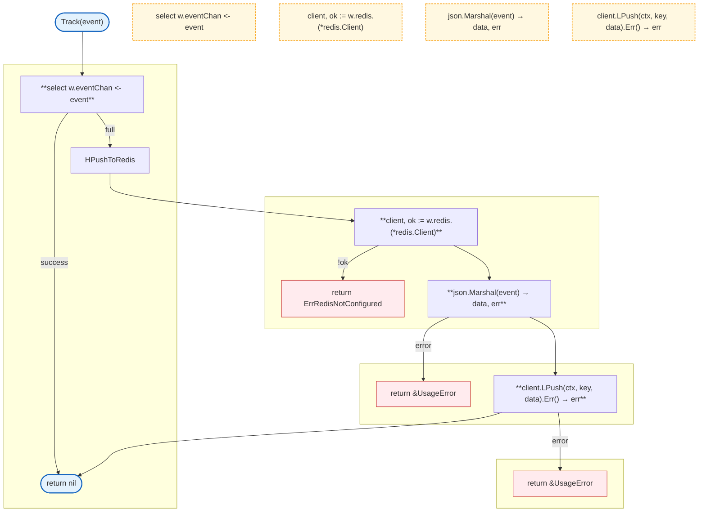
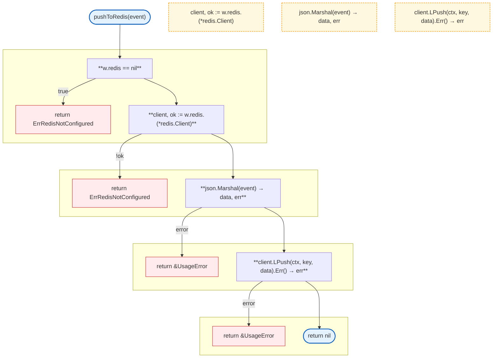
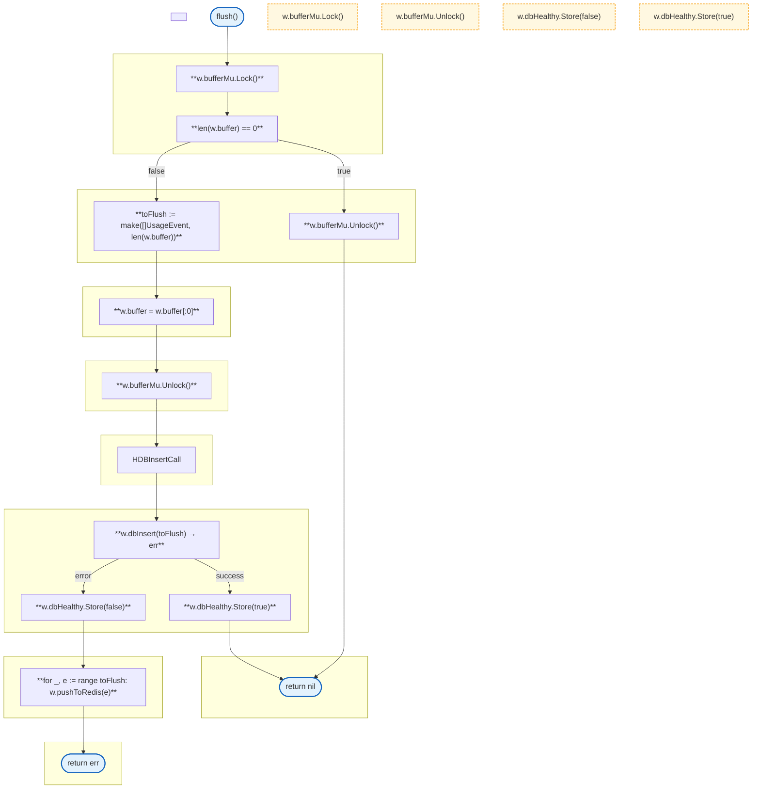
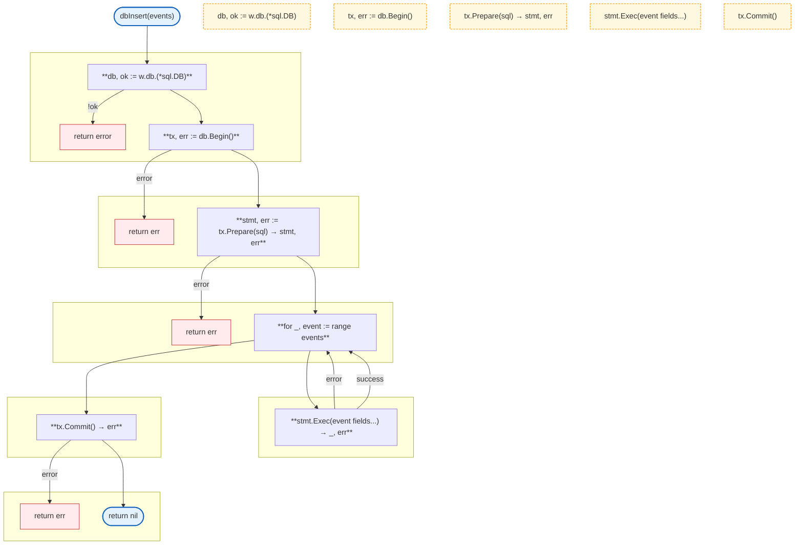
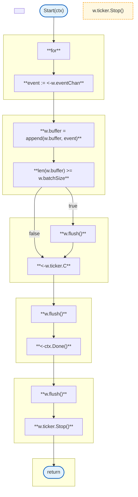
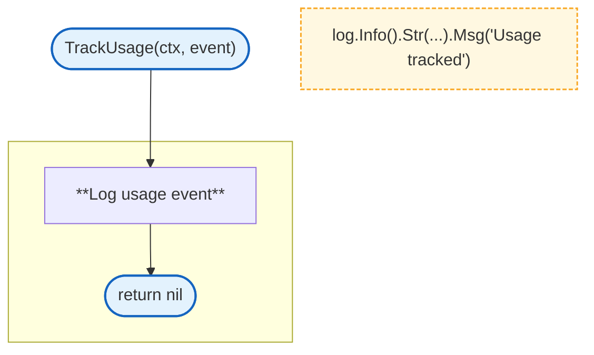

# LLM Proxy Usage

Usage tracking with buffered batch writes and Redis fallback.

### NewUsageWriter

### Track

### pushToRedis

### flush

### dbInsert

### Start

### TrackUsage

## Structs

### UsageWriter

| Struct | Field | Type | Description |
|--------|-------|------|-------------|
| `UsageWriter` | `eventChan` | `chan UsageEvent` | Event channel |
| | `buffer` | `[]UsageEvent` | Event buffer |
| | `bufferMu` | `sync.Mutex` | Buffer lock |
| | `ticker` | `*time.Ticker` | Flush ticker |
| | `db` | `any` | Database connection |
| | `redis` | `any` | Redis client |
| | `dbHealthy` | `atomic.Bool` | DB health flag |
| | `batchSize` | `int` | Batch size |

### UsageError

| Struct | Field | Type | Description |
|--------|-------|------|-------------|
| `UsageError` | `Op` | `string` | Operation name |
| | `Err` | `error` | Underlying error |

### FallbackError

| Struct | Field | Type | Description |
|--------|-------|------|-------------|
| `FallbackError` | `Message` | `string` | Error message |

## Constants

| Constant | Type | Value | Description |
|----------|------|-------|-------------|
| `defaultBatchSize` | `int` | `1000` | Default batch size |
| `defaultFlushInterval` | `time.Duration` | `30s` | Default flush interval |
| `defaultMaxBufferSize` | `int` | `10000` | Default max buffer size |

## Database Schema

### usage_events table

| Column | Type | Description |
|--------|------|-------------|
| `user_id` | `TEXT` | User identifier |
| `session_id` | `TEXT` | Session identifier |
| `model` | `TEXT` | Model name |
| `provider` | `TEXT` | Provider name |
| `tokens_input` | `INTEGER` | Input tokens |
| `tokens_output` | `INTEGER` | Output tokens |
| `cost_total` | `NUMERIC` | Total cost |
| `charged_from` | `TEXT` | "plan" or "addon" |
| `timestamp` | `BIGINT` | Unix timestamp |

## Redis Keys

| Key Pattern | Description |
|-------------|-------------|
| `usage:{userID}` | List of usage events (JSON) |

## Processing Flow

1. **Track**: Event sent to channel or directly to Redis if channel full
2. **Background goroutine**:
   - Receives events from channel
   - Appends to buffer
   - Flushes when buffer reaches batch size or on ticker interval
3. **Flush**:
   - Attempts DB insert
   - On DB failure, falls back to Redis
   - Updates dbHealthy flag accordingly

## Batch Write Behavior

| Trigger | Action |
|---------|--------|
| Buffer reaches batch size | Immediate flush |
| Ticker interval | Periodic flush |
| Context cancelled | Final flush before exit |

## Fallback Behavior

| Condition | Behavior |
|-----------|----------|
| Channel not full | Send to event channel |
| Channel full | Push directly to Redis |
| DB insert successful | Mark DB healthy |
| DB insert failed | Mark DB unhealthy, flush to Redis |
| Redis not configured | Return error |

## Errors

| Error | Description |
|-------|-------------|
| `ErrRedisNotConfigured` | Redis client not configured |
| `ErrRedisUnavailable` | Redis unavailable |

## Related

- [LLM Proxy README](README.md) - Main proxy documentation
