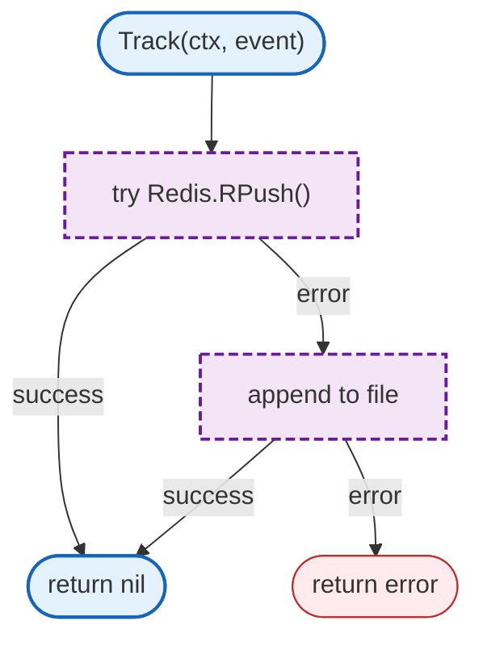

# LLM Proxy Usage

Usage tracking with Redis primary and file fallback.

## Overview

## Structs

### RedisUsageTracker

| Struct | Field | Type | Description |
|--------|-------|------|-------------|
| `RedisUsageTracker` | `redis` | `*redis.Client` | Redis client |
| | `fallbackPath` | `string` | Fallback file path |

## Functions

| Function | Signature | Description |
|----------|-----------|-------------|
| `NewRedisUsageTracker` | `(redis *redis.Client, fallbackPath string) *RedisUsageTracker` | Creates tracker |
| `Track` | `(ctx context.Context, event UsageEvent) error` | Records usage event |

## Redis Keys

| Key Pattern | Description |
|-------------|-------------|
| `usage:{userID}:events` | Usage event list |
| `usage:{userID}:daily:{date}` | Daily summary |

## Fallback Behavior

| Condition | Behavior |
|-----------|----------|
| Redis available | Append to Redis list |
| Redis unavailable | Append to local file |
| Both fail | Return error |

## Related

- [LLM Proxy README](README.md) - Main proxy documentation
